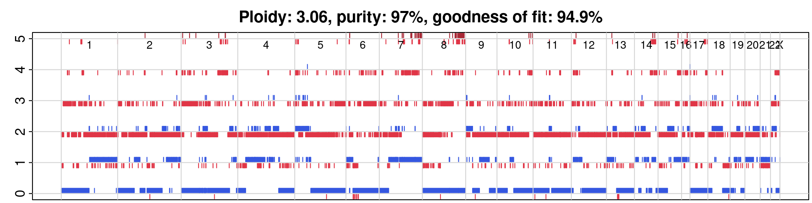

# HCC1395 ONT 5kHz 的 ASCAT（long read，重跑 2026-08 分析，2026-10-30）

目的：給 diplosim 方案 B（固定 CN）一份 long read、而且和 PPC 用的 read 不同批的 CN。

標記：〔實測〕＝本實驗計算；〔推論〕＝本檔推論；〔程式〕＝讀程式得到。

## 1. 結論

- **跑完了，結果和 8 月接近，但分段更碎。** purity 0.97、ploidy 3.06、goodness of fit 94.9%。8 月是 0.99／2.90／92.6%，650 段；這次 2,177 段〔實測〕。
- **LOH 判定幾乎一致。** 在 31,466 個 SNV 上，「minor CN 是不是 0」和 Wakhan HKU 一致 97.0%，和 SEQC2 ASCAT（short read，只當對照）一致 99.8%〔實測〕。
- **total CN 一致率較低。** 和 Wakhan 74.4%，和 SEQC2 82.5%〔實測〕。可能原因是 ploidy 尺度不同（Wakhan 2.73、這次 3.06、SEQC2 2.85），同一段的 CN 會差 1〔推論〕。
- **50.2% 的 SNV 落在 LOH 區（minor CN = 0）**〔實測〕。PPC 的真實資料有 48.3% 的位點 minor HP depth < 0.1。兩者接近，表示這份 CN 能解釋 PPC 第 ③ 類的差距〔推論〕。

## 2. 資料

- tumor：`/big8_disk/data/HCC1395/ONT_5khz_simplex_5mCG_5hmCG/HCC1395.cram`（204 GB）
- normal：同目錄 `HCC1395BL.cram`（119 GB）
- 這批 read 和 PPC 用的 `t50_n00` 不重疊：在 chr1:10.0–10.2 Mb，t50_n00 的 900 條 read 全部來自 `ONT/HCC1395.cram`，和 5kHz 共同 0 條〔實測；全基因體是推論〕。
- 參考檔：ASCAT 官方 hg38 WGS set（zenodo 14008443）：G1000 loci、alleles、GC、RT。

## 3. 做法

```bash
bash tools/ascat_hcc1395_5khz/run_ascat.sh /big8_disk/boyu114/hcc1395_ascat_5khz 23
```

- 設定照 8 月（git `f489437` 的 `data.md` §3）：ASCAT 3.2.0、hg38、`min_base_qual 10`、alleleCounter `-f 0`、gender XX。
- 新增兩項，因為輸入改成 CRAM：alleleCounter 加 `-r` reference；loci 檔加 `chr` 前綴。ASCAT 本身不處理這兩件事〔程式，`ascat.getAlleleCounts`〕。
- 官方 chr20 loci 檔有一個位置寫成 `8e+06`，第一次執行因此失敗；改成先讀數字再寫成整數〔實測〕。
- 之後是 GC／RT 校正（選到 Hepg2）、`ascat.aspcf`（預設 penalty）、`ascat.runAscat(gamma = 1)`。
- 約 35 分鐘（alleleCounter 23 threads）。
- `run.log` 有兩個 `NAs introduced by coercion`，和 8 月同一個 ASCAT 內部問題，你當時已確認不影響結果。

## 4. 結果

| 項目 | 這次 | 2026-08 |
|---|---:|---:|
| purity | 0.97 | 0.99 |
| ploidy | 3.06 | 2.90 |
| goodness of fit | 94.9% | 92.6% |
| segment 數 | 2,177 | 650 |
| het SNP 數 | 799,016 | — |
| tumour MAPD | 0.129 | — |

在 31,595 個 ClairS SNV 上（126 個不在任何 segment 內）：

| 比較對象 | SNV 數 | total CN 一致 | total＋minor 一致 | LOH 一致 |
|---|---:|---:|---:|---:|
| Wakhan HKU（long read，ploidy 2.73） | 31,466 | 0.744 | 0.736 | 0.970 |
| SEQC2 ASCAT 共識（short read，只當對照） | 25,860 | 0.825 | 0.815 | 0.998 |

最常見的 CN 狀態（total, minor）：(2,0) 8,564、(3,1) 6,584、(4,2) 4,054、(3,0) 3,869、(4,0) 1,574〔實測〕。



輸出：`tables/snv_cn.tsv`（每個 SNV 的 major／minor／total CN，給方案 B 用）、`tables/HCC1395_5khz.segments.txt`、`tables/purity_ploidy.txt`、`tables/QC_metrics.tsv`。完整中間檔在 `/big8_disk/boyu114/hcc1395_ascat_5khz/`。

## 5. 限制

- **分段比 8 月碎很多（2,177 vs 650）。** 原因沒有查。可能是參考 loci 版本不同，或 8 月用了不同的 penalty（8 月腳本已遺失）〔推論〕。圖上可以看到很多短段。
- **ploidy 3.06 比 SEQC2 的 2.85 高。** total CN 的絕對值可能整體偏高 1。LOH 判定不受影響。
- **CN 來自另一批 read。** 細胞株在兩次定序之間若有 CN 漂移，會變成 PPC 的差距來源。
