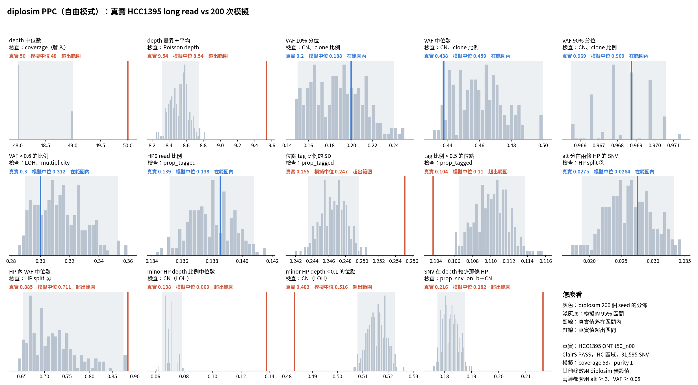

# diplosim PPC：解決「alt 分在兩條 HP」偏少（2026-10-31）

問題：目前最好的設定（`lab_report/2026-10-31_diplosim_ppc_hcc1395_mult_t0.8/`）中，alt 分在兩條 HP 的 SNV 是 0.015，真實 0.028（相對差距 −0.46）。使用者要求直接挑方案解決。

標記：〔實測〕＝本實驗計算；〔推論〕＝本檔推論；〔程式〕＝讀程式得到。

## 1. 結論

- **只要把 `--base-error` 從 0.005 調到 0.01：** alt 分在兩條 HP 0.0263，真實 0.0275（相對差距 −0.46 → −0.05）〔實測〕。
- **13 項平均相對差距 0.133 → 0.102，目前最低。** CN 相關 6 項不變（0.079 → 0.081）〔實測〕。
- 副作用很小：VAF 90% 分位完全對上；「SNV 在 depth 較少那條 HP」從 −0.13 變成 −0.16〔實測〕。
- **不需要新程式。** 我先試了「每個位點有自己的 mistag 機率」（Beta，同 tag 的做法）。它讓 alt 多的位點分裂太多、alt 少的位點分裂太少，方向不對，所以撤回，沒有留在 diplosim〔實測〕。
- base error 0.01 是看 HCC1395 選的，只當實驗設定。

## 2. 診斷：差距出在哪裡

先把位點依「帶 tag 的 alt 數」分組，比較每組中分裂的比例〔實測，模擬 6 個 seed〕：

| 帶 tag 的 alt 數 | 真實 | base 0.005（原本） | base 0.01（這次） |
|---|---:|---:|---:|
| 3–9 | 0.145 | 0.069 | 0.099 |
| 10–19 | 0.022 | 0.011 | 0.025 |
| ≥ 20 | 0.0055 | 0.0005 | 0.0024 |
| 全部 | 0.0275 | 0.0155 | 0.0266 |

- 兩邊低 alt 位點的比例差不多（模擬甚至較多），所以差距不是位點組成造成的，而是每組的分裂比例都偏低〔實測〕。
- 低 alt 位點的分裂主要來自 base error：另一條 HP 上的 ref read 讀成 alt〔程式＋推論〕。
- 真實分裂位點中，51% 的另一條 HP 只占 alt 的 10–20%，最常見的是只有 1–2 條 alt 在另一條 HP〔實測〕。這比較像單條 read 出錯，不像整段 phase switch〔推論〕。

per-site mistag 的掃描（mistag 平均 0.005，base 0.005）〔實測〕：

| 集中度 k | 3–9 | 10–19 | ≥ 20 | 全部 |
|---|---:|---:|---:|---:|
| 不設 | 0.069 | 0.011 | 0.0005 | 0.0155 |
| 1 | 0.049 | 0.015 | 0.011 | 0.019 |
| 0.2 | 0.041 | 0.008 | 0.0037 | 0.011 |

## 3. 做法

```bash
A="--prop-pos-lost 0.45 --loss-events cnloh_B --prop-pos-second-cna 0.5 --mistag-rate 0.005 --min-tumour-purity 0.97 \
   --max-tumour-purity 0.97 --prop-tagged 0.862 --tag-concentration 1 --prop-truncal-snvs 0.8"
python3 -I tools/diplosim_ppc_hcc1395.py sim lab_report/2026-10-31_diplosim_ppc_hcc1395_base001 200 $A --base-error 0.01   # 跳過 30 個 seed
python3 -I tools/split_alt_by_alt_count.py <diplosim 輸出目錄> <標籤>   # 第 2 節的分組表
```

## 4. 結果

| 統計量 | 真實 | 原本（t 0.8） | base 0.01 |
|---|---:|---:|---:|
| alt 分在兩條 HP | 0.0275 | 0.015 | **0.026** |
| VAF 90% 分位 | 0.969 | 0.972 | 0.969 |
| SNV 在 depth 較少那條 HP | 0.216 | 0.188 | 0.182 |
| 13 項平均 \|rel\| | | 0.133 | **0.102** |

完整：`tables/ppc_stats.tsv`、`tables/distance_vs_mult_t0.8.tsv`。



## 5. 限制

- 3–9 alt 的位點仍然偏少（0.099 對 0.145）。真實的 ClairS call 可能含有假陽性，假陽性的 alt read 會落在兩條 HP〔推論，未驗證〕。
- 圖底的「其他參數用 diplosim 預設值」不含這次的參數。
