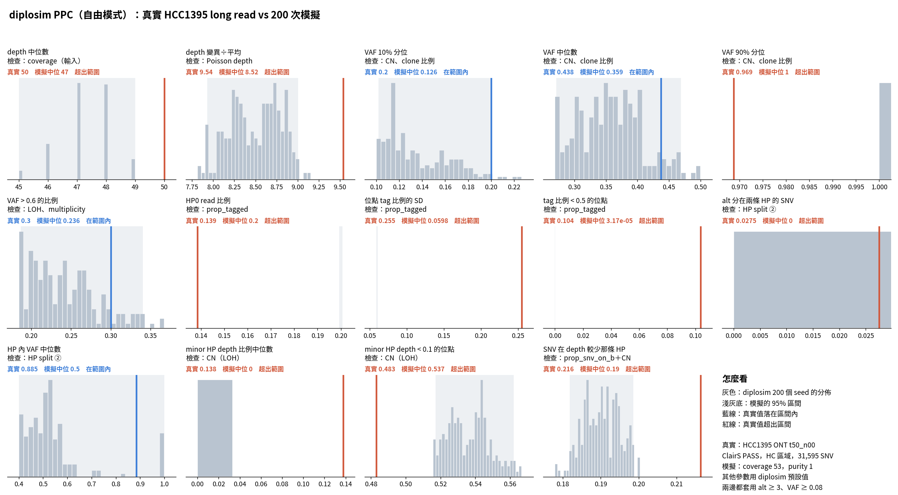

# diplosim PPC：`--prop-pos-lost 0.45 --loss-events cnloh_B --prop-pos-second-cna 0.5`（2026-10-31）

問題：這組參數的 CN 狀態分布最接近 ASCAT（`lab_report/2026-10-31_cn_state_ascat_vs_diplosim/` §5）。PPC 會不會跟著變好？

標記：〔實測〕＝本實驗計算；〔推論〕＝本檔推論；〔程式〕＝讀程式得到。

## 1. 結論

- **沒有變好。** 14 項中在範圍內的只有 4 項（VAF 10%／50% 分位、VAF > 0.6、HP 內 VAF 中位數）。只設 0.45 時是 7 項〔實測〕。
- **CN 狀態更像 HCC1395，不等於 PPC 更好。** 第 ③ 類 4 項仍然全部超出〔實測〕：
  - minor HP < 0.1 的位點 0.537，真實 0.483。模擬的 LOH 是 0.535，真實位點中 ASCAT 判成 LOH 的是 0.502〔實測〕。
  - 即使 LOH 比例完全對上，這一項也會偏高。10-31 固定 CN 檢查直接套 ASCAT，結果是 0.505。原因是真實 LOH 區仍有少量 minor HP read，模擬沒有〔實測＋推論〕。
  - SNV 在 depth 較少那條 HP 0.190，真實 0.216，偏少。
  - depth 變異÷平均 8.52，真實 9.54，這次改成偏少。
- depth 中位數 47（真實 50）也超出。平均 CN 變高，但 `--coverage` 沒改，CN 2 的位點 depth 因此變低〔推論〕。這一項是輸入，可以調 coverage。

## 2. 做法

```bash
O=lab_report/2026-10-31_diplosim_ppc_hcc1395_cnloh_second05
python3 -I tools/diplosim_ppc_hcc1395.py sim $O 200 --prop-pos-lost 0.45 --loss-events cnloh_B --prop-pos-second-cna 0.5   # 跳過 30 個 seed
python3 -I tools/diplosim_ppc_hcc1395.py compare $O
python3 tools/plot_diplosim_ppc_hcc1395.py $O
```

## 3. 結果（和前幾次並列）

| 統計量 | 真實 | 0.45 | 0.45＋second 0.5 | cnloh_B＋second 0.5 |
|---|---:|---:|---:|---:|
| depth 中位數 | 50 | 51 ✓ | 48 ✓ | 47 ✗ |
| depth 變異÷平均 | 9.54 | 10.21 ✗ | 13.08 ✗ | 8.52 ✗ |
| VAF 10%／50% 分位 | 0.200／0.438 | ✓／✓ | ✓／✓ | ✓／✓ |
| VAF > 0.6 的比例 | 0.300 | 0.294 ✓ | 0.302 ✓ | 0.236 ✓ |
| HP 內 VAF 中位數 | 0.885 | 0.667 ✓ | 0.600 ✓ | 0.500 ✓ |
| minor HP depth 比例中位數 | 0.138 | 0.25 ✓ | 0 ✗ | 0 ✗ |
| minor HP depth < 0.1 的位點 | 0.483 | 0.469 ✓ | 0.533 ✗ | 0.537 ✗ |
| SNV 在 depth 較少那條 HP | 0.216 | 0.261 ✗ | 0.199 ✗ | 0.190 ✗ |
| 在範圍內（14 項） | | 7 | 5 | 4 |

`prop_tagged` 與定序誤差的 5 項仍然超出。完整：`tables/ppc_stats.tsv`。



## 4. 限制

- minor HP 相關的兩項同時受 CN 和 tag 錯誤影響。diplosim 沒有 tag 錯誤，所以 CN 對了，這兩項也不會完全對上。
- 圖底的「其他參數用 diplosim 預設值」不含這次的三個參數。
