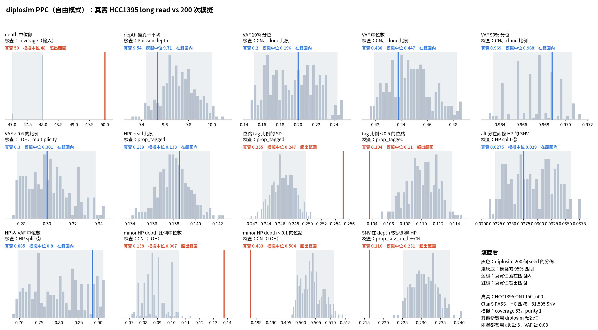
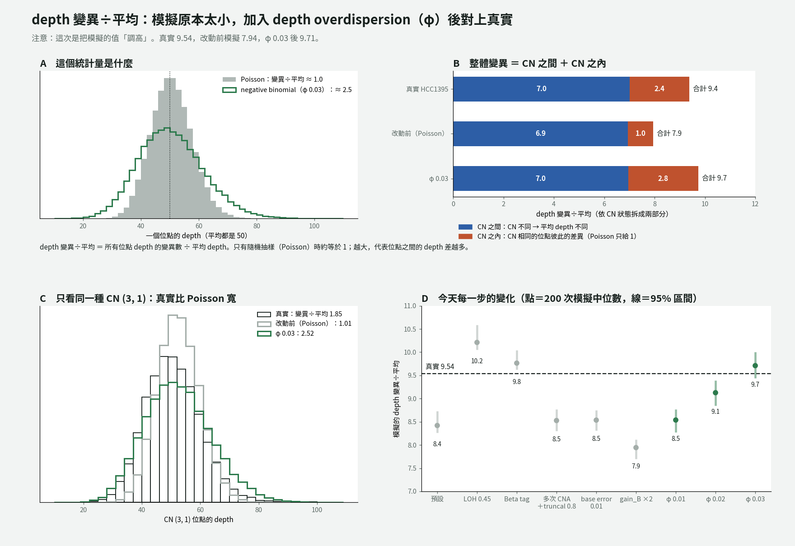

# diplosim PPC：depth overdispersion（2026-10-31）

問題：depth 變異÷平均一路變小（目前 −0.17）。使用者要求直接挑方案解決，而且要對全局統計都有正面影響，不能修好一項又弄壞另一項。

標記：〔實測〕＝本實驗計算；〔推論〕＝本檔推論；〔程式〕＝讀程式得到。

## 1. 結論

- **新增 `--depth-dispersion`（φ），depth 從 Poisson 改成 negative binomial。** φ 0.03 時 depth 變異÷平均 9.71，真實 9.54（相對差距 −0.17 → +0.02）〔實測〕。
- **其他 12 項幾乎不變：** 每一項的變化都 ≤ 0.03，在模擬雜訊範圍內〔實測〕。
- **13 項平均相對差距 0.074 → 0.061；CN 相關 6 項 0.057 → 0.029**，都是目前最低〔實測〕。φ 0.01、0.02、0.03 三個值都讓兩個總分下降，沒有顧此失彼〔實測〕。
- **為什麼前幾步越調越差：** 整體 depth 變異 = CN 不同造成的變異 + CN 相同時的雜訊。diplosim 原本沒有後者，只能靠 CN 分散來撐。CN 分布調得越像真實，缺口就越明顯〔推論〕。
- φ 0.03 是看 HCC1395 選的，只當實驗設定，預設仍是 Poisson。

## 2. 診斷：真實資料在 CN 相同時的 depth 雜訊

用 ASCAT CN 分組，計算每組 depth 的變異÷平均〔實測〕：

| CN 狀態 | 位點數 | 平均 depth | 變異÷平均 | φ =（變異÷平均 − 1）÷ 平均 |
|---|---:|---:|---:|---:|
| (2,0) | 8,564 | 34.0 | 1.83 | 0.024 |
| (3,1) | 6,584 | 50.3 | 1.85 | 0.017 |
| (4,2) | 4,054 | 65.0 | 2.37 | 0.021 |
| (3,0) | 3,869 | 50.0 | 2.32 | 0.026 |
| (4,0) | 1,574 | 64.6 | 2.68 | 0.026 |
| (5,2) | 1,151 | 73.8 | 3.06 | 0.028 |

Poisson 的變異÷平均是 1。真實資料在每一種 CN 都是 1.8–3，φ 大致固定在 0.02 左右，符合 negative binomial〔實測＋推論〕。ASCAT 的分段誤差也會讓組內變異變大，所以真正的 φ 可能略小〔推論〕。

## 3. 做法

- 程式：`diplosim/src/sequencing.rs` 的 `make_sequencing_data`。每個位點的 Poisson 平均先乘上 Gamma(1/φ, φ)，再抽 depth。alt 仍是 Binomial(depth, VAF)，HP 拆分不變。
- PPC：在 gain_B ×2 那一組（`lab_report/2026-10-31_diplosim_ppc_hcc1395_gainB2/`）上加 `--depth-dispersion` 0.01／0.02／0.03。

## 4. 結果

| 統計量（相對差距） | gain_B ×2 | φ 0.01 | φ 0.02 | φ 0.03 |
|---|---:|---:|---:|---:|
| depth 變異÷平均 | −0.167 | −0.105 | −0.043 | **+0.018** |
| VAF 10% 分位 | −0.037 | −0.027 | −0.032 | −0.023 |
| VAF 中位數 | +0.019 | +0.020 | +0.023 | +0.023 |
| alt 分在兩條 HP | +0.032 | +0.044 | +0.063 | +0.052 |
| HP 內 VAF 中位數 | −0.104 | −0.096 | −0.096 | −0.096 |
| SNV 在 depth 較少那條 HP | +0.070 | +0.067 | +0.069 | +0.067 |
| CN 6 項平均 \|rel\| | 0.057 | 0.044 | 0.036 | **0.029** |
| 13 項平均 \|rel\| | 0.074 | 0.068 | 0.065 | **0.061** |

完整：`tables/ppc_stats.tsv`、`tables/distance_sweep.tsv`。φ 0.01、0.02 的結果在同層目錄。

## 4b. 圖解

- A：統計量的定義。平均相同時，Poisson 的變異÷平均約 1，negative binomial（φ 0.03、平均 50）約 2.5。
- B：用「總變異 = 組間 + 組內」依 CN 狀態拆開〔實測〕。真實 7.0 + 2.4；改動前 6.9 + 1.0；φ 0.03 是 7.0 + 2.8。CN 之間的部分早已對上，缺的是 CN 之內。
- C：只看 CN (3,1)：真實 1.85，Poisson 1.01，φ 0.03 是 2.52。
- D：今天每一步的模擬值。CN 參數讓它上下跳，φ 才讓它穩定接近真實。

注意：φ 0.03 讓「CN 之內」略多於真實（2.8 對 2.4；(3,1) 是 2.52 對 1.85）。整體值剛好對上，可能是因為模擬的 CN 狀態組成和真實仍有差異〔推論〕。只看組內，φ 約 0.02 比較接近。

圖：`python3 tools/plot_depth_vmr_explainer.py <無 φ 的 diplosim 輸出> <φ 0.03 的輸出> depth_vmr_explainer.png`（各 6 個 seed）。

## 5. 限制

- 真實 depth 的雜訊可能有空間相關（GC、mappability），這裡每個位點獨立。
- 圖底的「其他參數用 diplosim 預設值」不含這次的參數。
