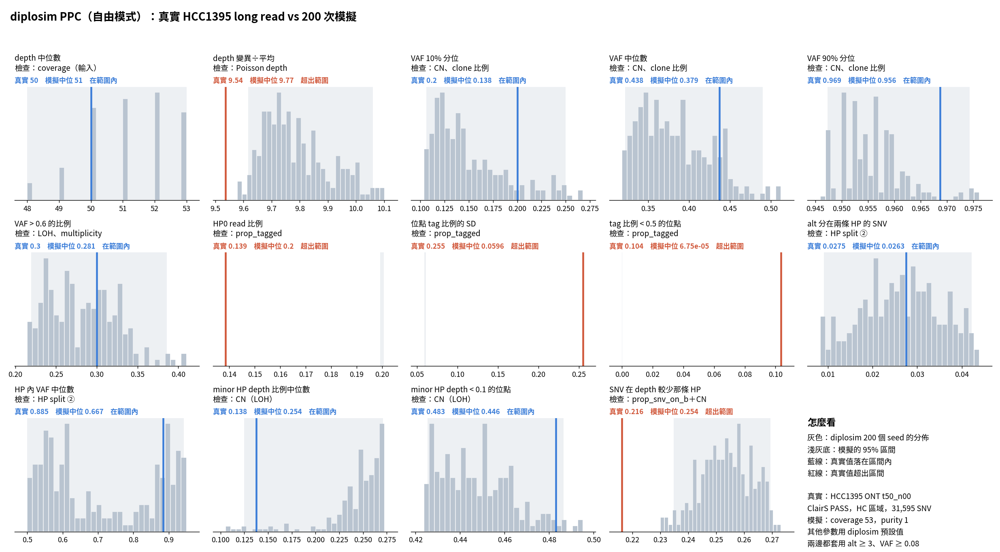

# diplosim PPC：錯誤率 0.005，purity 1 vs 0.97（2026-10-31）

問題：(1) 錯誤率 0.01 讓 alt 分在兩條 HP 的比例多了一倍，0.005 是否剛好？(2) VAF 90% 分位（真實 0.969）是鹼基錯誤造成的，還是殘留 normal 細胞造成的？

兩次都設 `--prop-pos-lost 0.45 --mistag-rate 0.005 --base-error 0.005`。對照：purity 1（`lab_report/2026-10-31_diplosim_ppc_hcc1395_err0005/`）；這次：purity 0.97（本目錄）。0.97 是 ASCAT 在 5kHz 那批 read 上估的 purity（`lab_report/2026-10-30_ascat_hcc1395_5khz/`），不是用 PPC 調出來的。

標記：〔實測〕＝本實驗計算；〔推論〕＝本檔推論；〔程式〕＝讀程式得到。

## 1. 結論

- **錯誤率 0.005 剛好：** alt 分在兩條 HP 的 SNV 0.026，真實 0.028（相對差距 −0.07）〔實測〕。
- **VAF 90% 分位是 purity 造成的，不是鹼基錯誤。** purity 1 時仍是 1.0；purity 0.97 時是 0.955（區間 0.947–0.974），真實 0.969 落在區間內〔實測〕。
- purity 0.97 也讓 depth 變異÷平均更接近（相對差距 +0.071 → +0.024）。minor HP < 0.1 的位點稍微變少（−0.031 → −0.076），因為 normal 細胞在 LOH 區也帶來 minor HP read〔實測＋推論〕。
- **13 項的平均相對差距是目前最低：** 0.316（purity 1）、0.319（purity 0.97）。只設 0.45 時是 0.388〔實測〕。
- 剩下的大差距是 tag 比例的 3 項，以及「SNV 在 depth 較少那條 HP」（+0.17）〔實測〕。

## 2. 做法

```bash
L=lab_report
python3 -I tools/diplosim_ppc_hcc1395.py sim $L/2026-10-31_diplosim_ppc_hcc1395_err0005 200 \
  --prop-pos-lost 0.45 --mistag-rate 0.005 --base-error 0.005                                     # 跳過 35 個 seed
python3 -I tools/diplosim_ppc_hcc1395.py sim $L/2026-10-31_diplosim_ppc_hcc1395_err0005_pur097 200 \
  --prop-pos-lost 0.45 --mistag-rate 0.005 --base-error 0.005 --min-tumour-purity 0.97 --max-tumour-purity 0.97   # 跳過 46 個
# 之後各自 compare、plot；距離評分見 tables/distance_compare.tsv
```

`tools/diplosim_ppc_hcc1395.py`：額外參數中若有 `--min-tumour-purity`，就不加預設的 purity 1（diplosim 不接受同一個參數出現兩次）。

## 3. 結果

| 統計量 | 真實 | 0.45 | 錯誤 0.01 | 錯誤 0.005 | 錯誤 0.005＋purity 0.97 |
|---|---:|---:|---:|---:|---:|
| alt 分在兩條 HP 的 SNV | 0.028 | 0 | 0.058 | **0.026** | **0.026** |
| VAF 90% 分位 | 0.969 | 1.0 | 1.0 | 1.0 | **0.955** ✓ |
| depth 變異÷平均 | 9.54 | 10.21 | 10.20 | 10.21 | **9.77** |
| minor HP depth < 0.1 的位點 | 0.483 | 0.469 | 0.464 | 0.468 | 0.446 |
| SNV 在 depth 較少那條 HP | 0.216 | 0.261 | 0.244 | 0.254 | 0.254 |
| 13 項平均 \|rel\| | | 0.388 | 0.395 | **0.316** | **0.319** |
| CN 相關 6 項平均 \|rel\| | | 0.123 | 0.117 | 0.122 | 0.131 |

完整：`tables/ppc_stats.tsv`（兩個目錄各一份）、`tables/distance_compare.tsv`。



## 4. 限制

- PPC 的真實資料 `t50_n00` 名義上 purity 1。0.97 來自另一批 read 的 ASCAT，兩批是同一株細胞，但定序時間不同〔實測＋推論〕。
- 錯誤率 0.005 是看了 HCC1395 的結果才選的，等於用一個資料集校正。只能當實驗設定，不能當預設值（預設仍是 0）。
