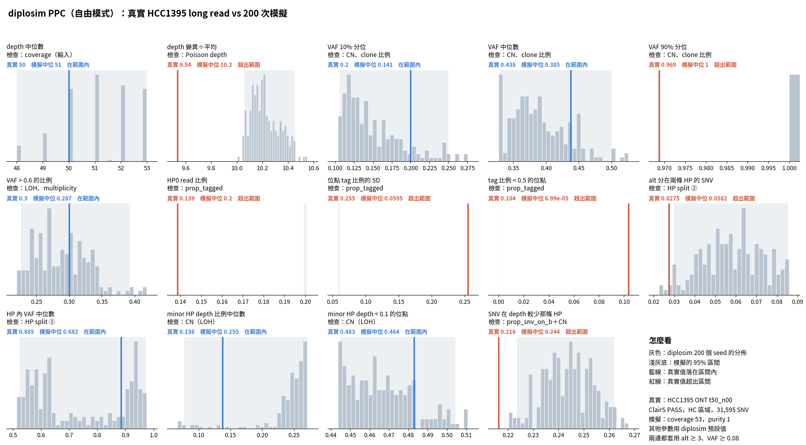

# diplosim PPC：`--prop-pos-lost 0.45 --mistag-rate 0.01 --base-error 0.01`（2026-10-31）

問題：加入 read 的 HP 標錯和鹼基錯誤（`diplosim/DECISIONS.md` 2026-10-31）後，PPC 的錯誤相關統計量會不會接近真實？對照組是只設 `--prop-pos-lost 0.45`。

標記：〔實測〕＝本實驗計算；〔推論〕＝本檔推論；〔程式〕＝讀程式得到。

## 1. 結論

- **alt 分在兩條 HP 的比例從 0 變成 0.058，但真實是 0.028，0.01 太多。** 約一半的錯誤率就夠了〔實測＋推論〕。
- **SNV 在 depth 較少那條 HP 變接近：** 0.261 → 0.244（真實 0.216），相對差距 0.21 → 0.13〔實測〕。
- **VAF 90% 分位仍是 1.0（真實 0.969）。** depth 50、錯誤率 1% 時，約 60% 的 VAF = 1 位點仍然一條 ref read 都沒有，所以分位數不動〔推論〕。真實的 0.969 也可能來自殘留的 normal 細胞：ASCAT 估的 purity 是 0.97，不是 1〔實測＋推論〕。
- **CN 相關 6 項的平均相對差距 0.123 → 0.117，幾乎不變。** 錯誤率不影響 CN 結構〔實測〕。
- tag 比例相關的 3 項（HP0、tag SD、tag < 0.5）不變，這是預期中的，要靠方案 ②〔實測〕。

## 2. 做法

```bash
O=lab_report/2026-10-31_diplosim_ppc_hcc1395_err001
python3 -I tools/diplosim_ppc_hcc1395.py sim $O 200 --prop-pos-lost 0.45 --mistag-rate 0.01 --base-error 0.01   # 跳過 34 個 seed
python3 -I tools/diplosim_ppc_hcc1395.py compare $O
python3 tools/plot_diplosim_ppc_hcc1395.py $O
python3 -I tools/ppc_distance_score.py l0.45=lab_report/2026-10-31_diplosim_ppc_hcc1395_lost045 err=$O > $O/tables/distance_vs_lost045.tsv
```

錯誤率 0.01 是整數值，不是從 HCC1395 校正來的。

## 3. 結果

| 統計量 | 真實 | 0.45 | 0.45＋錯誤 0.01 | 相對差距（前 → 後） |
|---|---:|---:|---:|---|
| alt 分在兩條 HP 的 SNV | 0.028 | 0 | 0.058 | −1.00 → +1.11 |
| SNV 在 depth 較少那條 HP | 0.216 | 0.261 | 0.244 | +0.21 → +0.13 |
| VAF 90% 分位 | 0.969 | 1.0 | 1.0 | +0.03 → +0.03 |
| minor HP depth < 0.1 的位點 | 0.483 | 0.469 | 0.464 | −0.03 → −0.04 |
| depth 變異÷平均 | 9.54 | 10.21 | 10.20 | +0.07 → +0.07 |
| HP0 比例 | 0.139 | 0.200 | 0.200 | +0.44 → +0.44 |
| 位點 tag 比例的 SD | 0.255 | 0.059 | 0.059 | −0.77 → −0.77 |
| CN 相關 6 項平均 \|rel\| | | 0.123 | 0.117 | |

完整：`tables/ppc_stats.tsv`、`tables/distance_vs_lost045.tsv`。



## 4. 限制

- 兩個錯誤率一起改，分不出各自對 alt 分在兩條 HP 的貢獻。HP 標錯和 ref → alt 鹼基錯誤都會讓另一條 HP 出現 alt〔程式〕。
- 圖底的「其他參數用 diplosim 預設值」不含這次的三個參數。
