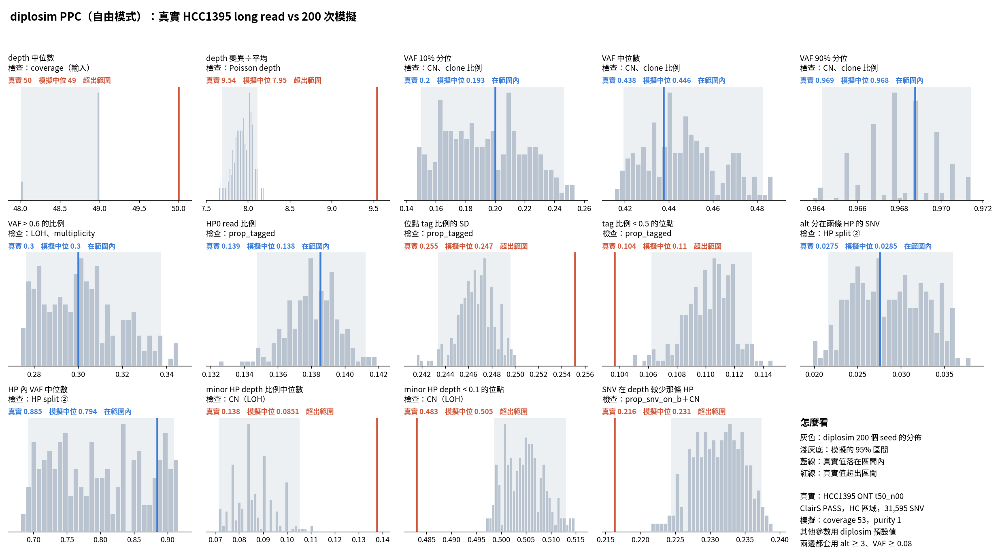

# diplosim PPC：解決「HP 內 VAF 中位數偏低」（2026-10-31）

問題：目前最好的設定（`lab_report/2026-10-31_diplosim_ppc_hcc1395_base001/`）中，HP 內 VAF 中位數 0.71，真實 0.885（相對差距 −0.20）。使用者要求直接挑方案解決。

標記：〔實測〕＝本實驗計算；〔推論〕＝本檔推論；〔程式〕＝讀程式得到。

## 1. 結論

- **用 `--gain-events gain_A,gain_B,gain_B,gain_both`（`gain_B` 的比重加倍）：** HP 內 VAF 中位數 −0.20 → −0.10，「SNV 在 depth 較少那條 HP」−0.16 → +0.07〔實測〕。
- **13 項平均相對差距 0.102 → 0.074，CN 相關 6 項 0.081 → 0.057**，兩者都是目前最低〔實測〕。
- **原因：** 真實資料中，SNV 比較常落在 copy 數較少的 allele 上。三種 gain 中只有 `gain_B` 會擴增「沒有 SNV 的那條」allele〔程式，`evolution.rs` `Event::apply`〕。
- **不需要新程式。** `gain_events` 是 CONIPHER 原有參數，清單中重複的事件會被抽到更多次〔程式，`create_event_dict` 等機率挑〕。
- **副作用：** depth 變異÷平均 −0.11 → −0.17〔實測〕。
- **試過但撤回：** 新增「truncal SNV 排在 CNA 之前的機率」。HP 內 VAF 會對上，但整體 VAF 變太高（VAF > 0.6 +0.32～+0.65），整體變差，所以程式已撤回〔實測〕。
- `gain_B` 加倍是看 HCC1395 選的，只當實驗設定。

## 2. 診斷

1. **中位數放大了差距。** 真實與模擬的 HP 內 VAF 都是兩群：約 0.5 與約 1。「≥ 0.85」的比例是真實 52%、模擬 45%。中位數剛好落在兩群交界，所以差 0.2〔實測〕。
2. **差距集中在 (2,0)、(3,1)、(4,2)、(5,2)。** 例如 (2,0) 中 HP 內 VAF ≥ 0.85 的位點，真實 0.56、模擬 0.43〔實測，真實用 ASCAT CN 分組〕。
3. **「SNV 提前」的解釋不成立。** SNV 提前會讓 HP 內 VAF 變高，但整體 VAF 也會變高。真實資料是 HP 內 VAF 高，整體 VAF 卻不高。符合這個組合的是：SNV 在 copy 數少的 allele 上（HP 內 VAF 1，整體 VAF 低）〔實測＋推論〕。

## 3. 結果

| 統計量（相對差距） | base 0.01（前一最佳） | SNV 提前 0.6 | SNV 提前 0.8 | gain_B ×2 | gain_B ×3 |
|---|---:|---:|---:|---:|---:|
| HP 內 VAF 中位數 | −0.20 | +0.06 | +0.09 | **−0.10** | −0.02 |
| SNV 在 depth 較少那條 HP | −0.16 | −0.15 | −0.15 | **+0.07** | +0.20 |
| VAF > 0.6 的比例 | +0.04 | +0.32 | +0.65 | **0.00** | −0.02 |
| VAF 中位數 | +0.05 | +0.17 | +0.36 | +0.02 | 0.00 |
| depth 變異÷平均 | −0.11 | −0.10 | −0.10 | −0.17 | −0.21 |
| alt 分在兩條 HP | −0.05 | −0.16 | −0.23 | +0.03 | +0.12 |
| CN 6 項平均 \|rel\| | 0.081 | 0.142 | 0.233 | **0.057** | 0.086 |
| 13 項平均 \|rel\| | 0.102 | 0.128 | 0.179 | **0.074** | 0.079 |

CN 狀態與 multiplicity（gain_B ×2，`tables/cn_state.txt`）：平均 total CN 3.04（ASCAT 3.25），LOH 0.513（0.502），multiplicity ≥ 2 0.404（0.439）〔實測〕。

完整：`tables/ppc_stats.tsv`、`tables/distance_compare.tsv`。SNV 提前（`..._early_b{0.6,0.7,0.8}/`）和 gain_B ×3（`..._gainB3/`）的結果在同層目錄。



## 4. 做法

```bash
A="--prop-pos-lost 0.45 --loss-events cnloh_B --prop-pos-second-cna 0.5 --mistag-rate 0.005 --base-error 0.01 \
   --min-tumour-purity 0.97 --max-tumour-purity 0.97 --prop-tagged 0.862 --tag-concentration 1 --prop-truncal-snvs 0.8"
python3 -I tools/diplosim_ppc_hcc1395.py sim lab_report/2026-10-31_diplosim_ppc_hcc1395_gainB2 200 $A \
  --gain-events gain_A,gain_B,gain_B,gain_both   # 跳過 25 個 seed
```

## 5. 限制

- HP 內 VAF 中位數仍差 −0.10。
- depth 變異÷平均變得更低，原因沒查。
- SNV 提前的 PPC 是用已撤回的程式跑的（`prop_snv_before_cna`），目前的 diplosim 無法重跑那三組。
