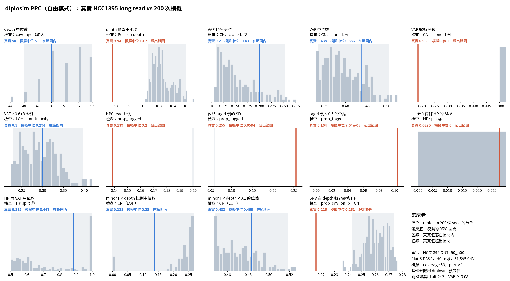

# diplosim PPC：`--prop-pos-lost 0.45`（2026-10-31）

問題：0.5 讓 minor HP < 0.1 的位點偏多。0.45 能不能讓第 ③ 類 4 項同時進入範圍？

標記：〔實測〕＝本實驗計算；〔推論〕＝本檔推論；〔程式〕＝讀程式得到。

## 1. 結論

- **沒有一個值能讓 4 項同時進入範圍。** 14 項中仍是 7 項在範圍內，但換成不同的 2 項〔實測〕。
- 4 項各自需要的值不同〔實測＋推論〕：
  - minor HP < 0.1 的位點：0.45 剛好。
  - SNV 在 depth 較少那條 HP：要約 0.5。
  - depth 變異÷平均：0.3 太低、0.45 太高，要約 0.35–0.4。
- 只調一個參數無法同時符合，表示還有別的 CN 結構不同，例如 gain 的分布或 multiplicity〔推論〕。這次沒有查。

## 2. 做法

和 `lab_report/2026-10-31_diplosim_ppc_hcc1395_lost05/` 相同，只把值改成 0.45。跳過 27 個重複 CHR/POS 的 seed。sim 目錄比較完已刪除。

## 3. 結果（第 ③ 類，三個值並列）

| 統計量 | 真實 | 0.3 | 0.45 | 0.5 |
|---|---:|---:|---:|---:|
| minor HP depth 比例中位數 | 0.138 | 0.339 ✗ | 0.25 ✓（0–0.267） | 0 ✓（0–0.180） |
| minor HP depth < 0.1 的位點 | 0.483 | 0.313 ✗ | **0.469 ✓**（0.448–0.519） | 0.522 ✗ |
| SNV 在 depth 較少那條 HP | 0.216 | 0.337 ✗ | 0.261 ✗（0.243–0.274） | 0.237 ✓ |
| depth 變異÷平均 | 9.54 | 8.42 ✗ | 10.21 ✗（10.05–10.59） | 10.85 ✗ |

✓＝在 95% 區間內。完整表：`tables/ppc_stats.tsv`。第 ①、② 類 5 項仍然超出〔實測〕。

## 4. 限制

- minor HP 中位數的區間仍然很寬，「在範圍內」的參考價值低。
- 圖底的「其他參數用 diplosim 預設值」不含這次的 `prop_pos_lost`。
