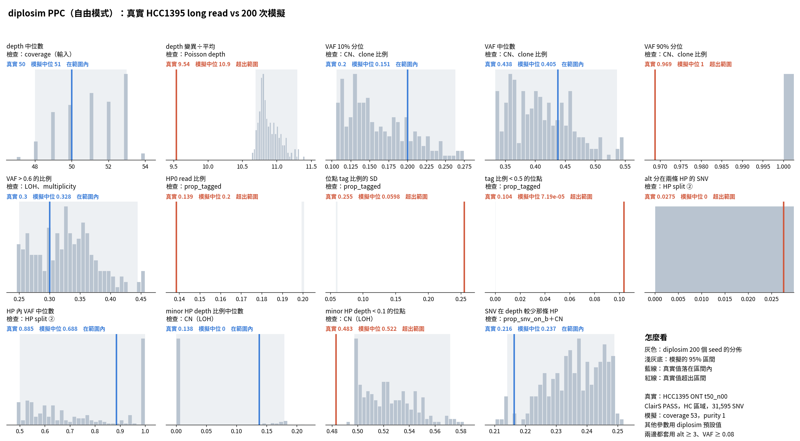

# diplosim PPC：`--prop-pos-lost 0.5`（2026-10-31）

問題：把 LOH 位置比例從預設 0.3 調到 0.5，PPC 第 ③ 類（CN 組成）會不會進入範圍？

標記：〔實測〕＝本實驗計算；〔推論〕＝本檔推論；〔程式〕＝讀程式得到。

## 1. 結論

- 14 個統計量中，在範圍內的從 5 個變成 7 個〔實測〕。
- 第 ③ 類 4 項中，2 項進入範圍：minor HP depth 中位數、SNV 在 depth 較少那條 HP〔實測〕。
- 另外 2 項從「模擬太少」翻成「模擬太多」：minor HP < 0.1 的位點 0.522（真實 0.483），depth 變異÷平均 10.85（真實 9.54）〔實測〕。0.5 調得略多，真實值落在 0.3 和 0.5 之間〔推論〕。
- 第 ①、② 類（`prop_tagged`、定序誤差）不受影響，仍然超出，和預期一樣〔實測〕。

## 2. 資料與做法

和 `lab_report/2026-10-30_diplosim_ppc_hcc1395/` 相同，只多一個參數。真實資料表直接複製過來。

```bash
O=lab_report/2026-10-31_diplosim_ppc_hcc1395_lost05
python3 -I tools/diplosim_ppc_hcc1395.py sim $O 200 --prop-pos-lost 0.5   # 跳過 26 個重複 CHR/POS 的 seed
python3 -I tools/diplosim_ppc_hcc1395.py compare $O
python3 tools/plot_diplosim_ppc_hcc1395.py $O
```

`prop_lost_truncal` 仍是 1.0，所以 loss 全部是 truncal〔程式，`diplosim/src/params.rs:71`〕。sim 目錄（2.1 GB）比較完已刪除。

## 3. 結果（第 ③ 類）

| 統計量 | 真實 | 0.3（預設） | 0.5（這次） | 0.5 的 95% 區間 | 判定 |
|---|---:|---:|---:|---|---|
| minor HP depth 比例中位數 | 0.138 | 0.339 | 0 | 0–0.180 | 在範圍內 |
| minor HP depth < 0.1 的位點 | 0.483 | 0.313 | 0.522 | 0.498–0.572 | 超出（偏多） |
| SNV 在 depth 較少那條 HP | 0.216 | 0.337 | 0.237 | 0.214–0.249 | 在範圍內 |
| depth 變異÷平均 | 9.54 | 8.42 | 10.85 | 10.69–11.30 | 超出（偏多） |

完整表：`tables/ppc_stats.tsv`。



## 4. 限制

- minor HP 中位數「在範圍內」只是因為 95% 區間很寬（0–0.18）。模擬中位是 0，原因是 LOH 區沒有 tag 錯誤，和 10-31 固定 CN 檢查看到的一樣〔實測〕。
- 圖底的說明寫「其他參數用 diplosim 預設值」，這次的 `prop_pos_lost` 例外。
