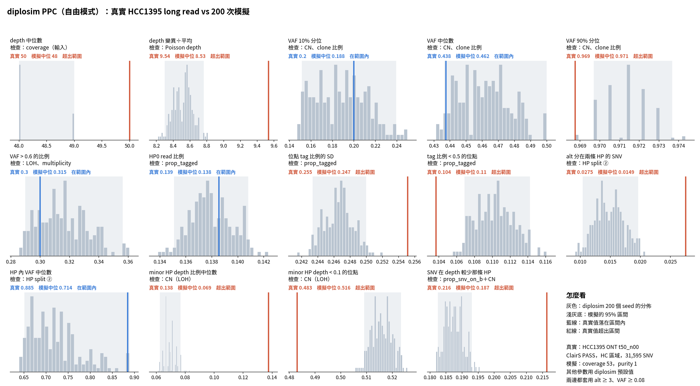

# diplosim PPC：SNV 可以排在兩次 CNA 之間＋提高 CN 與 truncal 比例（2026-10-31）

問題：multiplicity ≥ 2 只有真實的一半，VAF 10% 分位偏低。上一輪只調 `--prop-truncal-snvs 0.9`，VAF 變太高、multiplicity 仍不夠。

做法：使用者要求直接挑方案解決。這次同時做兩件事：

1. **改程式：** 有附加 CNA 的位置，SNV 在整串 CNA 中均勻選一個位置，可以夾在兩次 CNA 之間（`diplosim/DECISIONS.md` 2026-10-31 最後一列）。
2. **調參數：** 加上讓 CN 變高的 `--loss-events cnloh_B --prop-pos-second-cna 0.5`，並把 `--prop-truncal-snvs` 掃 0.6、0.7、0.8。

其餘同 Beta tag 那一組：`--prop-pos-lost 0.45 --mistag-rate 0.005 --base-error 0.005 --min/max-tumour-purity 0.97 --prop-tagged 0.862 --tag-concentration 1`。

標記：〔實測〕＝本實驗計算；〔推論〕＝本檔推論。

## 1. 結論

- **multiplicity 對上了：** ≥ 2 的比例 0.435，真實 0.439〔實測，粗估，truncal 0.8〕。
- **VAF 對上了：** 10% 分位 −0.31 → −0.06，中位數 −0.14 → +0.06，VAF > 0.6 −0.07 → +0.05〔實測〕。
- **13 項平均相對差距 0.165 → 0.133，CN 相關 6 項 0.132 → 0.079**，兩者都是目前最低〔實測〕。
- 平均 total CN 3.09，ASCAT 3.25〔實測〕。
- **新出現或變大的差距**〔實測〕：
  - depth 變異÷平均 −0.11（8.53 對 9.54）。
  - alt 分在兩條 HP −0.46（0.015 對 0.028）。subclonal SNV 變少，低 alt 的 SNV 跟著變少〔推論〕。
  - SNV 在 depth 較少那條 HP：從 +0.17 翻成 −0.13。
  - HP 內 VAF 中位數 −0.19。
- truncal 0.8 是看 HCC1395 選的，只當實驗設定。

## 2. 做法

```bash
A="--prop-pos-lost 0.45 --loss-events cnloh_B --prop-pos-second-cna 0.5 --mistag-rate 0.005 --base-error 0.005 \
   --min-tumour-purity 0.97 --max-tumour-purity 0.97 --prop-tagged 0.862 --tag-concentration 1"
for t in 0.6 0.7 0.8; do
  O=lab_report/2026-10-31_diplosim_ppc_hcc1395_mult_t$t
  python3 -I tools/diplosim_ppc_hcc1395.py sim $O 200 $A --prop-truncal-snvs $t   # 跳過 35、30、30 個 seed
  python3 -I tools/diplosim_ppc_hcc1395.py compare $O
done
python3 -I tools/cn_state_ascat_vs_diplosim.py <tmp> <A 去掉 purity> --prop-truncal-snvs 0.8   # tables/cn_state.txt
```

## 3. 結果

| 統計量 | 真實 | Beta tag（前一最佳） | t 0.6 | t 0.7 | t 0.8 |
|---|---:|---:|---:|---:|---:|
| VAF 10% 分位 rel | | −0.31 | −0.30 | −0.19 | **−0.06** |
| VAF 中位數 rel | | −0.14 | −0.10 | −0.01 | +0.06 |
| VAF > 0.6 rel | | −0.07 | −0.15 | −0.05 | +0.05 |
| depth 變異÷平均 rel | | +0.02 | −0.13 | −0.12 | −0.11 |
| alt 分在兩條 HP rel | | −0.09 | −0.25 | −0.35 | −0.46 |
| HP 內 VAF 中位數 rel | | −0.23 | −0.35 | −0.28 | −0.19 |
| SNV 在 depth 較少那條 HP rel | | +0.17 | −0.15 | −0.14 | −0.13 |
| CN 6 項平均 \|rel\| | | 0.132 | 0.150 | 0.097 | **0.079** |
| 13 項平均 \|rel\| | | 0.165 | 0.164 | 0.141 | **0.133** |

multiplicity（粗估，round(VAF × total CN)，purity 1）〔實測〕：

| multiplicity | ASCAT | t 0.8 |
|---|---:|---:|
| 0 | 0.030 | 0.072 |
| 1 | 0.527 | 0.493 |
| 2 | 0.360 | 0.325 |
| ≥ 3 | 0.080 | 0.110 |

完整：`tables/ppc_stats.tsv`、`tables/distance_sweep.tsv`、`tables/cn_state.txt`。t 0.6、0.7 的結果在同層目錄。



## 4. 限制

- 程式改動和參數一起換，分不出 multiplicity 的改善各自來自哪一個。
- alt 分在兩條 HP 變少，可以再調高錯誤率，但那又是用 HCC1395 校正。
- 圖底的「其他參數用 diplosim 預設值」不含這次的參數。
