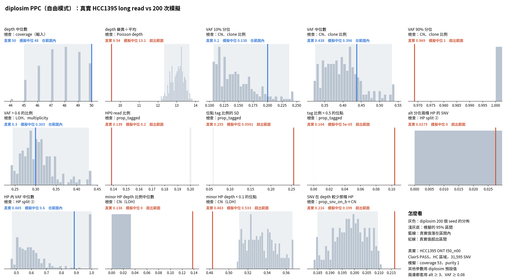

# diplosim PPC：`--prop-pos-lost 0.45 --prop-pos-second-cna 0.5`（2026-10-31）

問題：新增的「同位置多次 CNA」能產生 (3,0)、(4,0)。PPC 第 ③ 類會不會更接近真實？

標記：〔實測〕＝本實驗計算；〔推論〕＝本檔推論；〔程式〕＝讀程式得到。

## 1. 結論

- **沒有變好。** 14 項中在範圍內的從 7 項（只用 0.45）降到 5 項〔實測〕。
- **第 ③ 類 4 項全部超出，** 而且方向不一致〔實測〕：
  - minor HP < 0.1 的位點 0.533，真實 0.483，模擬偏多。LOH 合計 0.544 也比 ASCAT 的 0.502 多。
  - SNV 在 depth 較少那條 HP 0.199，真實 0.216，模擬偏少。
  - depth 變異÷平均 13.08，真實 9.54，偏離更大（0.45 時是 10.21）。
  - minor HP 中位數 0，因為 LOH 超過一半。
- **depth 變異變大，可能是 (1,0) 太多加上 CN 分散得更開。** 真實 depth 和 ASCAT total CN 成正比，每份 copy 約 16–18 條 read〔實測〕。diplosim 的 depth 也照 CN 比例抽〔程式，`sequencing.py:95-99`〕。所以 CN 分布不對，depth 變異就會不對〔推論〕。
- 機制本身有用，(3,0)、(4,0) 出現了。但第一個事件產生的 (1,0) 仍有 18%（真實 2.3%），把其他項目拉偏了〔實測＋推論〕。

## 2. 做法

```bash
O=lab_report/2026-10-31_diplosim_ppc_hcc1395_second05
python3 -I tools/diplosim_ppc_hcc1395.py sim $O 200 --prop-pos-lost 0.45 --prop-pos-second-cna 0.5   # 跳過 31 個 seed
python3 -I tools/diplosim_ppc_hcc1395.py compare $O
python3 tools/plot_diplosim_ppc_hcc1395.py $O
```

diplosim 是加了 `prop_pos_second_cna` 的版本（`diplosim/DECISIONS.md` 2026-10-31，未 commit）。sim 目錄比較完已刪除。

## 3. 結果

| 統計量 | 真實 | 0.45 | 0.45＋second 0.5 |
|---|---:|---:|---:|
| depth 變異÷平均 | 9.54 | 10.21 ✗ | 13.08 ✗ |
| VAF 10%／50% 分位 | 0.200／0.438 | ✓／✓ | ✓／✓ |
| VAF > 0.6 的比例 | 0.300 | 0.294 ✓ | 0.302 ✓ |
| HP 內 VAF 中位數 | 0.885 | 0.667 ✓ | 0.600 ✓ |
| minor HP depth 比例中位數 | 0.138 | 0.25 ✓ | 0 ✗ |
| minor HP depth < 0.1 的位點 | 0.483 | 0.469 ✓ | 0.533 ✗ |
| SNV 在 depth 較少那條 HP | 0.216 | 0.261 ✗ | 0.199 ✗ |

真實 depth 中位數 vs ASCAT total CN〔實測〕：CN 1 → 18、2 → 34、3 → 50、4 → 65、5 → 80、6 → 97。

`prop_tagged` 與定序誤差的 5 項仍然超出。完整：`tables/ppc_stats.tsv`。



## 4. 限制

- 只試了一組值。
- 圖底的「其他參數用 diplosim 預設值」不含這次的兩個參數。
