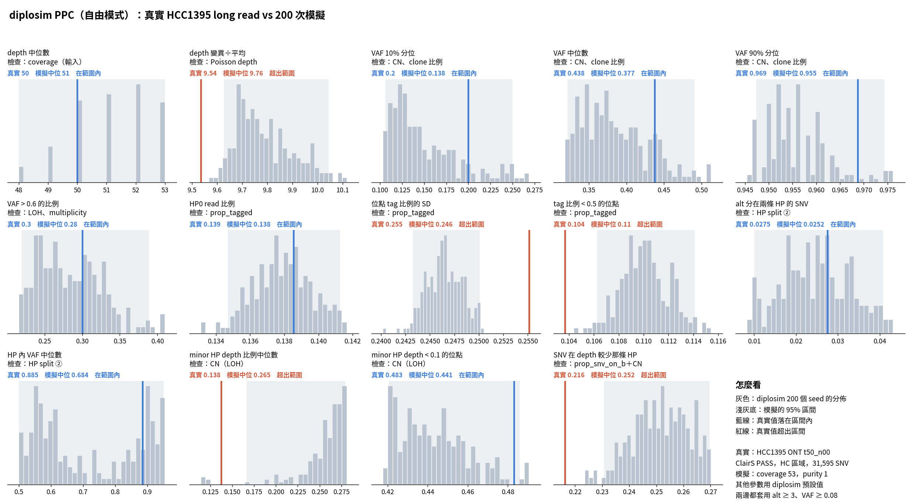

# diplosim PPC：每個位點的 tag 機率 ~ Beta（2026-10-31）

問題：新增 `tag_concentration` 後（`diplosim/DECISIONS.md` 2026-10-31），HP0 比例和位點 tag 比例的差異能不能對上真實 HCC1395？

設定：`--prop-pos-lost 0.45 --mistag-rate 0.005 --base-error 0.005 --min/max-tumour-purity 0.97 --prop-tagged 0.862 --tag-concentration 1`。對照組是同設定但不加最後兩個參數（`lab_report/2026-10-31_diplosim_ppc_hcc1395_err0005_pur097/`）。

標記：〔實測〕＝本實驗計算；〔推論〕＝本檔推論。

## 1. 結論

- **tag 相關的 3 項都對上了**〔實測〕：
  - HP0 比例 0.138，真實 0.139（相對差距 +0.44 → −0.004）。
  - 位點 tag 比例 SD 0.246，真實 0.255（−0.77 → −0.03）。
  - tag 比例 < 0.5 的位點 0.110，真實 0.104（−1.0 → +0.06）。
- **13 項平均相對差距從 0.319 降到 0.165**，是目前最低〔實測〕。CN 相關的 6 項不變（0.131 → 0.132），所以這個機制不干擾 CN〔實測〕。
- SD 和 tag < 0.5 仍判定為超出，但差距只有 3–6%，是因為模擬區間很窄〔實測〕。
- **剩下的主要差距：** VAF 10% 分位（−0.31）、HP 內 VAF 中位數（−0.23）、SNV 在 depth 較少那條 HP（+0.17）。這些和 tag 無關〔實測〕。
- m 0.862、κ 1 是看 HCC1395 選的，只當實驗設定，不當預設值。

## 2. 做法

```bash
O=lab_report/2026-10-31_diplosim_ppc_hcc1395_tagbeta
python3 -I tools/diplosim_ppc_hcc1395.py sim $O 200 --prop-pos-lost 0.45 --mistag-rate 0.005 --base-error 0.005 \
  --min-tumour-purity 0.97 --max-tumour-purity 0.97 --prop-tagged 0.862 --tag-concentration 1   # 跳過 39 個 seed
python3 -I tools/diplosim_ppc_hcc1395.py compare $O
python3 tools/plot_diplosim_ppc_hcc1395.py $O
python3 -I tools/ppc_distance_score.py before=lab_report/2026-10-31_diplosim_ppc_hcc1395_err0005_pur097 tagbeta=$O
```

## 3. 結果

| 統計量 | 真實 | 對照 | Beta tag | 相對差距（對照 → Beta） |
|---|---:|---:|---:|---|
| HP0 比例 | 0.139 | 0.200 | 0.138 | +0.44 → −0.004 |
| 位點 tag 比例 SD | 0.255 | 0.059 | 0.246 | −0.77 → −0.03 |
| tag 比例 < 0.5 的位點 | 0.104 | 0 | 0.110 | −1.00 → +0.06 |
| alt 分在兩條 HP | 0.028 | 0.026 | 0.025 | −0.04 → −0.09 |
| VAF 10% 分位 | 0.200 | 0.138 | 0.138 | −0.31 → −0.31 |
| HP 內 VAF 中位數 | 0.885 | 0.667 | 0.683 | −0.25 → −0.23 |
| SNV 在 depth 較少那條 HP | 0.216 | 0.254 | 0.252 | +0.17 → +0.17 |
| 13 項平均 \|rel\| | | 0.319 | **0.165** | |

完整：`tables/ppc_stats.tsv`、`tables/distance_vs_err0005_pur097.tsv`。



## 4. 限制

- 相鄰位點的 tag 比例各自獨立，真實資料在同一個 PS block 內會相關。目前的統計量看不出這個差別。
- 圖底的「其他參數用 diplosim 預設值」不含這次的參數。
