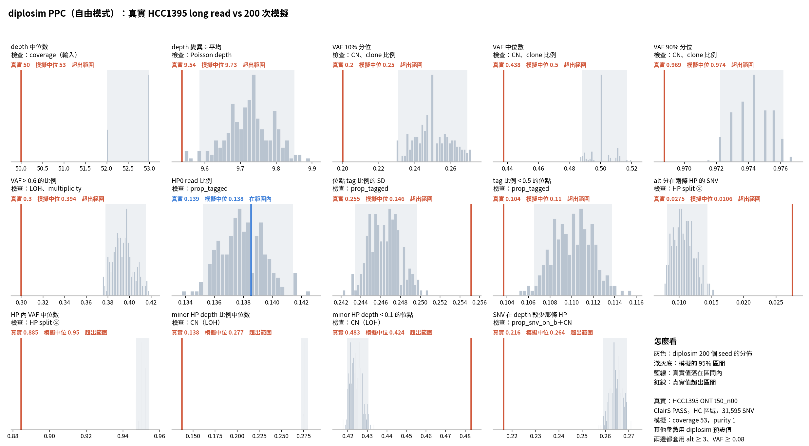

# diplosim PPC：`--prop-truncal-snvs 0.9`（2026-10-31）

問題：模擬的 subclonal SNV 占一半，multiplicity 一定是 1。把 truncal SNV 比例調到 0.9，multiplicity 和 VAF 10% 分位會不會改善？

設定：Beta tag 那一組（`lab_report/2026-10-31_diplosim_ppc_hcc1395_tagbeta/`），再加 `--prop-truncal-snvs 0.9`。

標記：〔實測〕＝本實驗計算；〔推論〕＝本檔推論。

## 1. 結論

- **整體變差：** 13 項平均相對差距 0.165 → 0.221〔實測〕。
- **VAF 從偏低翻成偏高：** VAF 10% 分位 −0.31 → +0.25，中位數 −0.14 → +0.14，VAF > 0.6 的比例 −0.07 → +0.31〔實測〕。只看 VAF，合適的值大約在 0.5 和 0.9 中間〔推論〕。
- **HP 內 VAF 中位數變接近：** −0.23 → +0.07〔實測〕。
- **multiplicity ≥ 2 只從 0.18 升到 0.26，真實是 0.44**〔實測，粗估〕。multiplicity 0 的比例對上了（0.036 對 0.030），所以 clonal 的比例大致對了，但 multiplicity 仍然不夠〔實測＋推論〕。
- **矛盾點：** 真實資料的 VAF 比較低，multiplicity 卻比較高。這表示真實的 copy 數比較多：ASCAT 平均 total CN 3.25，這組模擬約 2.4〔實測，`lab_report/2026-10-31_cn_state_ascat_vs_diplosim/`〕。copy 多了，multiplicity 1 的 SNV 的 VAF 才會下降〔推論〕。
- 其他變差的項目：alt 分在兩條 HP −0.09 → −0.62（低 alt 的 subclonal SNV 變少），SNV 在 depth 較少那條 HP +0.17 → +0.22〔實測〕。

## 2. 做法

```bash
O=lab_report/2026-10-31_diplosim_ppc_hcc1395_truncal09
python3 -I tools/diplosim_ppc_hcc1395.py sim $O 200 --prop-pos-lost 0.45 --mistag-rate 0.005 --base-error 0.005 \
  --min-tumour-purity 0.97 --max-tumour-purity 0.97 --prop-tagged 0.862 --tag-concentration 1 --prop-truncal-snvs 0.9   # 跳過 49 個 seed
python3 -I tools/diplosim_ppc_hcc1395.py compare $O
python3 -I tools/ppc_distance_score.py tagbeta=lab_report/2026-10-31_diplosim_ppc_hcc1395_tagbeta truncal09=$O
python3 -I tools/cn_state_ascat_vs_diplosim.py <tmp> <同上參數，不含 purity> --prop-truncal-snvs {0.5,0.9}   # tables/multiplicity.txt
```

`cn_state_ascat_vs_diplosim.py` 內建 purity 1，不能再傳 purity 參數（diplosim 不接受同一個參數出現兩次），所以 multiplicity 那一步沒有設 0.97。

## 3. 結果

| 統計量 | 真實 | truncal 0.5 | truncal 0.9 |
|---|---:|---:|---:|
| VAF 10% 分位 | 0.200 | 0.138 | 0.250 |
| VAF 中位數 | 0.438 | 0.376 | 0.500 |
| VAF > 0.6 的比例 | 0.300 | 0.280 | 0.394 |
| HP 內 VAF 中位數 | 0.885 | 0.683 | 0.950 |
| alt 分在兩條 HP | 0.028 | 0.025 | 0.011 |
| SNV 在 depth 較少那條 HP | 0.216 | 0.252 | 0.264 |
| multiplicity ≥ 2（粗估） | 0.439 | 0.177 | 0.263 |
| 13 項平均 \|rel\| | | 0.165 | 0.221 |

完整：`tables/ppc_stats.tsv`、`tables/distance_vs_tagbeta.tsv`、`tables/multiplicity.txt`。



## 4. 限制

- 只試了 0.9。
- multiplicity 是用 round(VAF × total CN) 粗估，真實那邊依賴 ASCAT 的 CN。
