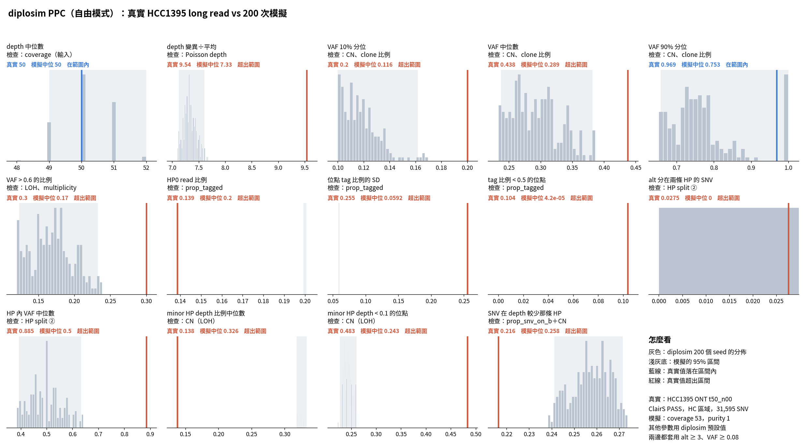

# diplosim PPC：`--clonal-wgd true --prop-pos-lost 0.45`（2026-10-31）

問題：打開 clonal WGD，能不能產生 HCC1395 的「LOH 後又 gain」和高 copy 狀態，讓 PPC 更接近？

標記：〔實測〕＝本實驗計算；〔推論〕＝本檔推論；〔程式〕＝讀程式得到。

## 1. 結論

- **變差了。** 14 項中在範圍內的從 7 項降到 2 項（depth 中位數、VAF 90% 分位）〔實測〕。
- **LOH 反而變少：** minor HP < 0.1 的位點 0.243（真實 0.483）。CN 狀態中 LOH 只剩 24.4%（ASCAT 50.2%）〔實測〕。
- **copy 太多：** 平均 total CN 4.52（ASCAT 3.25），total ≥ 5 占 46.1%（ASCAT 15.7%）〔實測〕。
- **VAF 整體偏低：** VAF 中位數 0.29（真實 0.44）〔實測〕。
- 原因（已讀程式確認）：每個位置最多一個 CNA。clonal WGD 和 truncal CNA 都放在同一個 node，同一位置的事件順序隨機洗牌，所以 truncal loss 有一半排在 WGD 之後，只變成 (2,1)，不是 LOH〔程式，CONIPHER `evolution.py:91-105, 294-319`；diplosim `evolution.rs:284-313`〕。

## 2. 做法

```bash
O=lab_report/2026-10-31_diplosim_ppc_hcc1395_wgd_lost045
python3 -I tools/diplosim_ppc_hcc1395.py sim $O 200 --clonal-wgd true --prop-pos-lost 0.45   # 跳過 40 個 seed
python3 -I tools/diplosim_ppc_hcc1395.py compare $O
python3 tools/plot_diplosim_ppc_hcc1395.py $O
python3 -I tools/cn_state_ascat_vs_diplosim.py <tmp> --clonal-wgd true --prop-pos-lost 0.45 > $O/tables/cn_state.txt
```

## 3. 結果

| 統計量 | 真實 | 0.45 | WGD＋0.45 |
|---|---:|---:|---:|
| depth 變異÷平均 | 9.54 | 10.21 ✗ | 7.33 ✗ |
| VAF 10% 分位 | 0.200 | 0.142 ✓ | 0.116 ✗ |
| VAF 中位數 | 0.438 | 0.385 ✓ | 0.290 ✗ |
| VAF 90% 分位 | 0.969 | 1.000 ✗ | 0.752 ✓ |
| VAF > 0.6 的比例 | 0.300 | 0.294 ✓ | 0.170 ✗ |
| HP 內 VAF 中位數 | 0.885 | 0.667 ✓ | 0.500 ✗ |
| minor HP depth 比例中位數 | 0.138 | 0.25 ✓ | 0.326 ✗ |
| minor HP depth < 0.1 的位點 | 0.483 | 0.469 ✓ | 0.243 ✗ |
| SNV 在 depth 較少那條 HP | 0.216 | 0.261 ✗ | 0.258 ✗ |

`prop_tagged` 與定序誤差的 5 項仍然超出。VAF 90% 分位「在範圍內」只是因為整體 VAF 變低，不是有了定序誤差〔推論〕。

| CN 狀態摘要 | ASCAT | 0.45 | WGD＋0.45 |
|---|---:|---:|---:|
| LOH | 0.502 | 0.475 | 0.244 |
| total ≥ 5 | 0.157 | 0 | 0.461 |
| 平均 total CN | 3.25 | 2.38 | 4.52 |
| multiplicity ≥ 2 | 0.439 | 0.177 | 0.411 |

完整：`tables/ppc_stats.tsv`、`tables/cn_state.txt`。



## 4. 限制

- 只試了一組參數。WGD 搭配更高的 `prop_pos_lost` 沒有試。
- 圖底的「其他參數用 diplosim 預設值」不含這次的兩個參數。
