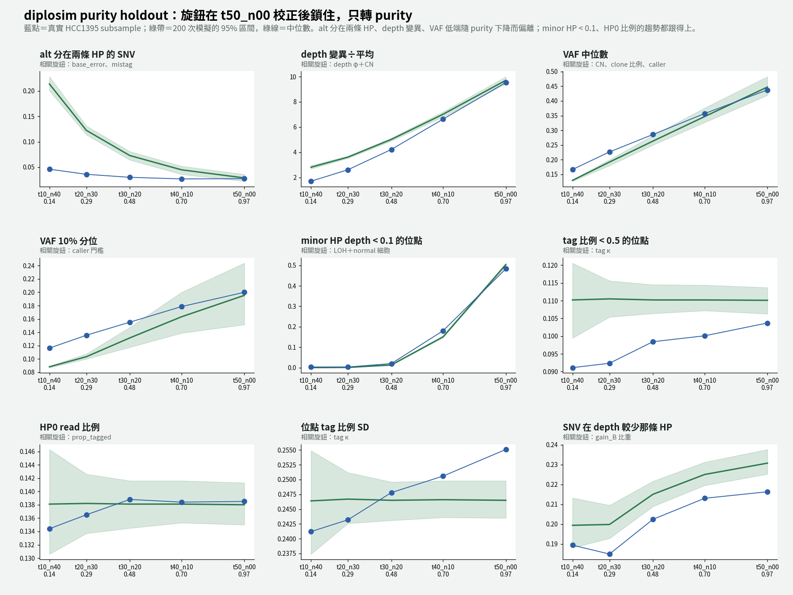

# diplosim purity holdout：HCC1395 其他 purity 的 subsample（2026-10-31）

問題：diplosim 在 `t50_n00` 上校正的旋鈕（10 個參數）全部鎖住，只轉 purity、coverage、SNV 數。它能不能模擬出其他 purity 的真實 HCC1395 bulk 資料？計畫與示意圖：`lab_report/2026-10-31_diplosim_purity_holdout_plan/`。

標記：〔實測〕＝本實驗計算；〔推論〕＝本檔推論；〔程式〕＝讀程式得到。

進度：4 個 subsample 都完成（`t40_n10`、`t30_n20`、`t20_n30`、`t10_n40`）。



## 1. 結論

- **purity 越低，差距越大；只有 `t40_n10` 勉強通過。** 13 項平均相對差距〔實測〕：

  | subsample | purity | 13 項平均 \|rel\| | CN 6 項平均 \|rel\| |
  |---|---:|---:|---:|
  | t50_n00（校正用） | 0.97 | 0.061 | 0.029 |
  | t40_n10 | 0.70 | **0.099** | 0.068 |
  | t30_n20 | 0.48 | 0.206 | 0.177 |
  | t20_n30 | 0.29 | 0.396 | 0.392 |
  | t10_n40 | 0.14 | 0.562 | 0.514 |

- **在各 purity 都成立的機制：** HP0 比例、位點 tag 比例 SD、minor HP < 0.1 的趨勢、SNV 在 depth 較少那條 HP〔實測，見趨勢圖〕。tag 機制（`prop_tagged`、κ）和 LOH 的 CN 結構，不是只湊對 `t50_n00`。
- **隨 purity 下降而偏離的有三組，原因不同：**
  1. **alt 分在兩條 HP**（+0.05 → +3.6）：真實資料在各 purity 都約 0.03–0.05，模擬從 0.03 漲到 0.21〔實測〕。`base_error` 會把另一條 HP 的 ref 讀成 alt；purity 越低，ref 越多、alt 越少，越容易超過 10% 門檻〔程式＋推論〕。**`t50_n00` 上用 `base_error` 0.01 補這一項，是湊出來的。** 真實的成因應該不太受 purity 影響，例如 caller 的假陽性，但這還沒驗證〔推論〕。
  2. **depth 變異÷平均**（+0.02 → +0.65）：purity 越低，CN 之間的差異越小，CN 之內的雜訊越重要。φ 0.03 太大，`t50_n00` 的組內分析本來就指向 φ 約 0.02〔實測＋推論〕。
  3. **VAF 低端偏低**（VAF 10% 分位 −0.02 → −0.24）：**主要是比較方法的問題，不是 diplosim。** 補充檢查：讓 diplosim 模擬完整的 31,595 個 SNV，再用同樣的偵測門檻，`t10_n40` 模擬保留 16,300 個，真實 ClairS 只叫出 7,442 個〔實測，60 seeds〕。模擬的門檻（alt ≥ 3、VAF ≥ 0.08）比 low purity 時的 ClairS 寬鬆很多，所以留下太多低 VAF 的 SNV。現在的做法是只模擬和真實 call 一樣多的 SNV，這會讓模擬的 SNV 集合偏向低 VAF〔推論〕。
- **整體判斷：** diplosim 的 CN 與 tag 機制可以推廣到不同 purity。但 `base_error` 和 φ 的值是在 `t50_n00` 上湊對的；比較流程也缺少「隨 purity 改變的 caller 靈敏度」〔推論〕。

## 2. 做法

```bash
D=lab_report/2026-10-31_diplosim_purity_holdout/t30_n20
# 1. SNV：ClairS PASS ∩ HC 區域 → 26,058 個
bcftools view -H -R .../High-Confidence_Regions_v1.2.bed -f PASS -v snps -m2 -M2 \
  /big8_disk/data/HCC1395/ONT/subsample/t30_n20/ClairS_v0_4_1/output.vcf.gz | awk ... > $D/tables/clairs_hc_sites.tsv
# 2. haplotag（共用 t50_n00 在 normal 上 phase 好的 VCF），約 10 分鐘
longphase-s haplotag -s /big8_disk/boyu114/hcc1395_hp_split/phased_fix.vcf.gz -b .../HCC1395_t30_n20.cram \
  -r GRCh38_no_alt_analysis_set.fasta -t 32 --cram -o /big8_disk/boyu114/hcc1395_hp_split/tagged_t30_n20
# 3. pileup（約 4 分鐘），median depth 50
python3 -I tools/diplosim_ppc_hcc1395.py real $D $D/tables/clairs_hc_sites.tsv /big8_disk/boyu114/hcc1395_hp_split/tagged_t30_n20.cram
# 4. 模擬：旋鈕鎖住，只換 purity、coverage（跳過 22 個重複 CHR/POS 的 seed）
K="--prop-pos-lost 0.45 --loss-events cnloh_B --prop-pos-second-cna 0.5 --gain-events gain_A,gain_B,gain_B,gain_both \
   --prop-truncal-snvs 0.8 --depth-dispersion 0.03 --base-error 0.01 --mistag-rate 0.005 --prop-tagged 0.862 --tag-concentration 1"
python3 -I tools/diplosim_ppc_hcc1395.py sim $D 200 $K --min-tumour-purity 0.4802 --max-tumour-purity 0.4802 --coverage 52
python3 -I tools/diplosim_ppc_hcc1395.py compare $D
```

其餘 3 個 subsample 用 `bash tools/diplosim_purity_holdout_one.sh <名稱> <purity> 52`，流程相同。purity：t40_n10 0.7016、t20_n30 0.2944、t10_n40 0.1362。SNV 數：29,508、19,277、7,452。跳過的 seed：26、10、1。

purity 0.4802 = 2f ÷ (ψ(1 − f) + 2f) × 0.97，f = 30 ÷ 50 = 0.6，ψ = 3.06（ASCAT 5kHz）。haplotag 結果：HP1 3,779,516 條、HP2 3,737,501 條、untagged 9,448,052 條 read〔實測，`/big8_disk/boyu114/hcc1395_hp_split/haplotag_t30_n20.log`〕。

## 3. 結果：t30_n20 逐項（其他 subsample 見 `<名稱>/tables/ppc_stats.tsv`）

| 統計量 | 真實 | 模擬中位 | 相對差距 | t50_n00 的相對差距 |
|---|---:|---:|---:|---:|
| alt 分在兩條 HP | 0.030 | 0.073 | **+1.42** | +0.05 |
| tag 比例 < 0.5 的位點 | 0.098 | 0.110 | +0.12 | +0.06 |
| minor HP depth < 0.1 的位點 | 0.020 | 0.013 | −0.34 | +0.04 |
| VAF > 0.6 的比例 | 0.048 | 0.036 | −0.24 | 0.00 |
| depth 變異÷平均 | 4.23 | 5.03 | +0.19 | +0.02 |
| VAF 10% 分位 | 0.155 | 0.132 | −0.15 | −0.02 |
| VAF 中位數 | 0.286 | 0.263 | −0.08 | +0.02 |
| SNV 在 depth 較少那條 HP | 0.202 | 0.215 | +0.06 | +0.07 |
| HP 內 VAF 中位數 | 0.500 | 0.483 | −0.03 | −0.10 |
| HP0 比例 | 0.139 | 0.138 | −0.01 | 0.00 |
| 位點 tag 比例 SD | 0.248 | 0.247 | −0.01 | −0.03 |
| 13 項平均 \|rel\| | | | **0.206** | 0.061 |
| CN 6 項平均 \|rel\| | | | **0.177** | 0.029 |

minor HP < 0.1 的相對差距很大，但絕對值只差 0.007，因為 normal 細胞讓 LOH 位點也有兩條 HP〔實測＋推論〕。

完整：`t30_n20/tables/ppc_stats.tsv`、`t30_n20/tables/distance_vs_t50.tsv`、`t30_n20/diplosim_ppc_hcc1395.png`。

跨 purity 的完整距離表：`distance_all_purities.tsv`。趨勢圖：`purity_trend.png`（`tools/plot_purity_holdout_trend.py`）。

## 4. 下一步候選（還沒做）

1. **修比較流程：** 模擬完整的 SNV 數（31,595），並讓模擬端的偵測門檻隨 purity 接近 ClairS（例如讓保留的 SNV 數對上真實 call 數）。這會先排除 VAF 低端的假差距。
2. **修被 holdout 抓出來的兩個旋鈕：** `base_error` 和 φ。目標是找一組在 5 個 purity 都成立的值或機制，不是再對 `t50_n00` 調一次。
3. 檢查 purity 換算：比較 ψ = 2.73 與 3.06 的結果。

## 5. 限制

- `t30_n20` 的 tumor reads 可能和 `t50_n00` 來自同一批定序，所以主要測的是「不同 purity」〔推論〕。
- 模擬端的 caller 門檻仍是 alt ≥ 3、VAF ≥ 0.08。模擬保留了 88% 的 SNV（真實是 ClairS 叫出來的 26,058 個，全部保留）〔實測〕。
