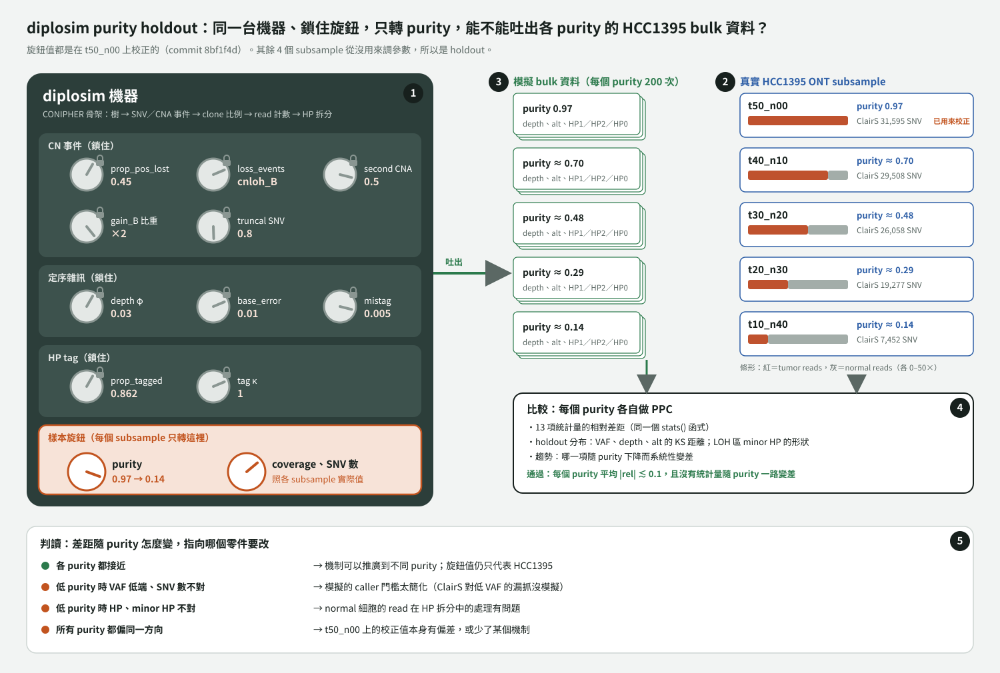

# 計畫：用 HCC1395 其他 purity 的 subsample 做 diplosim holdout 驗證（2026-10-31）

狀態：**計畫，還沒執行。** 執行前要先決定第 5 節的 3 個問題。

標記：〔實測〕＝已量測；〔推論〕＝推論；〔程式〕＝讀程式得到。

## 1. 問題與想法

diplosim 目前的旋鈕值（10 個參數）都是在 `t50_n00` 一個樣本上校正的。這是 calibration，不是 validation（`lab_report/2026-10-31_ppc_distance_score/`、10-31 審視）。

想法：把 diplosim 當成一台機器。**鎖住所有在 `t50_n00` 上調出來的旋鈕，只轉「樣本旋鈕」**（purity、coverage、SNV 數），讓它吐出各 purity 的 bulk 模擬資料，再和同一株細胞、不同 purity 的真實 ONT subsample 比較。其他 4 個 subsample 從沒用來調參數，所以是 holdout。

## 2. 資料

| subsample | tumor／normal reads | purity（換算） | ClairS PASS SNV（HC 區域內） | 現況 |
|---|---|---:|---:|---|
| t50_n00 | 50×／0× | 0.97 | 31,595 | 已 haplotag、已 pileup（校正用） |
| t40_n10 | 40×／10× | ≈ 0.70 | 29,508 | 只有 CRAM 與 ClairS |
| t30_n20 | 30×／20× | ≈ 0.48 | 26,058 | 同上 |
| t20_n30 | 20×／30× | ≈ 0.29 | 19,277 | 同上 |
| t10_n40 | 10×／40× | ≈ 0.14 | 7,452 | 同上 |
| t00_n25 | 0×／25× | 0 | — | 不用（沒有 tumor） |

〔實測〕：CRAM 與 ClairS 結果在 `/big8_disk/data/HCC1395/ONT/subsample/<名稱>/`；SNV 數是 `ClairS_v0_4_1/output.vcf.gz` 的 PASS 雙等位 SNV ∩ `High-Confidence_Regions_v1.2.bed`。

**purity 換算只用 long read 資料**〔推論，公式〕：tumor DNA 比例 f = t ÷ (t + n)。換成細胞比例 p = 2f ÷ (ψ(1 − f) + 2f)，ψ = 3.06（ASCAT 5kHz ploidy），再乘上 `t50_n00` 本身的 purity 0.97（ASCAT）。`2026-10-25_seqc2_hcc1395_measured_purity/` 的實測值用了 SEQC2 short read 真值，依規則不用〔memory：long-read-only validation〕。

## 3. 流程（對應圖中編號）

1. **鎖住機器。** 用 commit `b63cebd` 的 diplosim 與目前最佳設定：
   `--prop-pos-lost 0.45 --loss-events cnloh_B --prop-pos-second-cna 0.5 --gain-events gain_A,gain_B,gain_B,gain_both --prop-truncal-snvs 0.8 --depth-dispersion 0.03 --base-error 0.01 --mistag-rate 0.005 --prop-tagged 0.862 --tag-concentration 1`。
   這些值在整個驗證中不改。
2. **準備真實資料**（每個 subsample 各做一次）。
   - SNV：ClairS PASS ∩ HC 區域（沿用 `t50_n00` 的 `bcftools` 指令）。
   - haplotag：用 `t50_n00` 已經 phase 好的 `phased_fix.vcf.gz`（phase 是在 normal 上做的，各 subsample 共用），對各 CRAM 跑 `longphase-s haplotag`（沿用 `tools/hcc1395_hp_split_prepare.sh` 第 3 步，只換 CRAM）。
   - pileup：`tools/diplosim_ppc_hcc1395.py real`（沿用）→ 每個 SNV 的 HP1／HP2／HP0 ref、alt。
3. **產生模擬資料。** 每個 subsample 跑 200 次 diplosim，只換 `--min/max-tumour-purity`（第 2 節換算值）、`--coverage`（該 subsample 的 median depth）、`--n-snv`（該 subsample 的 SNV 數）。`n_clones` 照舊在 2–8 隨機。
4. **比較。** 每個 purity 各自做：
   - 13 項統計量的相對差距（同一個 `stats()`、同一個 caller 門檻）。
   - holdout 分布：VAF、depth、alt 數的 KS 距離；LOH 區 minor HP 比例的分布形狀（剛好 0、0–0.05、0.1–0.3）。
   - 趨勢：把每一項畫成「purity vs 統計量」，真實是點，模擬是 95% 區間帶。
5. **判讀。** 通過條件：每個 purity 的 13 項平均 |rel| ≲ 0.1，而且沒有統計量隨 purity 一路變差（使用者 10-31 指示：模擬不必極度精確，|rel| < 0.1 就夠好）。不通過時，依圖中第 5 塊對照指向哪個零件。

## 4. 已知風險

- **caller 門檻太簡化**〔推論〕：模擬端只用 alt ≥ 3、VAF ≥ 0.08。purity 越低，ClairS 漏掉的低 VAF SNV 越多（t10_n40 只剩 7,452 個）。這最可能在低 purity 造成差距，但那是 caller 模型的問題，不是 diplosim 生成機制的問題。
- **不是完全獨立的資料**〔推論〕：各 subsample 的 tumor reads 可能來自同一批 ONT 定序（`t50_n00` 的 read 來自 `ONT/HCC1395.cram`）。所以這個 holdout 主要測「不同 purity」，不是測「另一批定序」。
- **purity 換算的誤差**：ψ 用 ASCAT 的 3.06；另外兩份估計是 2.73（Wakhan）、2.85。ψ 改變 0.2，p 約改變 0.01–0.02〔推論，公式〕。
- **HC 區域、germline het SNP 仍來自 SEQC2**（沿用 `t50_n00` 的做法與限制）。
- 估計耗時：haplotag 每個 CRAM 的時間沒有量測過；pileup 約 4 分鐘；模擬加比較每個 purity 約 2 分鐘〔實測，`t50_n00`〕。

## 5. 執行前要你決定

1. **purity 用哪個值？** 建議：第 2 節的 long read 換算值。另一個選項是用 nominal（0.8、0.6、0.4、0.2），比較簡單，但它是 DNA 比例，不是細胞比例。
2. **t10_n40 要不要納入？** 建議納入，但單獨標示。它的 SNV 數最少、受 caller 門檻影響最大，結果主要用來看趨勢。
3. **先做幾個？** 建議先只做 `t30_n20`（中間的 purity），確認流程可行後再做其餘 3 個。

## 6. 產出

- `lab_report/2026-10-31_diplosim_purity_holdout/`（執行後建立）：每個 subsample 的 `ppc_stats.tsv`、距離評分、「purity vs 統計量」趨勢圖、README。
- 腳本：`tools/diplosim_ppc_hcc1395.py` 需要加一個參數，讓 `real` 模式可以指定 CRAM（目前寫死 `tagged_t50_n00.cram`）。
- 示意圖：本目錄 `diplosim_purity_holdout_plan.svg`（`tools/draw_diplosim_purity_holdout_plan.py`）。
