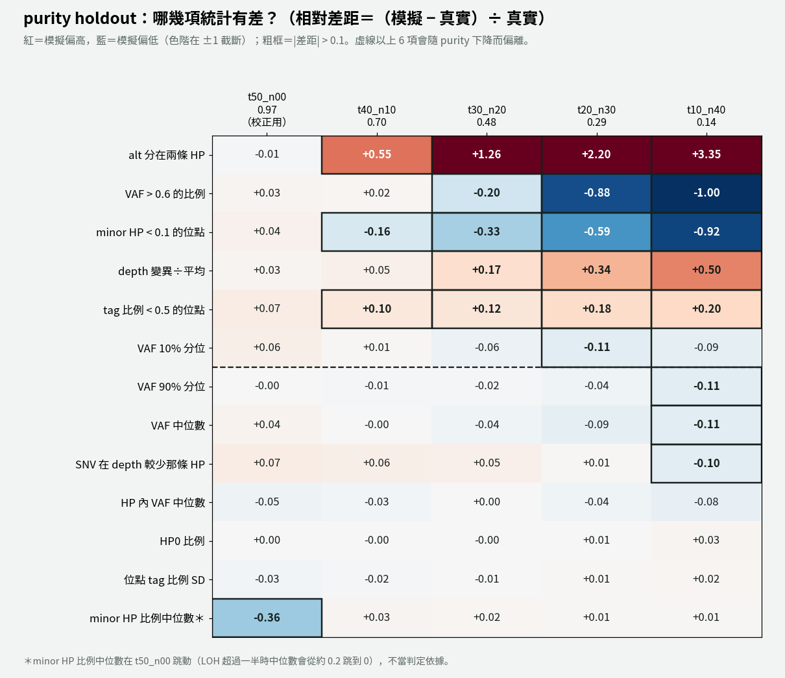
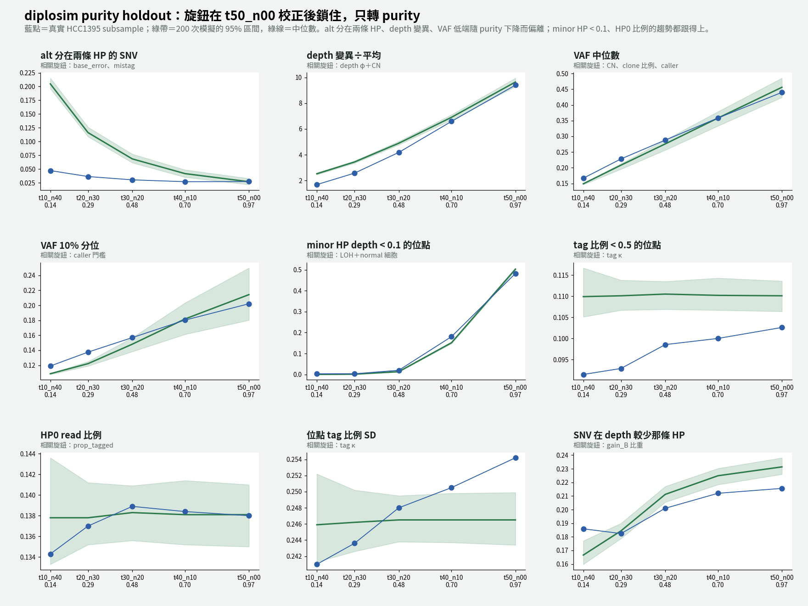

# diplosim purity holdout v2：修正比較流程後重跑 5 個 purity（2026-10-31）

問題：v1（`lab_report/2026-10-31_diplosim_purity_holdout/`）中，低 purity 的 VAF 差距主要來自比較流程，不是 diplosim。修正比較流程後，哪些差距還在？

標記：〔實測〕＝本實驗計算；〔推論〕＝本檔推論；〔程式〕＝讀程式得到。

## 1. 結論

- **VAF 的差距大幅縮小：** VAF 10% 分位在 `t10_n40` 從 −0.24 → −0.09，VAF 中位數 −0.22 → −0.11〔實測〕。v1 的 VAF 偏低，大部分確實是比較流程造成的。
- **13 項平均相對差距：** t40 0.099 → 0.079、t30 0.206 → 0.175、t20 0.396 → 0.348、t10 0.562 → 0.501；`t50_n00` 不變（0.061）〔實測〕。
- **剩下真正的差距只有兩項，都是 diplosim 的旋鈕問題：**
  - **alt 分在兩條 HP：** 真實 0.03–0.05，模擬到 0.20（`t10_n40`）。`base_error` 0.01 是在 `t50_n00` 上湊的〔實測＋推論〕。
  - **depth 變異÷平均：** `t10_n40` +0.50。φ 0.03 太大〔實測＋推論〕。
- **兩項看起來很大，但絕對值很小：** 低 purity 時真實值接近 0，相對差距會被放大〔實測〕。
  - VAF > 0.6：`t10_n40` 真實 0.0015、模擬 0；`t20_n30` 0.0048 對 0.0006。
  - minor HP < 0.1：`t10_n40` 真實 0.0032、模擬 0.0003。
- **tag 比例 < 0.5 的位點：** 隨 purity 下降，從 +0.07 漲到 +0.20，屬於輕微偏離〔實測〕。
- **門檻在低 purity 仍然偏鬆：** `t10_n40` 模擬留下約 12,000 個 SNV，真實 7,260 個；`t20_n30` 22,300 對 19,100。高 purity 時兩邊接近〔實測〕。ClairS 不是硬門檻，靠近門檻的 SNV 只有一部分會被叫出來〔推論〕。

## 2. 改了什麼

1. **偵測門檻固定為 alt ≥ 5、VAF ≥ 0.10，兩邊都套用。** 依據：真實 ClairS call 的 1% 分位，在各 purity 都差不多〔實測〕：

   | subsample | ClairS call 數 | alt 1% 分位 | AF 1% 分位 |
   |---|---:|---:|---:|
   | t50_n00 | 31,595 | 5 | 0.124 |
   | t40_n10 | 29,508 | 5 | 0.118 |
   | t30_n20 | 26,058 | 5 | 0.111 |
   | t20_n30 | 19,277 | 5 | 0.104 |
   | t10_n40 | 7,452 | 4 | 0.098 |

   v1 的 alt ≥ 3、VAF ≥ 0.08，是 `t50_n00` 上極少數極端值的最小值。
2. **每個 purity 都模擬完整的 31,595 個 SNV**，讓門檻決定留下哪些，不再照真實 call 數模擬。
3. diplosim 旋鈕不變（同 v1），只換 purity 與 coverage。

## 3. 做法

```bash
# 真實 pileup 沿用 v1（t40/t30/t20/t10）與 10-30（t50）
bash tools/diplosim_purity_holdout_v2.sh t50_n00 0.97   53 lab_report/2026-10-31_diplosim_ppc_hcc1395_lost045
bash tools/diplosim_purity_holdout_v2.sh t40_n10 0.7016 52 lab_report/2026-10-31_diplosim_purity_holdout/t40_n10
# t30_n20 0.4802、t20_n30 0.2944、t10_n40 0.1362 同上
```

門檻由環境變數 `DIPLOSIM_PPC_MIN_ALT=5`、`DIPLOSIM_PPC_MIN_VAF=0.10` 傳給 `tools/diplosim_ppc_hcc1395.py`（不設時仍是 3、0.08，舊結果可重現）。跳過的 seed：32–38 個。

## 4. 結果





| 統計量（相對差距） | t50 | t40 | t30 | t20 | t10 |
|---|---:|---:|---:|---:|---:|
| alt 分在兩條 HP | −0.01 | +0.55 | +1.26 | +2.20 | +3.35 |
| depth 變異÷平均 | +0.03 | +0.05 | +0.17 | +0.34 | +0.50 |
| tag 比例 < 0.5 | +0.07 | +0.10 | +0.12 | +0.18 | +0.20 |
| VAF 10% 分位 | +0.06 | +0.01 | −0.06 | −0.11 | −0.09 |
| VAF 中位數 | +0.04 | 0.00 | −0.04 | −0.09 | −0.11 |
| 13 項平均 \|rel\|（v2） | 0.061 | 0.079 | 0.175 | 0.348 | 0.501 |
| 13 項平均 \|rel\|（v1） | 0.061 | 0.099 | 0.206 | 0.396 | 0.562 |

完整：`distance_all_purities.tsv`、各 subsample `tables/ppc_stats.tsv`。

## 5. 下一步候選

1. 修 `base_error`：真實的「alt 分在兩條 HP」幾乎不隨 purity 改變，要找一個不隨 purity 放大的機制。
2. 修 φ：找一個在 5 個 purity 都成立的值（`t50_n00` 組內分析指向約 0.02）。
3. 門檻改成機率式（靠近門檻的 SNV 只部分被叫出），讓低 purity 的 call 數也對上。
4. 評分改用絕對差距或加下限，避免真實值接近 0 的統計量被放大。

## 6. 限制

- 門檻 alt ≥ 5、VAF ≥ 0.10 是從 HCC1395 的 ClairS 結果讀出來的。
- 31,595 是 `t50_n00` 的 ClairS call 數，不是 HCC1395 的真實 SNV 總數（ClairS recall 約 0.74）〔實測，10-30 報告〕。
