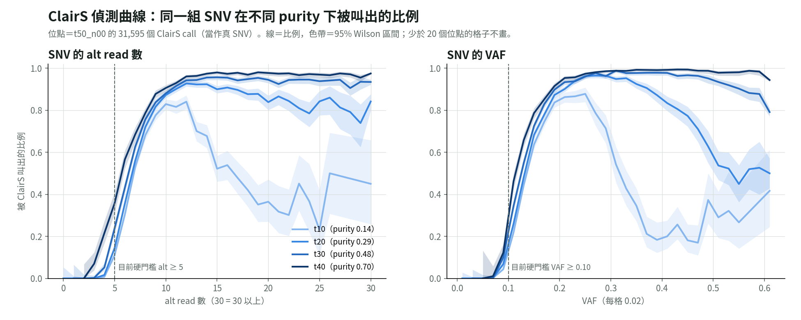

# ClairS 偵測曲線：同一組 SNV 在 4 個 purity 下被叫出的比例（2026-11-01）

問題：ClairS 叫出一個 SNV 的機率，是不是只看 alt read 數（或 VAF），和 purity 無關？如果無關，就可以用一條曲線取代 diplosim 比較流程裡的硬門檻（alt ≥ 5、VAF ≥ 0.10），而且不必擔心對 HCC1395 過擬合。

標記：〔實測〕＝本實驗計算；〔推論〕＝本檔推論；〔程式〕＝讀程式得到。

狀態：只量了曲線，還沒有接進模擬。



## 1. 結論

- **曲線和 purity 有關，一條共用曲線不夠。** 有兩個不同的效果〔實測〕：
  1. **上升段大致重疊，但 purity 越低越往右移，約 1 條 alt read。** alt = 5 時，被叫出的比例在 t10／t20／t30／t40 分別是 0.11／0.15／0.24／0.36；alt = 6 時是 0.31／0.36／0.43／0.57；alt ≥ 9 時都在 0.78–0.88 以上。
  2. **低 purity 時，高 VAF 的 SNV 反而叫不出來。** t10 從 VAF 約 0.26 開始下降，t20 約 0.35，t30 約 0.5，t40 到 0.6 仍幾乎不降。t10 中 VAF ≥ 0.26 的 1,725 個位點，只叫出 685 個（PASS），70 個是 LowQual，**970 個根本沒出現在 ClairS 的 VCF**。
- **留一驗證（用另外 3 個 purity 的曲線，預測第 4 個的 call 數）**〔實測〕：

  | | t10 | t20 | t30 | t40 |
  |---|---:|---:|---:|---:|
  | 真實 call 數（在 t50 位點內） | 7,436 | 19,234 | 25,940 | 29,264 |
  | 留一預測（依 alt 數） | 9,467（+27%） | 19,914（+4%） | 25,024（−4%） | 26,958（−8%） |
  | 只看 VAF < 0.25 的位點：真實 | 6,585 | 11,103 | 10,161 | 7,566 |
  | 只看 VAF < 0.25 的位點：留一預測 | 7,580（+15%） | 11,223（+1%） | 9,779（−4%） | 7,135（−6%） |

  中間的 purity（t20、t30）誤差在 ±4% 內；兩端誤差較大，t10 主要來自高 VAF 位點的掉落。
- **高 VAF 掉落的原因還不知道**〔推論〕。970 個位點根本沒進 ClairS 的候選，表示是在候選篩選階段就被排除，不是模型打分數太低。可能和 ClairS 怎麼處理「VAF 高到不像該 purity 的 somatic」有關，例如被當成 germline。這要讀 ClairS 的程式才能確認，目前沒讀。
- **這些位點在 t10 為什麼 VAF 能到 0.26 以上，也還沒查。** purity 0.14 時，要所有拷貝都帶突變、CN 約 4 以上，VAF 才到得了 0.26〔推論，公式〕。也可能是 t50 call 集合中的假陽性（例如 reference 重複區）。

## 2. 資料與做法

- 位點：`t50_n00` 的 31,595 個 ClairS PASS ∩ HC SNV，當作真 SNV。低 purity 的 call 有 99% 以上落在這組位點內（t40 29,264／29,508、t30 25,940／26,058、t20 19,234／19,277、t10 7,436／7,452）〔實測〕。
- 每個 subsample：在它的 haplotag CRAM 上 pileup 這 31,595 個位點（每個約 3 分鐘）。「叫出」＝該位點在該 subsample 自己的 ClairS PASS ∩ HC 集合裡。

```bash
D=lab_report/2026-11-01_clairs_detection_curve
for p in t40_n10 t30_n20 t20_n30 t10_n40; do
  python3 -I tools/diplosim_ppc_hcc1395.py real $D/$p lab_report/2026-10-30_diplosim_ppc_hcc1395/tables/clairs_hc_sites.tsv \
    /big8_disk/boyu114/hcc1395_hp_split/tagged_$p.cram
done
python3 tools/plot_clairs_detection_curve.py $D lab_report/2026-10-31_diplosim_purity_holdout
```

輸出：`detection_by_alt.tsv`、`detection_by_vaf.tsv`（每格的位點數、叫出數、比例）、`detection_curve.png`。

## 3. 限制

- t50 的 call 集合不是真值：ClairS recall 約 0.74，漏掉的多半是低 VAF 的 subclonal SNV；也含少數假陽性。
- 曲線只代表 ClairS v0.4.1 在 ONT HCC1395 上的表現。
- 這裡的 alt 數是我們自己的 pileup（MAPQ ≥ 20、BQ ≥ 7），不是 ClairS 內部看到的數字。
