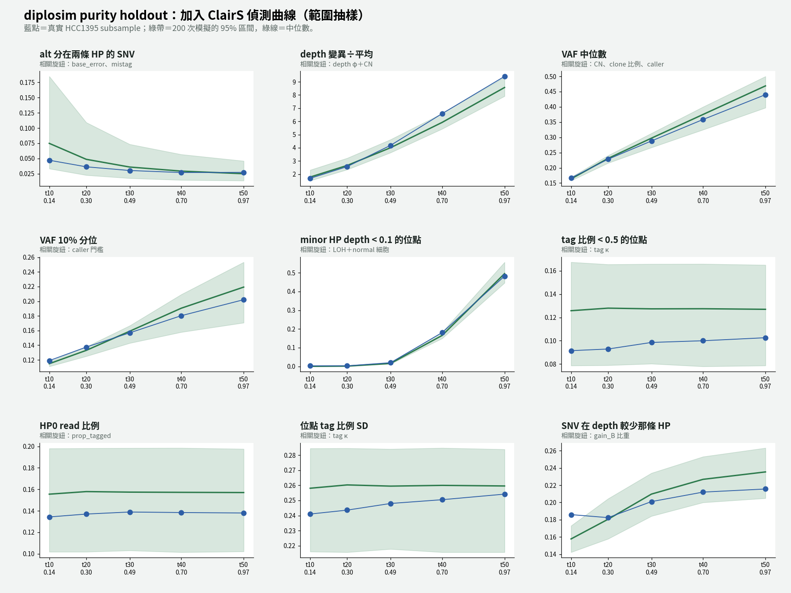
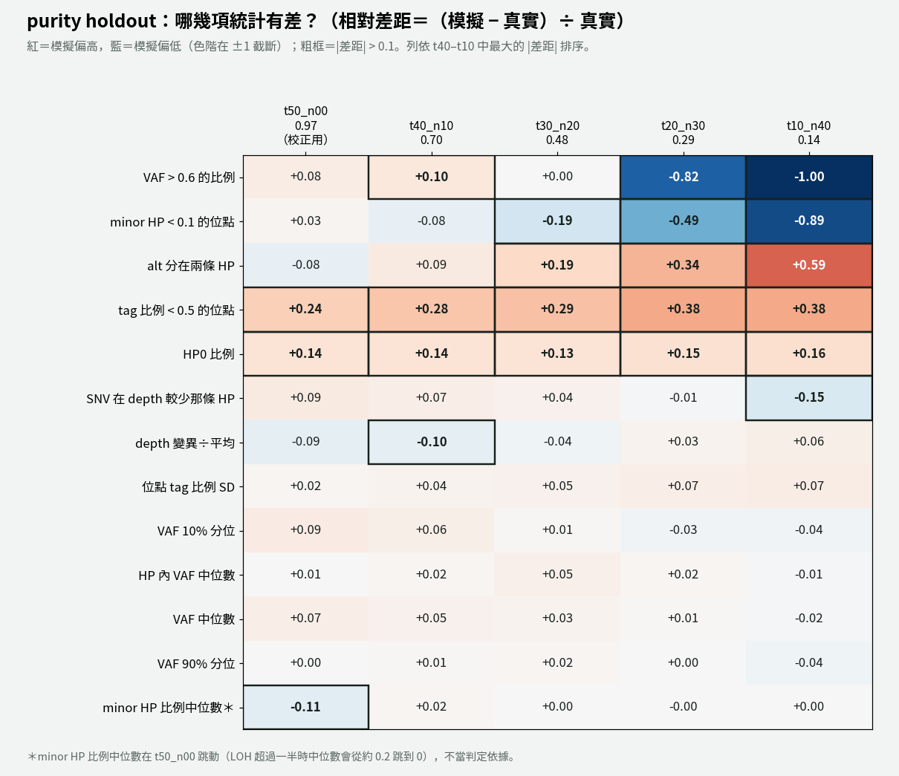

# diplosim：用 ClairS 偵測曲線取代「全部叫出」，重跑 5 個 purity（2026-11-01）

問題：模擬端加上 ClairS 的偵測曲線（alt read 少時只有一部分 SNV 被叫出）後，5 個 purity 的通過數改善多少？

標記：〔實測〕＝本實驗計算；〔推論〕＝本檔推論；〔程式〕＝讀程式得到。

對照組：`lab_report/2026-11-01_diplosim_purity_normal_share/`（其他設定完全相同，只是沒有偵測曲線）。



## 1. 結論

- **低 purity 明顯改善**〔實測〕：

  | | t50 | t40 | t30 | t20 | t10 |
  |---|---:|---:|---:|---:|---:|
  | 對照（沒有偵測曲線） | 12 | 13 | 11 | 7 | 6 |
  | **加偵測曲線** | 12 | 13 | **12** | **11** | **8** |
  | 13 項平均 \|rel\|（對照） | 0.072 | 0.079 | 0.108 | 0.220 | 0.290 |
  | 13 項平均 \|rel\|（加曲線） | 0.080 | 0.081 | 0.081 | 0.182 | 0.262 |

- **VAF 類統計量大致對上**〔實測〕：t10 的 VAF 中位數相對差距 −0.111 → −0.018，HP 內 VAF 中位數 −0.091 → −0.012；t20 的 VAF 10%／50%／90% 分位都進入區間。t10 的 VAF 10% 和 90% 分位仍略在區間外（−0.036、−0.045）。
- **剩下的失敗**〔實測＋推論〕：
  1. 真實值接近 0 的統計量：VAF > 0.6（t10 真實 0.0015、t20 0.0048）和 minor HP < 0.1（t10 真實 0.0032）。相對差距被放大，絕對值差不到 0.005。
  2. t10 的「SNV 在 depth 較少那條 HP」（−0.15）。
  3. split alt 仍隨 purity 下降而偏高（t10 +0.59，對照 +0.74）。
- **副作用：高 purity 的 call 數變成偏少**〔實測〕：t50 中位數 25,460（真實 31,350）、t40 24,010（真實 29,380）、t30 21,040（真實 25,930），都在區間外。t10、t20 在區間內。
  - 原因〔推論〕：偵測曲線是用「t50 的 call」當真 SNV 量的，t50 自己的 call 在定義上全部被叫出；套到 t50 上等於重複扣一次。另外模擬的 31,595 個 SNV 是「t50 叫出的數量」，不是真實的 SNV 總數（ClairS recall 約 0.74），所以高 purity 的 call 數本來就不是乾淨的驗證項目。

## 2. 改了什麼

1. **量偵測曲線**：`tools/diplosim_estimate_knobs.py detect` 只用 ClairS normal 規則不會刪掉的位點，量每個 subsample 的 P(叫出 | alt read 數)，輸出 `tools/clairs_detection_curve_hcc1395.tsv`。排除 normal 規則後，t10 在高 alt 數的掉落消失，4 條曲線在 alt ≥ 12 都約 0.95–0.99，只在 alt 5–9 不同〔實測〕：

   | alt | 4 | 5 | 6 | 7 | 8 | 9 | 10 |
   |---|---:|---:|---:|---:|---:|---:|---:|
   | t40 | 0.22 | 0.36 | 0.57 | 0.68 | 0.79 | 0.88 | 0.92 |
   | t30 | 0.05 | 0.24 | 0.44 | 0.63 | 0.76 | 0.84 | 0.89 |
   | t20 | 0.02 | 0.15 | 0.36 | 0.57 | 0.73 | 0.83 | 0.89 |
   | t10 | 0.01 | 0.11 | 0.31 | 0.54 | 0.71 | 0.80 | 0.88 |

2. **接進模擬**：範圍表新增 `detection_curve_position` u（0–1，只給腳本用）。每個 seed 的曲線是 (1 − u) × t10 曲線 + u × t40 曲線；先套 normal 規則，剩下的 SNV 依曲線機率決定留不留，最後兩邊再套同樣的硬門檻（alt ≥ 5、VAF ≥ 0.10）。被刪的 SNV 保留列、alt 設 0。
3. 其他設定同對照組（purity 加入 c、配對 normal、6 個旋鈕範圍抽樣）。

## 3. 做法

```bash
python3 -I tools/diplosim_estimate_knobs.py detect lab_report/2026-11-01_diplosim_phi_from_normal/tables/real_per_snv.tsv \
  lab_report/2026-11-01_clairs_detection_curve lab_report/2026-10-31_diplosim_purity_holdout tools/clairs_detection_curve_hcc1395.tsv
export OUT_ROOT=lab_report/2026-11-01_diplosim_detection_curve DIPLOSIM_PPC_RANGES=tools/diplosim_knob_ranges_hcc1395.tsv
export KNOBS="（同 2026-11-01_diplosim_matched_normal）"
bash tools/diplosim_purity_holdout_v2.sh t50_n00 0.97 53 lab_report/2026-10-30_diplosim_ppc_hcc1395
bash tools/diplosim_purity_holdout_v2.sh t40_n10 0.7045:0.7055 52 lab_report/2026-10-31_diplosim_purity_holdout/t40_n10
# t30_n20 0.4851:0.4867、t20_n30 0.3006:0.3026、t10_n40 0.1433:0.1456 同上
```

## 4. 結果

各 purity 落在區間外的統計量（含 13 項以外的 `n_called`、`frac_called`、`depth_median`、`inHP_VAF_q90`）〔實測〕：

- t50：n_called、frac_called、depth_median、depth_VMR
- t40：n_called、frac_called、depth_median
- t30：n_called、frac_called、minorHP_depth_lt_0.1
- t20：frac_called、depth_median、VAF_frac_gt_0.6、minorHP_depth_lt_0.1
- t10：frac_called、depth_median、VAF_q10、VAF_q90、VAF_frac_gt_0.6、inHP_VAF_q90、minorHP_depth_lt_0.1、alt_on_minorHP



完整：`distance_all_purities.tsv`、各 purity 的 `tables/ppc_stats.tsv`、`tables/sim_knobs.tsv`。

## 5. 限制

- 偵測曲線用的是 4 個 holdout subsample 自己的 ClairS 結果。每個 seed 從兩端曲線之間抽，沒有對單一 purity 擬合，但 t10、t40 的曲線就是從那兩個樣本量的，所以這兩個 purity 的 call 數不算獨立驗證。
- 曲線只依 alt 數，不依 depth 或 HP。
- 偵測曲線、normal 規則、purity 的 c 都只來自 ClairS v0.4.1 + HCC1395 ONT，不當 diplosim 預設值。
