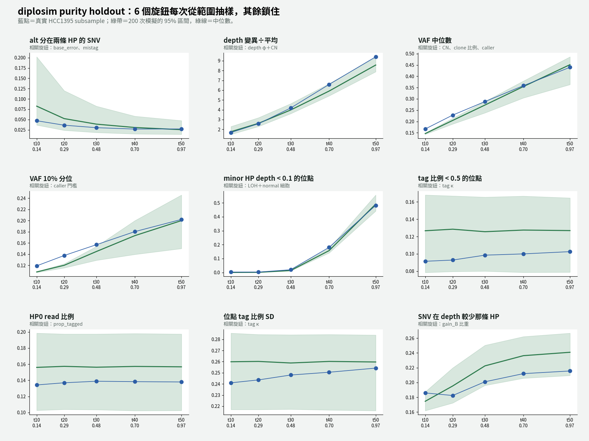
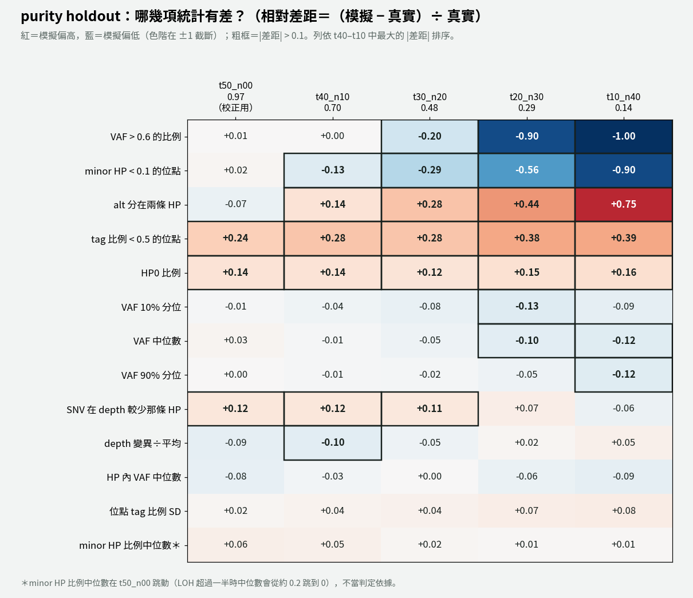

# diplosim：旋鈕從範圍抽樣，不再用單一值（2026-11-01）

問題：如果 6 個旋鈕不再用單一值，每次模擬改從一個範圍抽樣，5 個 purity 的真實統計量有多少能落在模擬的 95% 區間內？通過標準由使用者 11-01 決定：真實值大致落在模擬區間內即可，不追求單一最佳值。

標記：〔實測〕＝本實驗計算；〔推論〕＝本檔推論；〔程式〕＝讀程式得到。

對照組：`lab_report/2026-11-01_diplosim_split_alt_mistag/`（同一組設定，但所有旋鈕都是單一值）。



## 1. 結論

- **落在區間內的統計量變多**（13 項中）〔實測〕：

  | | t50 | t40 | t30 | t20 | t10 |
  |---|---:|---:|---:|---:|---:|
  | 單一值（對照） | 7 | 6 | 3 | 2 | 2 |
  | **範圍抽樣** | **12** | **12** | **10** | 7 | 6 |

- **代價：模擬中位數離真實值稍遠。** 13 項平均 |rel|：對照 0.050／0.050／0.090／0.198／0.251，範圍抽樣 0.067／0.083／0.118／0.227／0.294〔實測〕。區間變寬了，但中心偏移。
  - 偏移主要來自 `prop_tagged`：範圍 0.80–0.90 的中點是 0.85，低於真實的 0.862。所以 HP0 比例 +0.14、tag 比例 < 0.5 +0.24 到 +0.39，但這兩項在各 purity 都仍在區間內〔實測〕。
- **depth VMR 在 t10–t30 都在區間內**（φ 範圍來自 normal 樣本的量測）。t50、t40 剛好在區間外：t50 真實 9.41，模擬上界 9.36〔實測〕。
- **低 purity 剩下的失敗集中在兩類，都不是這 6 個旋鈕造成的**〔實測＋推論〕：
  1. **VAF 類**（VAF 10%／50%／90% 分位、HP 內 VAF）和 call 數：t10 模擬區間很窄，而且整體偏低；模擬留下 8,470–12,940 個 SNV，真實只有 7,260 個。這是 v2 就知道的 caller 門檻問題：模擬的硬門檻比 ClairS 寬鬆，留下太多低 VAF 的 SNV。
  2. **真實值接近 0 的統計量**（VAF > 0.6、minor HP < 0.1）：t10 真實 0.0015 和 0.0032，模擬幾乎全是 0。
- **每個旋鈕影響哪些統計量，現在可以直接量出來**（200 個 seed 的 Spearman 相關，`*/tables/knob_stat_spearman.tsv`）〔實測〕：

  | 統計量 | t50 主要的旋鈕 | t10 主要的旋鈕 |
  |---|---|---|
  | depth VMR | φ（+0.74）、`prop_pos_lost`（−0.40） | φ（+0.99） |
  | alt 分在兩條 HP | `mistag_rate`（+0.69）、`base_error`（+0.63） | `base_error`（+0.98） |
  | HP0 比例、tag 比例 < 0.5 | `prop_tagged`（−1.00） | `prop_tagged`（−1.00） |
  | minor HP < 0.1、SNV 在 depth 較少那條 HP | `prop_pos_lost`（+0.98、−0.96） | 後者：`prop_pos_lost`（−0.76）；前者：`prop_tagged`（−0.40） |
  | VAF 中位數、call 數 | `prop_truncal_snvs`（+0.57、+0.56） | `prop_truncal_snvs`（call 數 +0.93） |

  這也支持「φ 在高 purity 時被 CN 蓋過」的說法：VMR 和 φ 的相關在 t50 是 0.74，在 t10 是 0.99。

## 2. 改了什麼

1. **範圍表** `tools/diplosim_knob_ranges_hcc1395.tsv`（使用者 11-01 確認）：

   | 旋鈕 | 範圍 | 抽樣方式 | 依據 |
   |---|---|---|---|
   | `--depth-dispersion` | 0.006–0.025 | log-uniform | normal 樣本量測（`2026-11-01_diplosim_phi_from_normal/`） |
   | `--base-error` | 0.001–0.01 | log-uniform | 之前試過的範圍 |
   | `--mistag-rate` | 0.005–0.015 | log-uniform | 11-01 掃描 |
   | `--prop-tagged` | 0.80–0.90 | uniform | t50 真實約 0.86 |
   | `--prop-pos-lost` | 0.40–0.50 | uniform | 10-31 掃描 |
   | `--prop-truncal-snvs` | 0.6–0.9 | uniform | 10-31 掃描 |

   範圍跨 3 倍以上的用 log-uniform，避免大部分抽樣落在範圍上端。
2. **`tools/diplosim_ppc_hcc1395.py`**：設定 `DIPLOSIM_PPC_RANGES=<範圍表>` 後，每個 seed 用自己的亂數流抽一組值，取代 `KNOBS` 裡的固定值。`n_clones` 的抽法不變。抽到的值存在 `*/tables/sim_knobs.tsv`。不設時行為和之前相同。
3. diplosim 本身沒改。其他旋鈕（`gain_events`、`prop_pos_second_cna`、`mistag_concentration`、tag κ 等）照對照組的固定值。
4. `tools/plot_purity_holdout_trend.py` 可以用 `TREND_TITLE` 改標題。

## 3. 做法

```bash
export OUT_ROOT=lab_report/2026-11-01_diplosim_knob_ranges DIPLOSIM_PPC_RANGES=tools/diplosim_knob_ranges_hcc1395.tsv
export KNOBS="--prop-pos-lost 0.45 --loss-events cnloh_B --prop-pos-second-cna 0.5 --gain-events gain_A,gain_B,gain_B,gain_both --prop-truncal-snvs 0.8 --depth-dispersion 0.03 --base-error 0.001 --mistag-rate 0.01 --mistag-concentration 1 --prop-tagged 0.862 --tag-concentration 1"
bash tools/diplosim_purity_holdout_v2.sh t50_n00 0.97   53 lab_report/2026-10-30_diplosim_ppc_hcc1395
bash tools/diplosim_purity_holdout_v2.sh t40_n10 0.7016 52 lab_report/2026-10-31_diplosim_purity_holdout/t40_n10
# t30_n20 0.4802、t20_n30 0.2944、t10_n40 0.1362 同上
python3 -I tools/ppc_distance_score.py t50=$OUT_ROOT/t50_n00 ... > $OUT_ROOT/distance_all_purities.tsv
```

`KNOBS` 中被範圍取代的 6 個值不會用到。每個 purity 200 個 seed，跳過 38–58 個重複 CHR/POS 的 seed。總耗時約 15 分鐘。

## 4. 結果

各 purity 落在區間外的統計量（`*/tables/ppc_stats.tsv`，另含 13 項以外的 `n_called`、`frac_called`、`depth_median`、`inHP_VAF_q90`）〔實測〕：

- t50：depth_median、depth_VMR
- t40：frac_called、depth_median、inHP_VAF_q90、minorHP_depth_lt_0.1
- t30：frac_called、VAF_q10、VAF_frac_gt_0.6、inHP_VAF_q90、minorHP_depth_lt_0.1
- t20：frac_called、VAF_q10／q50／q90、VAF_frac_gt_0.6、inHP_VAF_q50／q90、minorHP_depth_lt_0.1
- t10：n_called、frac_called、VAF_q10／q50／q90、VAF_frac_gt_0.6、inHP_VAF_q50／q90、minorHP_depth_q50、minorHP_depth_lt_0.1



完整：`distance_all_purities.tsv`。

## 5. 下一步候選（還沒做）

1. 處理 caller 門檻：改成機率式門檻，讓低 purity 的 call 數和 VAF 分布對上。這是目前低 purity 剩下的主要失敗。
2. 評分加絕對差距或下限，處理真實值接近 0 的統計量。
3. 範圍穩定後，把範圍抽樣搬進 diplosim（方案 3b），讓產生 benchmark 時可以直接使用。

## 6. 限制

- 範圍仍然來自 HCC1395 這一株細胞，主要是「之前試過、結果還可以」的區間；只有 φ 來自獨立量測。
- 6 個旋鈕各自獨立抽樣，沒有考慮旋鈕之間的相關。
- 範圍變寬後，「在區間內」比較容易達成。這個標準比單一值寬鬆，報告時要一併說明區間寬度。
