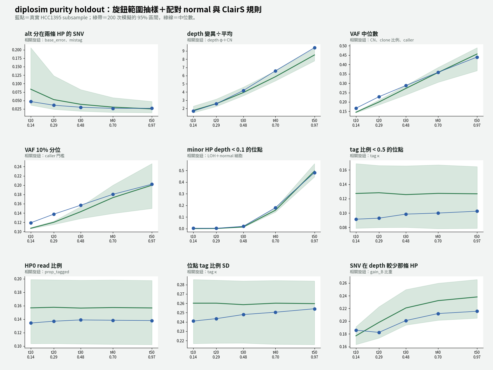
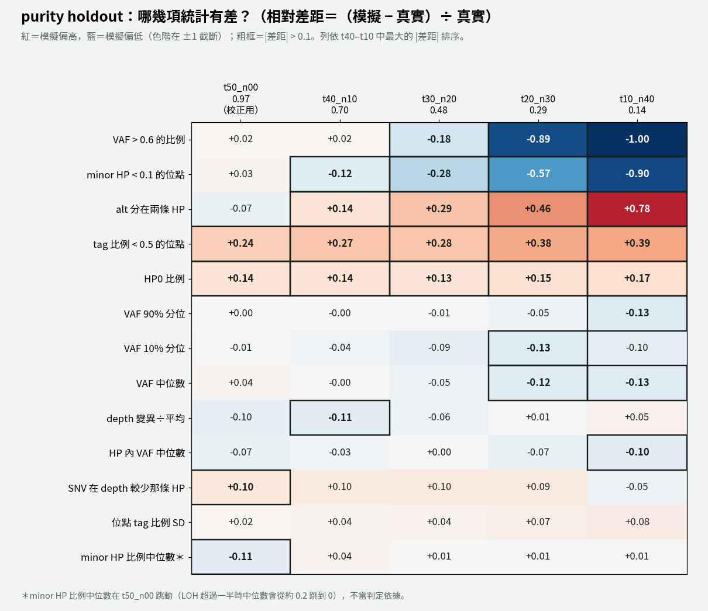

# diplosim：加上配對 normal 與 ClairS 的 normal-AF 規則，重跑 5 個 purity（2026-11-01）

問題：模擬端加上配對的 normal 樣本，並套用 ClairS 的 normal-AF 規則後，5 個 purity 的通過數改善多少？

標記：〔實測〕＝本實驗計算；〔推論〕＝本檔推論；〔程式〕＝讀程式得到。

對照組：`lab_report/2026-11-01_diplosim_knob_ranges/`（6 個旋鈕範圍抽樣，沒有 normal 和 ClairS 規則）。



## 1. 結論

- **13 項統計量的通過數幾乎沒變**〔實測〕：

  | | t50 | t40 | t30 | t20 | t10 |
  |---|---:|---:|---:|---:|---:|
  | 對照（只有範圍抽樣） | 12 | 12 | 10 | 7 | 6 |
  | **加配對 normal** | **12** | **11** | **10** | **7** | **6** |
  | 13 項平均 \|rel\|（對照） | 0.067 | 0.083 | 0.118 | 0.227 | 0.294 |
  | 13 項平均 \|rel\|（加 normal） | 0.072 | 0.081 | 0.117 | 0.231 | 0.299 |

  t40 少的一項是 depth VMR，真實值剛好落在區間邊緣，屬於抽樣波動〔推論〕。
- **真正改善的只有 call 數**（不在 13 項內）〔實測〕：

  | | t50 | t40 | t30 | t20 | t10 |
  |---|---:|---:|---:|---:|---:|
  | 真實 | 31,350 | 29,380 | 25,930 | 19,080 | 7,260 |
  | 對照（中位） | 27,740 | 26,900 | 25,460 | 21,200 | 10,850（區間外） |
  | 加 normal（中位） | 27,030（區間外） | 25,930 | 23,950 | 19,410 | **9,572（區間內）** |

  t10 從區間外變成區間內，中位數從 +49% 變成 +32%。t20 的中位數幾乎對上。代價是 t50 的模擬區間上界（31,080）略低於真實值，變成區間外。
- **低 purity 的 VAF 分位數完全沒改善。** t10 的 VAF 90% 分位：真實 0.256，對照 0.225，加 normal 0.222〔實測〕。ClairS 規則刪掉的主要是高 VAF 的 SNV，所以模擬的 VAF 只會更低，不會更高。這項差距的主因是另一個問題：模擬中 VAF 高的 SNV 太少（t10 VAF ≥ 0.35：真實 1,006 個，模擬每個 seed 約 26 個，見 `2026-11-01_clairs_detection_curve` 第 5 節前的試跑）。
- **判斷**〔推論〕：配對 normal 和 ClairS 規則是對的機制，讓低 purity 的 call 數往正確方向移動；但它不影響 13 項統計量。再細修低 VAF 端（`2026-11-01_clairs_detection_curve` 第 5 節：真實 normal alt 集中在少數位點），預期也不會改變通過數，只會讓 call 數更準。

## 2. 改了什麼

沿用 `tools/diplosim_ppc_hcc1395.py` 的配對 normal（commit `4b6a645`、`792051d`、`0a524fe`）：

- 每個 seed 用同一棵樹、同一組 clone，以 purity = c 產生一份 25.1× 的 normal 樣本（`normal.tsv`）。
- c 從 0.5–2.5% 抽樣；normal 自己的 base error 從 0–0.001 抽樣（`tools/diplosim_knob_ranges_hcc1395.tsv`）。
- 模擬端套用 ClairS v0.4.1 的規則：normal depth > 4、normal AF ≥ 0.05、而且 tumor AF < 6 × normal AF，就刪掉〔程式，ClairS `src/extract_pair_candidates.py:439-450`〕。真實端已經跑過 ClairS，不重複套用。
- 其他設定和對照組相同。

## 3. 做法

```bash
export OUT_ROOT=lab_report/2026-11-01_diplosim_matched_normal DIPLOSIM_PPC_RANGES=tools/diplosim_knob_ranges_hcc1395.tsv
export KNOBS="--prop-pos-lost 0.45 --loss-events cnloh_B --prop-pos-second-cna 0.5 --gain-events gain_A,gain_B,gain_B,gain_both --prop-truncal-snvs 0.8 --depth-dispersion 0.03 --base-error 0.001 --mistag-rate 0.01 --mistag-concentration 1 --prop-tagged 0.862 --tag-concentration 1"
bash tools/diplosim_purity_holdout_v2.sh t50_n00 0.97   53 lab_report/2026-10-30_diplosim_ppc_hcc1395
bash tools/diplosim_purity_holdout_v2.sh t40_n10 0.7016 52 lab_report/2026-10-31_diplosim_purity_holdout/t40_n10
# t30_n20 0.4802、t20_n30 0.2944、t10_n40 0.1362 同上
python3 -I tools/ppc_distance_score.py t50=$OUT_ROOT/t50_n00 ... > $OUT_ROOT/distance_all_purities.tsv
```

每個 purity 200 個 seed，跳過 38–58 個重複 CHR/POS 的 seed。

## 4. 結果

各 purity 落在區間外的統計量（含 13 項以外的 `n_called`、`frac_called`、`depth_median`、`inHP_VAF_q90`）〔實測〕：

- t50：n_called、frac_called、depth_median、depth_VMR
- t40：frac_called、depth_median、depth_VMR、inHP_VAF_q90、minorHP_depth_lt_0.1
- t30：frac_called、VAF_q10、VAF_frac_gt_0.6、inHP_VAF_q90、minorHP_depth_lt_0.1
- t20：frac_called、VAF_q10／q50／q90、VAF_frac_gt_0.6、inHP_VAF_q50／q90、minorHP_depth_lt_0.1
- t10：frac_called、VAF_q10／q50／q90、VAF_frac_gt_0.6、inHP_VAF_q50／q90、minorHP_depth_q50、minorHP_depth_lt_0.1



完整：`distance_all_purities.tsv`、各 purity 的 `tables/ppc_stats.tsv`、`tables/sim_knobs.tsv`。

## 5. 下一步候選（還沒做）

1. 查低 purity 的 VAF 偏低：模擬中高 VAF 的 SNV 太少，可能是高 CN、LOH 後所有拷貝都突變的區段不夠。這是低 purity 目前最大的失敗來源。
2. 評分加絕對差距或下限，處理真實值接近 0 的統計量（VAF > 0.6、minor HP < 0.1）。
3. 細修 normal 的低 VAF 端（alt 集中在少數位點）。預期只影響 call 數，優先度低。

## 6. 限制

- c 和 normal base error 的範圍來自 HCC1395 的 normal（t00_n25）一個樣本。
- 均勻的 c 模型和真實 normal 的 alt 分布形狀不符（`2026-11-01_clairs_detection_curve` 第 5 節）。
- 偵測曲線（alt 少時叫不出來）還沒接進模擬；硬門檻仍是 alt ≥ 5、VAF ≥ 0.10。
