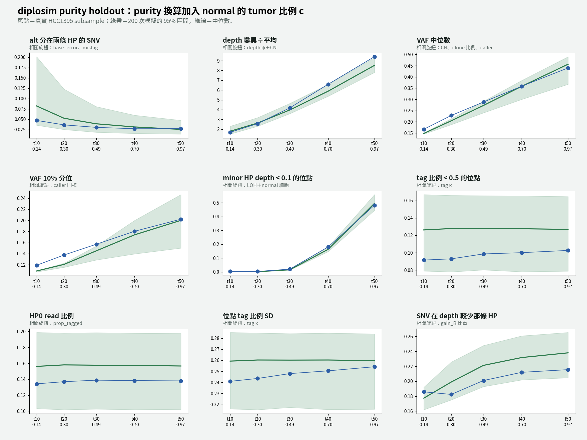
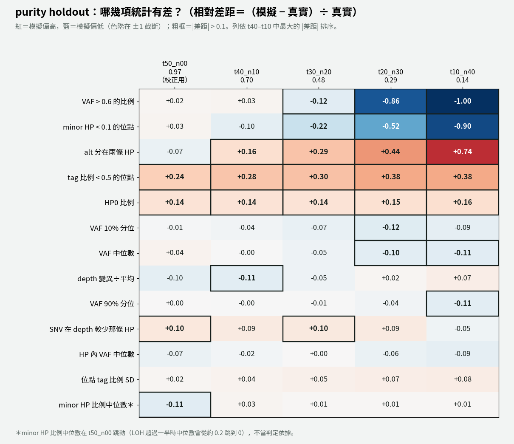

# diplosim：purity 換算加入 normal 的 tumor 比例 c（2026-11-01）

問題：`2026-11-01_diplosim_matched_normal` 第 7 節發現，低 purity 樣本的實際 purity 比換算值高（t10：0.154 對 0.136）。如果換算時考慮 normal reads 也帶少量 tumor DNA，5 個 purity 的通過數改善多少？

標記：〔實測〕＝本實驗計算；〔推論〕＝本檔推論；〔程式〕＝讀程式得到。

對照組：`lab_report/2026-11-01_diplosim_matched_normal/`（其他設定完全相同，只差 purity）。



## 1. 結論

- **t40、t30 各多通過 1–2 項；t20、t10 沒變**〔實測〕：

  | | t50 | t40 | t30 | t20 | t10 |
  |---|---:|---:|---:|---:|---:|
  | 對照（原換算 purity） | 12 | 11 | 10 | 7 | 6 |
  | **purity 加入 c** | 12 | **13** | **11** | 7 | 6 |
  | 13 項平均 \|rel\|（對照） | 0.072 | 0.081 | 0.117 | 0.231 | 0.299 |
  | 13 項平均 \|rel\|（加入 c） | 0.072 | 0.079 | 0.108 | 0.220 | 0.290 |

  t50 沒有 normal reads，purity 不變，直接沿用對照組的結果。
- **t10 的 VAF 只往上移一點**〔實測〕：VAF 中位數 0.145 → 0.148（真實 0.167），90% 分位 0.222 → 0.229（真實 0.256）。purity 只補了 t10 落差的一半（0.136 → 0.145；VAF 估計值是 0.154）。
- **t10 的 call 數變差**：中位數 9,572 → 10,300，回到區間外（真實 7,260）。purity 變高後，更多 SNV 通過硬門檻〔實測＋推論〕。
- **剩下的低 purity 差距，主要是偵測曲線還沒接進模擬**〔推論〕。模擬仍用硬門檻（alt ≥ 5、VAF ≥ 0.10），在 t10 多留下約 3,000 個靠近門檻的低 VAF SNV。真實的 ClairS 在 alt = 5–8 時只叫出 11–68%（`2026-11-01_clairs_detection_curve`）。這同時解釋了「call 數偏多」和「VAF 分位數偏低」。

## 2. 改了什麼

- purity 換算的 tumor DNA 比例，從 t ÷ (t + n) 改成 (t + n·c) ÷ (t + n)，c = 1.2–1.6%（normal alt 量測，`2026-11-01_clairs_detection_curve` 第 5 節）。再用 p = 2f ÷ (ψ(1 − f) + 2f) × 0.97、ψ = 3.06 換成細胞比例。每個 seed 由 diplosim 在範圍內抽 purity：

  | | 原換算 | 新範圍 |
  |---|---:|---:|
  | t40_n10 | 0.7016 | 0.7045–0.7055 |
  | t30_n20 | 0.4802 | 0.4851–0.4867 |
  | t20_n30 | 0.2944 | 0.3006–0.3026 |
  | t10_n40 | 0.1362 | 0.1433–0.1456 |

- `tools/diplosim_purity_holdout_v2.sh` 的 purity 參數可以寫成 `LO:HI`。單一值時行為不變。

## 3. 做法

```bash
export OUT_ROOT=lab_report/2026-11-01_diplosim_purity_normal_share DIPLOSIM_PPC_RANGES=tools/diplosim_knob_ranges_hcc1395.tsv
export KNOBS="（同 2026-11-01_diplosim_matched_normal）"
cp -r lab_report/2026-11-01_diplosim_matched_normal/t50_n00 $OUT_ROOT/
bash tools/diplosim_purity_holdout_v2.sh t40_n10 0.7045:0.7055 52 lab_report/2026-10-31_diplosim_purity_holdout/t40_n10
bash tools/diplosim_purity_holdout_v2.sh t30_n20 0.4851:0.4867 52 lab_report/2026-10-31_diplosim_purity_holdout/t30_n20
bash tools/diplosim_purity_holdout_v2.sh t20_n30 0.3006:0.3026 52 lab_report/2026-10-31_diplosim_purity_holdout/t20_n30
bash tools/diplosim_purity_holdout_v2.sh t10_n40 0.1433:0.1456 52 lab_report/2026-10-31_diplosim_purity_holdout/t10_n40
```

## 4. 結果

各 purity 落在區間外的統計量（含 13 項以外的 `n_called`、`frac_called`、`depth_median`、`inHP_VAF_q90`）〔實測〕：

- t40：frac_called、depth_median
- t30：frac_called、VAF_q10、inHP_VAF_q90、minorHP_depth_lt_0.1
- t20：frac_called、VAF_q10／q50／q90、VAF_frac_gt_0.6、inHP_VAF_q50／q90、minorHP_depth_lt_0.1
- t10：n_called、frac_called、VAF_q10／q50／q90、VAF_frac_gt_0.6、inHP_VAF_q50／q90、minorHP_depth_q50、minorHP_depth_lt_0.1



完整：`distance_all_purities.tsv`、各 purity 的 `tables/ppc_stats.tsv`。

## 5. 限制

- c 的兩種估計還沒對齊：normal alt 給 1.2–1.6%，從 VAF 反推給 2.6–3.5%。本實驗用前者，因為它不用到被驗證樣本的資料。
- ψ 用 ASCAT 的 3.06；用 2.73 時，換算 purity 會再高約 10%。
