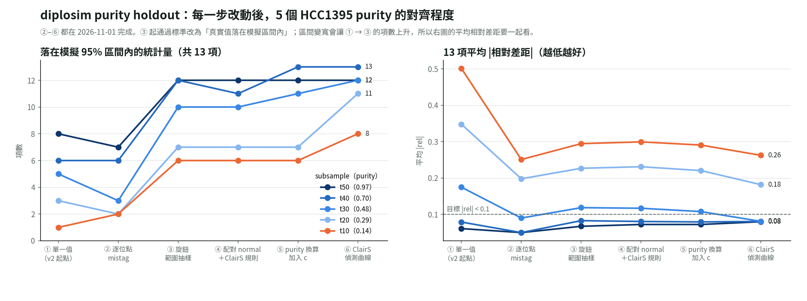
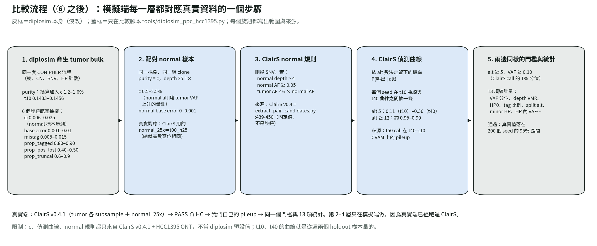

# 整理：diplosim 在 5 個 HCC1395 purity 上的驗證（2026-10-31 至 11-01）

用到的會議：`meeting_record/2026_10_28_meeting_record.md`（最新一次，沒有 `_summary.md`），自我檢查清單取自 `2026_10_21_meeting_summary.md` §2.2。

標記：〔實測〕＝實驗計算；〔推論〕＝推論；〔程式〕＝讀程式得到；〔會議〕＝會議紀錄。

## 1. 接回上次會議

- **研究目的：** 改造模擬器，讓它產生雙套體、單倍型（HP1／HP2）層級的 long read bulk 資料，用來測試 PhyClone 的 HP 擴充〔會議，10-28 決議 1〕。
- **上次定的方向：**
  1. 說清楚改造相對原流程加了什麼〔會議，決議 1〕。目前狀態：**可行**。diplosim 已照 CONIPHER 流程移植，並加上 HP 計數（`diplosim/DECISIONS.md`）。
  2. 對設計與驗證問題，先比較 2–3 個方案再選〔會議，決議 2〕。目前狀態：**照做**，本次每一步都先列方案再選（第 3 節）。
  3. 用流程圖呈現中間思考〔會議，決議 3〕。目前狀態：**照做**，見 `pipeline.png` 與 `progress.png`。
  4. 探討驗證方法、釐清 HCC1395 能支持什麼〔會議，待辦〕。目前狀態：**部分可行**。本次用的方法是「同一株細胞、不同 purity 的真實 ONT subsample」：只在 t50 上調參數，再看 t40–t10 對不對得上（holdout）。

## 2. 本次任務

只做一個任務：**diplosim 在 t50 上調好的設定，換到其他 purity 還成立嗎？如果不成立，問題出在哪？**

資料：HCC1395 ONT 的 5 個 subsample（t50_n00、t40_n10、t30_n20、t20_n30、t10_n40）；tumor 端是 ClairS v0.4.1 的 PASS ∩ HC SNV，再做 HP pileup。比較 13 項統計量（VAF 分位、depth 變異、HP0 比例、tag 比例、split alt、minor HP 等）。

## 3. 方案與選擇理由（照時間順序）

| 步驟 | 發現的問題 | 候選方案 | 選了 | 理由 |
|---|---|---|---|---|
| ② 逐位點 mistag | 「alt 分在兩條 HP」在 t10 高估 +3.35 | 調 base error／改成 tag 錯誤 | 降 base error，加逐位點 mistag | 真實資料中，另一條 HP 上的 alt 跟著 alt 數走，不跟 ref 數走〔實測〕 |
| φ 量測 | depth 變異在低 purity 高估 +0.50 | 在 5 個 purity 掃描／從 normal 量／用 t10 回推 | 從 normal 樣本量 | 不用到 holdout 樣本；結果顯示 φ 依估計式在 0.006–0.025 之間 |
| ③ 範圍抽樣 | 單一值一直要試 | 逐項量測／自動擬合／範圍抽樣 | 範圍抽樣（使用者選） | 模擬器是拿來 benchmark，不必精確複製一株細胞 |
| ClairS 偵測 | 低 purity 的 call 數高估約 50% | 量 ClairS 偵測曲線／假設曲線／對齊 call 數 | 量曲線 | 曲線是量出來的，不是猜的 |
| ④ 配對 normal | 低 purity 時高 VAF 的 SNV 反而叫不出 | 查原因 → 在 Python 模擬／在 diplosim 模擬 | Python 先做 | 原因找到：ClairS 規則刪掉 normal 有 alt 的位點〔程式〕；Python 改最快，不動 diplosim |
| ⑤ purity 換算 | 低 purity 的 VAF 低 13–15% | 換算加入 c／用 VAF 估 purity／purity 範圍 | 換算加入 c | c 從 normal 量，不用到被驗證樣本的 VAF |
| ⑥ 偵測曲線 | call 數仍多、VAF 仍低 | 曲線範圍抽樣／曲線含 purity 變數 | 範圍抽樣 | 和旋鈕做法一致，不必逐個 purity 擬合 |

每一步的細節在各自的 `lab_report/2026-11-01_*` 目錄。

## 4. 結果（含失敗）

13 項中落在模擬 95% 區間內的項數〔實測〕：

| 步驟 | t50 | t40 | t30 | t20 | t10 |
|---|---:|---:|---:|---:|---:|
| ① 單一值（v2） | 8 | 6 | 5 | 3 | 1 |
| ② 逐位點 mistag | 7 | 6 | 3 | 2 | 2 |
| ③ 旋鈕範圍抽樣 | 12 | 12 | 10 | 7 | 6 |
| ④ 配對 normal＋ClairS 規則 | 12 | 11 | 10 | 7 | 6 |
| ⑤ purity 換算加入 c | 12 | 13 | 11 | 7 | 6 |
| ⑥ ClairS 偵測曲線 | **12** | **13** | **12** | **11** | **8** |

13 項平均 |相對差距|：① 0.061／0.079／0.175／0.348／0.501 → ⑥ 0.080／0.081／0.081／0.182／0.262〔實測〕。

讀這張表要注意：
- ① → ③ 項數大增，有一部分只是因為區間變寬（③ 起改成範圍抽樣），要搭配平均相對差距一起看。
- ② 的項數下降，但平均相對差距大幅變好：當時區間很窄，差一點就算失敗。

**預期與實際：**
- 預期：只調 φ 就能修好低 purity 的 depth 變異。實際：φ 依估計式差 4 倍，最後改成範圍抽樣。
- 預期：低 purity 的 VAF 偏低是 diplosim 的 CN 不夠。實際：CN 分布對得上；真正原因是 purity 換算低估，加上模擬沒有 ClairS 的漏抓。
- 預期：配對 normal 會讓通過數上升。實際：通過數幾乎不變，只有 call 數改善。

**還沒解決（失敗也列出）：**
1. t10 的 VAF 10%、90% 分位仍略在區間外（−0.04）。
2. 真實值接近 0 的統計量（VAF > 0.6、minor HP < 0.1）：相對差距被放大，絕對值差不到 0.005。
3. split alt 仍隨 purity 下降而偏高（t10 +0.59）。
4. ⑥ 之後高 purity 的 call 數偏少（t50 模擬 25,460、真實 31,350），因為曲線把 t50 自己的 call 當成真 SNV。
5. 真實 normal 的 alt 集中在少數位點，均勻的 c 模型解釋不了（`2026-11-01_clairs_detection_curve` 第 5 節）。
6. c 的兩個估計沒對齊：normal alt 給 1.2–1.6%，從 VAF 反推給 2.6–3.5%。

## 5. 已知與未知

**有證據支持：**
- 低 purity 的大部分差距來自「量測端」（ClairS 規則、偵測靈敏度、purity 換算），不是 diplosim 的生成機制〔實測，第 3 節各步〕。
- ClairS 用的 normal 和 t00_n25 是同一批 read〔實測，總鹼基數逐位相同〕。
- ClairS 會刪掉 normal AF ≥ 0.05 且 tumor AF < 6 × normal AF 的候選〔程式〕。
- t50 上的 CN 與突變拷貝數分布，模擬和真實對得上〔實測〕。

**還不知道：**
- 真實 normal 為什麼只有少數位點帶大量 alt（mosaic？比對問題？）。
- c 的兩個估計為什麼不同。
- split alt 在低 purity 偏高的原因。
- 這些結論能不能推廣到別的細胞株或 caller：所有量測都只來自 ClairS v0.4.1 + HCC1395 ONT。

（使用者自己「懂／不懂」的部分，請報告前自行補上。）

## 6. 自我檢查（2026-10-21 summary §2.2）

- [x] 每一節第一句回答「對研究目標有什麼用」：第 1–2 節開頭有寫。
- [x] 「可以／已驗證」附來源：各項有〔實測〕〔程式〕〔會議〕標記。
- [x] benchmark 寫出真值來源、讀長、輸入、生成程式：本次沒有使用外部 benchmark；驗證資料是 HCC1395 ONT subsample，沒有真值樹，只比較統計量。
- [x] 「沒找到」附搜尋範圍：本次沒有「沒找到」類的結論。
- [ ] AI 結論標明自己核對過哪部分：**需要使用者補**。本文件由 AI 整理，數字都來自 `lab_report/` 的實際輸出。

## 7. 檔案

- 圖：`progress.png`、`pipeline.png`（`tools/plot_diplosim_purity_summary.py`）。
- 各步驟：`lab_report/2026-10-31_diplosim_purity_holdout_v2/`、`2026-11-01_diplosim_split_alt_mistag/`、`2026-11-01_diplosim_phi_from_normal/`、`2026-11-01_diplosim_knob_ranges/`、`2026-11-01_clairs_detection_curve/`、`2026-11-01_diplosim_matched_normal/`、`2026-11-01_diplosim_purity_normal_share/`、`2026-11-01_diplosim_detection_curve/`。
