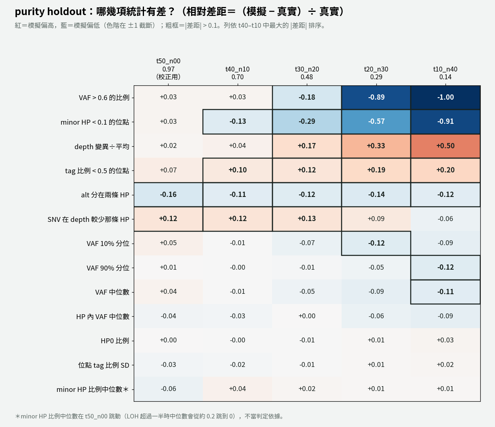
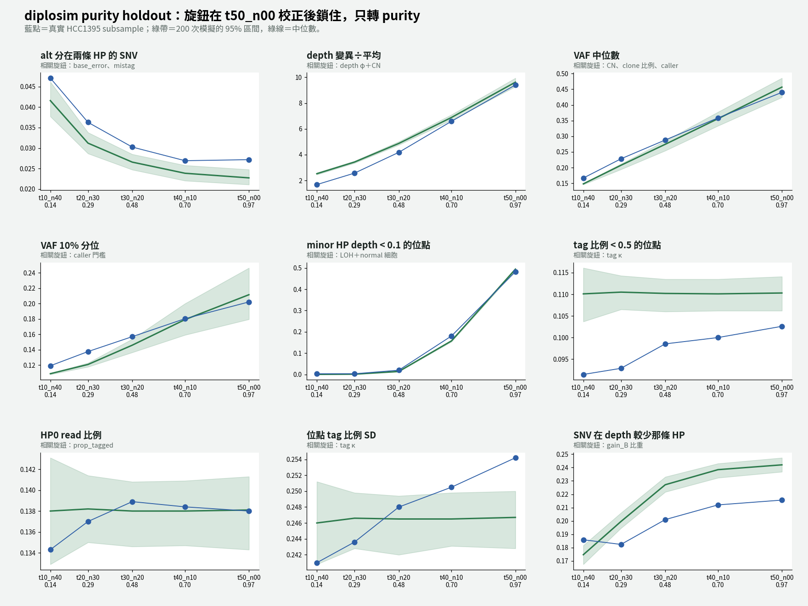

# diplosim：用「逐位點 mistag」取代大的 base error，修正 alt 分在兩條 HP 偏高（2026-11-01）

問題：purity holdout v2（`lab_report/2026-10-31_diplosim_purity_holdout_v2/`）中，「alt 分在兩條 HP 的 SNV 比例」在 `t50_n00` 對得上，但 purity 越低差越多（`t10_n40` +3.35）。原因是什麼？怎麼修？

標記：〔實測〕＝本實驗計算；〔推論〕＝本檔推論；〔程式〕＝讀程式得到。

## 1. 結論

- **「alt 分在兩條 HP」現在在 5 個 purity 都落在 −0.11 到 −0.16**，不再隨 purity 下降而變大（v2：−0.01 → +3.35）〔實測〕。
- **13 項平均 |相對差距|：** t50 0.061 → 0.050、t40 0.079 → 0.050、t30 0.175 → 0.090、t20 0.348 → 0.198、t10 0.501 → 0.251〔實測〕。
- **副作用：** 「SNV 在 depth 較少那條 HP」在 t50–t30 從 +0.07 變 +0.12〔實測〕。`t50_n00` 的 minor HP 比例中位數則從 −0.36 變成 −0.06。
- **原因：** v2 的 `base_error` 0.01 會把另一條 HP 的 ref read 讀成 alt。purity 越低，另一條 HP 上 normal 細胞的 ref read 越多，假的 alt 也越多。真實資料不是這樣：另一條 HP 上的 alt 主要跟著 alt 數走〔實測，第 3 節〕。
- **仍沒解決：** depth 變異÷平均（t10 +0.50）、tag 比例 < 0.5（+0.20），以及低 purity 的 call 數（t10 模擬 10,690、真實 7,260）。VAF > 0.6 和 minor HP < 0.1 在低 purity 是真實值接近 0 造成的相對差距放大（同 v2）。

## 2. 改了什麼

1. **diplosim 新增 `--mistag-concentration`（κ）**〔程式，`diplosim/src/hp.rs` `site_rate`〕：每個位點從 Beta(κ·`mistag_rate`, κ·(1 − `mistag_rate`)) 抽自己的 mistag 機率。平均不變，但錯誤集中在少數位點，像局部的 phasing 錯誤。不設時資料輸出和改動前逐位元相同。
2. **HCC1395 設定改成** `--base-error 0.001 --mistag-rate 0.01 --mistag-concentration 1`（v2：`--base-error 0.01 --mistag-rate 0.005`）。其他旋鈕不變。
3. `tools/diplosim_purity_holdout_v2.sh` 可用 `OUT_ROOT`、`KNOBS` 環境變數覆寫輸出目錄和旋鈕；不設時等於 v2。

## 3. 為什麼選這個方案

真實資料中，取 alt 較多那條 HP 為 X、另一條為 O〔實測，alt ≥ 5、VAF ≥ 0.10、tagged alt ≥ 3〕：

| subsample | O 上的 alt ÷ X 上的 alt | O 上的 alt ÷ O 上的 ref | O 上 alt ≥ 2 的位點 |
|---|---:|---:|---:|
| t50_n00 | 0.0063 | 0.0103 | 2.4% |
| t40_n10 | 0.0069 | 0.0083 | 1.9% |
| t30_n20 | 0.0077 | 0.0067 | 1.5% |
| t20_n30 | 0.0090 | 0.0056 | 1.2% |
| t10_n40 | 0.0100 | 0.0043 | 0.8% |

- 如果錯誤來自 base error，「O 上的 alt ÷ O 上的 ref」應該固定。實際上它從 0.010 降到 0.004，所以 base error 不是主因。
- 「O 上的 alt ÷ X 上的 alt」大致穩定（0.006–0.010），符合 tag 錯誤。用兩部分做最小平方擬合：每條 alt read 約 0.46%，每條 ref read 約 0.27%〔實測，粗略擬合〕。
- `t50_n00` 有一條尾巴（同一位點 O 上 ≥ 2 條 alt），固定的 mistag 機率產生不出來，所以每個位點的 mistag 機率要不同。

10-31 曾試過同一機制（逐位點 mistag），但當時 `base_error` 沒有降，alt 少的位點對不上，所以撤回。這次是兩者一起調。

## 4. 掃描（只跑 t50 與 t10，各 200 次）

| `base_error` | `mistag_rate` | κ | t50 split_alt | t10 split_alt |
|---:|---:|---:|---:|---:|
| 0.01（v2） | 0.005 | — | −0.01 | +3.35 |
| 0.003 | 0.005 | — | −0.60 | +0.76 |
| 0.003 | 0.015 | — | +0.09 | +1.74 |
| 0.003 | 0.010 | 1 | −0.05 | +0.68 |
| 0.002 | 0.010 | 1 | −0.11 | +0.29 |
| 0.002 | 0.010 | 10 | +0.33 | +0.74 |
| 0.002 | 0.020 | 1 | +0.67 | +0.72 |
| **0.001** | **0.010** | **1** | **−0.16** | **−0.12** |
| 0.001 | 0.015 | 1 | +0.23 | +0.11 |

選 0.001／0.010／κ 1：兩端的差距都在 ±0.16 內，而且方向相同。沒有再細調，因為只有一株細胞（見 memory：模擬不必過度精確）。

## 5. 做法

```bash
export OUT_ROOT=lab_report/2026-11-01_diplosim_split_alt_mistag
export KNOBS="--prop-pos-lost 0.45 --loss-events cnloh_B --prop-pos-second-cna 0.5 --gain-events gain_A,gain_B,gain_B,gain_both --prop-truncal-snvs 0.8 --depth-dispersion 0.03 --base-error 0.001 --mistag-rate 0.01 --mistag-concentration 1 --prop-tagged 0.862 --tag-concentration 1"
bash tools/diplosim_purity_holdout_v2.sh t50_n00 0.97   53 lab_report/2026-10-30_diplosim_ppc_hcc1395
bash tools/diplosim_purity_holdout_v2.sh t40_n10 0.7016 52 lab_report/2026-10-31_diplosim_purity_holdout/t40_n10
# t30_n20 0.4802、t20_n30 0.2944、t10_n40 0.1362 同上
python3 -I tools/ppc_distance_score.py t50=$OUT_ROOT/t50_n00 ... > $OUT_ROOT/distance_all_purities.tsv
```

## 6. 結果





| 統計量（相對差距） | t50 | t40 | t30 | t20 | t10 |
|---|---:|---:|---:|---:|---:|
| alt 分在兩條 HP（v2） | −0.01 | +0.55 | +1.26 | +2.20 | +3.35 |
| alt 分在兩條 HP（本次） | −0.16 | −0.11 | −0.12 | −0.14 | −0.12 |
| SNV 在 depth 較少那條 HP（本次） | +0.12 | +0.12 | +0.13 | +0.09 | −0.06 |
| depth 變異÷平均（本次） | +0.02 | +0.05 | +0.17 | +0.33 | +0.50 |
| 13 項平均 \|rel\|（v2） | 0.061 | 0.079 | 0.175 | 0.348 | 0.501 |
| 13 項平均 \|rel\|（本次） | 0.050 | 0.050 | 0.090 | 0.198 | 0.251 |

完整數值：`distance_all_purities.tsv`；各 purity 的 `*/tables/ppc_stats.tsv`。

## 7. 限制

- 數值只用 HCC1395 一株細胞選，只當實驗設定，不當預設值〔memory：dataset-calibrated defaults off〕。
- 逐位點 mistag 的位點彼此獨立；真實的 phasing 錯誤是整段的（PS block、switch），相鄰位點會一起錯〔推論〕。
- base error 不分三種鹼基，ref → alt 和 alt → ref 機率相同。
- 模擬的「alt 分在兩條 HP」一致偏低約 0.12–0.16，`t50_n00` 的低 alt 位點仍偏少〔實測〕。
