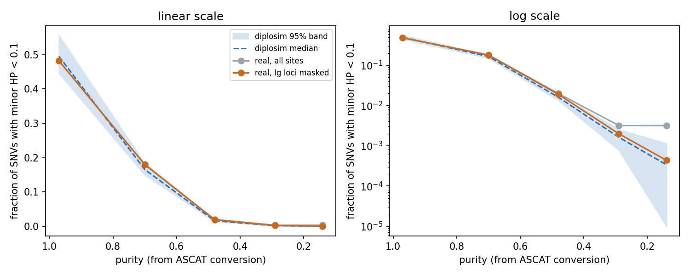

# diplosim：真實端排除抗體基因區後，低 purity 的 LOH 比例對上（2026-11-03）

問題：`minorHP_depth_lt_0.1`（minor HP depth < 0.1 的 SNV 比例，代表 LOH）在 t30、t20、t10 落在 diplosim 95% 區間外。這是 diplosim 模擬 LOH 的問題嗎？

標記：〔實測〕＝本實驗計算；〔推論〕＝本檔推論；〔程式〕＝讀程式得到。



## 1. 結論

- **不是 diplosim 的問題。** 多出來的位點來自 normal（HCC1395BL）本身在抗體基因區少一條 allele〔實測＋推論〕。
- 真實端排除 IGH、IGK、IGL 三個基因座（81–114 個 SNV）後，LOH 比例在 5 個 purity 都落在區間內〔實測〕：

  | purity | 真實（全部） | 真實（排除） | diplosim 95% 區間 | 判定 |
  |---|---:|---:|---|---|
  | t50（0.97） | 0.4822 | 0.4818 | 0.446–0.556 | in → in |
  | t40（0.70） | 0.1806 | 0.1798 | 0.150–0.184 | in → in |
  | t30（0.48） | 0.0199 | 0.0190 | 0.0134–0.0193 | OUT → in |
  | t20（0.29） | 0.0032 | 0.0020 | 0.0008–0.0026 | OUT → in |
  | t10（0.14） | 0.0032 | 0.0004 | 0–0.0011 | OUT → in |

- 其他統計量只微幅移動，判定都沒變〔實測，各 purity 的 `tables/ppc_stats.tsv`〕。

## 2. 證據

1. t10 的 22 個 minor HP < 0.1 位點，有 19 個在 chr22:22,816,187–22,829,095〔實測〕。這段在 GRCh38 的 IGL 基因座內（chr22:22,026,076–22,922,913）。
2. 這 19 個位點在 t50 也是 LOH；但其他 LOH 區（例如 chr8）的 minor HP 會隨 purity 下降而回升到約 0.37，這些位點不會〔實測〕。
3. normal 在 chr22:22,816,000–22,830,000 的 depth 是 31×，兩側（22.3、22.6、22.9 Mb）是 52–62×〔實測，`samtools coverage -q 20`，HCC1395BL.cram〕。
4. HCC1395BL 是 B 淋巴母細胞株。B 細胞的 V(D)J 重組會刪掉抗體基因座的一段 DNA，所以 normal 在這裡只剩一條 HP，混進 normal 也補不回 minor HP〔推論〕。
5. IGK、IGH 整段的 normal 平均 depth 也偏低（35×、39×；兩側約 52–56×）〔實測〕。因為 B 細胞這三個基因座都會重排，三個一起排除。這個遮罩是由細胞種類事先決定的，不是看結果去調。

## 3. 做法

```bash
export DIPLOSIM_PPC_MIN_ALT=5 DIPLOSIM_PPC_MIN_VAF=0.10
for p in t50_n00 t40_n10 t30_n20 t20_n30 t10_n40; do
  python3 -I tools/diplosim_ppc_mask_real.py lab_report/2026-11-01_diplosim_detection_curve/$p lab_report/2026-11-03_diplosim_mask_ig_loci/$p
done
python3 tools/plot_mask_ig_loh.py
```

- 只重算真實端。模擬端直接用 `2026-11-01_diplosim_detection_curve/*/tables/sim_stats.json`：diplosim 用人工座標，normal 處處是兩條 HP，沒有抗體基因區可以排除〔程式〕。
- 不加遮罩時，新工具的輸出和原本的 `ppc_stats.tsv` 逐行相同（t50、t10 已核對）〔實測〕。
- 基因座座標：GRCh38，IGH chr14:105,586,437–106,879,844；IGK chr2:88,857,361–90,235,368；IGL chr22:22,026,076–22,922,913。

## 4. 限制

- 「V(D)J 刪除」是推論：只量了 normal 的 depth，沒有看 read 的斷點。
- t10 另有 3 個低 minor HP 位點不在抗體基因區（chr22:23.42 Mb 2 個、chr7:153.7 Mb 1 個）。那裡 normal depth 正常、tumor depth 很高（162×、279×），可能是高倍 amplification〔推論〕。
- t10 的 `alt_on_minorHP`、VAF 分位等其他失敗項目不受影響，仍在區間外。
- 遮罩只適用於 normal 是 B 細胞株的資料。

## 5. 檔案

- `<purity>/tables/ppc_stats.tsv`、`real_stats.json`、`masked_sites.tsv`（被排除的位點與基因座）。
- `loh_mask.png`。
- 投影片「真實 HCC1395 對 diplosim」改用本目錄（`report/2026_11_04_slides/gen_p11.py`）。
