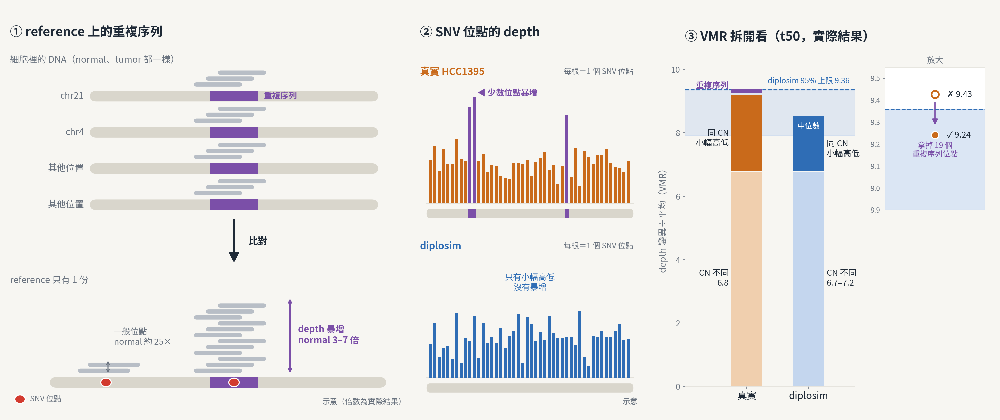

# diplosim：t50 的 depth VMR 略高於模擬區間，原因是 reference 重複序列（2026-11-03）

問題：第 14 頁「每個 SNV 的 depth 高低程度」（`depth_VMR`）只有 purity 0.97（t50）在區間外。原因是什麼？

標記：〔實測〕＝本實驗計算；〔推論〕＝本檔推論；〔程式〕＝讀程式得到。



## 1. 結論

- 真實 9.43，diplosim 95% 區間 7.91–9.36，比 200 次模擬都高，但只高 0.07〔實測，已排除抗體基因區〕。
- **CN 造成的部分兩邊對得上**：真實 6.8（ASCAT CN），diplosim 6.7–7.2（8 個 seed，depth 變異旋鈕設為 1e-6）〔實測〕。
- **多出來的是 19 個 reference 重複序列位點**：normal（t00_n25）depth 是中位數的 3–7 倍，例如 chr21 中心粒旁、chr4 端粒旁。多份重複序列的 read 都比對到 reference 的同一份〔實測＋推論〕。拿掉後真實 VMR 9.24，在區間內〔實測〕。
- diplosim 的 depth 變異模型對每個位點一視同仁，產生不出這種長尾〔程式，`diplosim/src/sequencing.rs:154`〕。

## 2. 數值

| 拿掉的位點（normal depth ≥ 中位數 × k） | 位點數 | 真實 VMR |
|---|---:|---:|
| 不拿掉 | 0 | 9.43 |
| k = 3 | 19 | 9.24 |
| k = 2.5 | 34 | 9.18 |
| k = 2 | 72 | 9.10 |

- 模擬端 VMR 和旋鈕的相關：`--depth-dispersion` 0.77、`--prop-pos-lost` −0.41，其他 |r| ≤ 0.21〔實測，`2026-11-01_diplosim_detection_curve/t50_n00/tables/sim_knobs.tsv`〕。
- 區域 depth（`samtools coverage -q 20`，完整 CRAM）：chr21:10.46 Mb normal 348×／tumor 494×；chr4:190.11 Mb normal 331×／tumor 598×；對照 chr21:15.0 Mb normal 53×／tumor 64×〔實測〕。

## 3. 做法

```bash
python3 tools/plot_vmr_repeat_cause.py      # 讀既有 tables，計算並畫圖
```

- 真實 depth：`2026-11-01_diplosim_detection_curve/t50_n00/tables/real_per_snv.tsv`；normal depth：`2026-11-01_diplosim_phi_from_normal/tables/real_per_snv.tsv`（同一組位點）；CN：`2026-10-30_ascat_hcc1395_5khz/tables/snv_cn.tsv`。
- `tables/sim_cn_part.tsv`：8 個 diplosim seed（PPC 的固定旋鈕，purity 0.97、coverage 53、n_snv 31,595、`--depth-dispersion 1e-6`），把 depth 換成同 CN 組的平均後算 VMR。

## 4. 限制

- 「重複序列」的判斷只用 normal depth，沒有對照 segmental duplication 註解。門檻 3 倍是看結果選的。
- 拿掉重複位點後，「同 CN 內的 depth 差異」仍在 φ 範圍上緣；ASCAT CN 的誤差也會讓這部分看起來偏大〔推論〕。
- 8 個 seed 只用來看 CN 部分，不是正式的 200 次 PPC。
- 下一步（不改程式／排除重複位點／調高 φ 上限）尚未決定。
