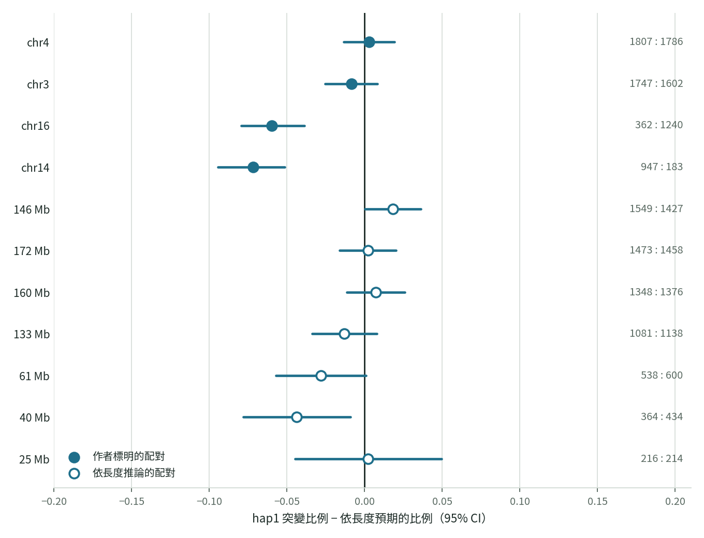

# COLO829：體細胞 SNV 在兩條單倍型上的比例（2026-11-06）

問題：腫瘤裡，兩條單倍型（一條來自爸爸，一條來自媽媽）的體細胞 SNV 數一樣多嗎？之前查的論文正文都沒有用 long read 報告全基因組比例，所以用 Sohn 2026（*Cell*）公開的突變表自己算。

真值來源：沒有演化真值，這是真實細胞株的觀測。讀長：這份 VCF 來自 long read（Fiber-seq）。輸入：作者公開的 COLO829 體細胞 SNV，座標在同一位捐贈者的二倍體組裝上。生成程式：作者已公開。

標記：〔實測〕＝本實驗計算；〔論文〕＝原文；〔程式〕＝讀作者程式；〔推論〕＝本檔推論。



> **2026-11-06 更新：** 後續驗證見 `../2026-11-06_colo829_loss_events/`。本檔的計算不變，但有兩點補充：① Sohn 圖 S2B 支持 hap2 的 chr1 在該批細胞確實缺失；② 實驗室另兩批 COLO829 在 chr1p 的拷貝數不同，所以本檔結果只代表 Sohn 那批。2:1 區的獨立 read 驗證結果是 1,639 比 1,425。

## 1. 結論

- **原始比例是 61.2% 比 38.8%，但主要是假象。** hap2 有 7 條 contig（844 Mb）一個 SNV 都沒有，hap1 只有 1 Mb。作者的流程會移除整段刪除區的 SNV，所以這些很可能是腫瘤丟掉的那一條。〔實測〕〔論文〕〔推論〕
- **扣掉沒有突變的長片段後，兩條幾乎一樣：hap1 9.34、hap2 9.31 個／Mb。** 比值 1.004（95% CI 0.985–1.023）。〔實測〕
- **成對比較也大多接近 50%。** 兩條都保留的 11 對中，9 對的 hap1 比例和預期差不到 4.4 個百分點。chr14、chr16 偏離較大，但這兩條都涉及 t(14;16) 和大片刪除，配對長度不可靠。〔實測〕〔推論〕
- **這不能回答「爸爸或媽媽哪邊較多」。** hap1、hap2 只是組裝標籤，沒有親源資訊。而且這只是一個細胞株。

支持的層（N3）：觀測特徵。不支持克隆結構或演化路徑。

## 2. 預期和實際

| | 預期 | 實際 |
|---|---|---|
| 檔案筆數 | 接近論文的 44,795 | 44,810，多 15 筆，原因未查 |
| 原始比例 | 動手前只預期會受拷貝數影響，沒有定量預期 | 61.2%：38.8%，比想像中偏得多 |
| 校正後 | 同上 | 差 0.4%（CI 包含 1） |
| 配對 | 長度配對可能有錯 | 確實有錯，見第 5 節 |

## 3. 數字

### 全基因組（`haplotype_totals.tsv`）

| | SNV | 組裝長度（Mb） | SNV／Mb | 有突變的長度（Mb） | SNV／有突變的 Mb |
|---|---:|---:|---:|---:|---:|
| hap1 | 27,410 | 3,001.1 | 9.13 | 2,934.0 | 9.34 |
| hap2 | 17,400 | 2,921.2 | 5.96 | 1,869.3 | 9.31 |

「有突變的長度」：扣掉連續超過 5 Mb 沒有 SNV 的片段。門檻改成 2 Mb、10 Mb，密度分別是 9.34／9.34、9.32／9.27，結論不變。

### 同源配對（`homolog_pairs.tsv`）

| 配對 | 來源 | hap1 : hap2 | hap1 比例 | 依長度預期 | 主要 CN |
|---|---|---:|---:|---:|---|
| chr3 | 作者 | 1,747 : 1,602 | 0.522 | 0.530 | CN2／CN2 |
| chr4 | 作者 | 1,807 : 1,786 | 0.503 | 0.500 | CN2／CN2 |
| chr14 | 作者 | 947 : 183 | 0.838 | 0.910 | CN3／CN2 |
| chr16 | 作者 | 362 : 1,240 | 0.226 | 0.286 | CN2／CN2 |
| 172 Mb | 長度 | 1,473 : 1,458 | 0.503 | 0.501 | CN1／CN1 |
| 160 Mb | 長度 | 1,348 : 1,376 | 0.495 | 0.488 | CN2／CN2 |
| 146 Mb | 長度 | 1,549 : 1,427 | 0.521 | 0.502 | CN2／CN1 |
| 133 Mb | 長度 | 1,081 : 1,138 | 0.487 | 0.500 | CN1／CN2 |
| 61 Mb | 長度 | 538 : 600 | 0.473 | 0.501 | CN2／CN1 |
| 40 Mb | 長度 | 364 : 434 | 0.456 | 0.500 | CN2／CN2 |
| 25 Mb | 長度 | 216 : 214 | 0.502 | 0.500 | CN2／CN2 |
| chr1 | 作者 | 2,954 : 0 | — | — | 一條流失 |
| 135 Mb | 長度 | 1,227 : 0 | — | — | 一條流失 |
| 81 Mb | 長度 | 589 : 0 | — | — | 一條流失 |

- 整體異質性檢定（11 對）：chi² 116.1，p = 1.1×10⁻¹⁹。Bonferroni 校正後顯著的是 chr14、chr16。所以對與對之間確實有差異，不是每對都完全相等。〔實測〕
- 兩條 CN 相同的 3 對（≥ 95% SNV 落在同一個 CN）：chi² 7.1，p = 0.068，最大偏差 4.4 個百分點。〔實測〕
- 預期比例用「有突變的長度」計算，這個長度本身來自 SNV 位置，所以有部分循環。結果是比較密度，不是獨立估計可比對長度。〔推論〕

## 4. 怎麼做

```bash
python3 -I tools/colo829_hap_snv_ratio.py \
  /big8_disk/boyu114/benchmark_data/colo829_t2t_sohn2026/somatic_snvs.vcf.gz \
  lab_report/2026-11-06_colo829_hap_snv_ratio
python3 tools/plot_colo829_hap_snv_ratio.py lab_report/2026-11-06_colo829_hap_snv_ratio
```

- **資料：** [UCSC hub 的 `somatic_snvs.vcf.gz`](https://s3.kopah.uw.edu/stergachis/public/FIRE/trackHubs/trackHub/data/COLO829-vcf-trackhub/somatic_snvs.vcf.gz)，2026-11-06 下載，SHA-256 `a0bb806bacdceec28537b510bae212cf48d8896bfde2f74b18dd1969d3acb125`。標題是 COLO829T Somatic SNVs (DeepVariant, PASS, Density Filtered)。樣本欄是 Passage B。
- **單倍型：** 來自 contig 名稱（`haplotype1-`、`haplotype2-`）。〔實測〕
- **配對：** chr1、3、4、14、16 來自作者 `hCN/plot_log2hcn.py`，chr16 是多條 contig 的組合。〔程式〕其他配對用長度：互為最接近，且差距 ≤ 1%。〔推論〕
- **統計：** 每對做精確二項檢定，比例的 CI 用 Wilson。全基因組比值的 CI 用 Poisson 近似。

## 5. 過程中的錯誤和事後決定

- **長度配對配錯兩對，已修正。** 第一次跑時最偏的是 `len75Mb`、`len76Mb`。查作者程式後發現 `haplotype1-0000008`、`haplotype2-0000055` 都是 chr16，所以這兩對是錯的。改成 chr16 組合後重跑。修正是看到結果才做的。
- **剩下的長度配對沒有獨立驗證。** 既然錯過兩對，其他對也可能有錯。要驗證，得把 contig 比對到 CHM13（2bit 檔 1.48 GB，沒有下載）。
- **5 Mb 門檻是看到零 SNV 的 contig 後才定的。** 所以才測了 2 Mb、10 Mb。
- **只有 22,890 個 SNV（51%）進入兩條都保留的配對。** 其他落在未配對的 contig（不少是斷開的染色體）、流失的配對或短 contig。

## 6. 限制

- **只有一個細胞株，來自一位捐贈者。** 黑色素瘤，以 UV 突變為主，不能外推到其他腫瘤。
- **流失那條的突變看不到。** 這裡比的是腫瘤留下來的部分，已流失染色體上曾有多少突變，無從得知。
- **作者的過濾會影響計數。** 這份 VCF 主要是固定的突變（38,339 個 1/1，6,469 個 0/1），並經過密度過濾。低頻 subclonal 突變不在內。
- **拷貝數沒有完整校正。** 每筆有 CN 標註，但檔案沒有各 CN 的片段長度，所以沒有算各 CN 的密度。gain 之後發生的突變也可能讓拷貝較多的那條看起來較多。
- **未解的觀察：** 長度 ≥ 20 Mb 的零 SNV contig 有 7 條，全部在 hap2。如果 hap1、hap2 的標籤和腫瘤無關，機率約 1.6%（雙尾）。作者組裝流程怎麼定標籤我沒有查，所以不下結論。〔推論〕
- **不是 diplosim 的驗證。** 這份結果只增加知識，沒有改動模擬器，也沒有設定任何參數值。

## 7. 檔案

| 檔案 | 內容 |
|---|---|
| `haplotype_totals.tsv` | 兩條單倍型的總數與密度，含 3 種門檻 |
| `homolog_pairs.tsv` | 每對的計數、比例、CI、預期、p 值 |
| `hap1_share_by_pair.png` | 上圖 |
| `explainer.html`、`explainer.png` | 白話圖解，用 `tools/draw_colo829_hap_explainer.py` 產生 |
