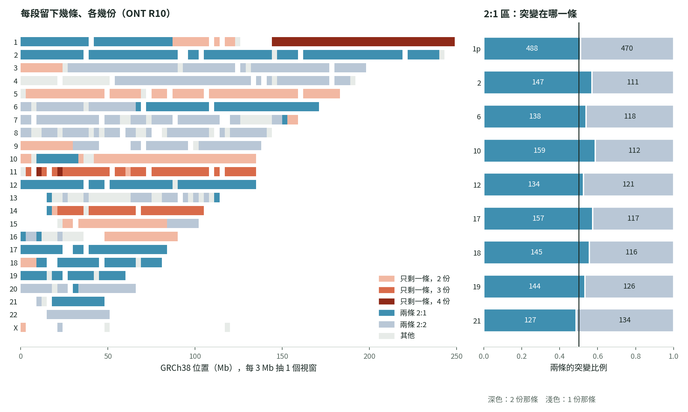

# COLO829：突變比例不平衡背後發生了什麼事件（2026-11-06）

問題：COLO829 的 hap1:hap2 突變數是 61:39（`../2026-11-06_colo829_hap_snv_ratio/`）。這是真的偏向嗎？用不靠 SNV 數的證據，查清楚發生了什麼事件。

真值來源：沒有演化真值，這是細胞株觀測。讀長：ONT R10、ONT PAO（實驗室副本）與論文的 Fiber-seq。輸入：tumor／BL CRAM、ClairS 體細胞突變、Sohn 2026 公開資料、Valle-Inclan 2022 SV 真值。

使用者決定：本實驗把 HP1、HP2 當作爸爸、媽媽來討論；實際親源沒有量。

標記：〔實測〕本實驗計算；〔論文〕原文或原圖；〔程式〕讀作者程式；〔推論〕本檔推論。



## 1. 結論

- **61:39 不是突變率偏向，主要是 LOH。** 約 765 Mb 只剩一條單倍型，另一條的突變已經看不到。〔實測〕〔推論〕
- **流失通常不是單純少一條。** 只剩一條的區域都有多份：2 份 471 Mb、3 份 183 Mb、4 份 111 Mb。深度接近單份的視窗只有 4 個。這比較像「先丟一條，留下的再複製」。〔實測〕順序是〔推論〕
- **兩條都在的地方，突變接近各半。** 9 個 2:1 區域，2 份那條 1,639 個、1 份那條 1,425 個（46.5%）。chr1p 是 488 比 470。〔實測〕
- **這 53.5% 比 46.5% 不能解讀成偏向。** 2 份那條在複製後有兩倍目標，晚期突變本來就會較多；1 份那條的突變 VAF 也較低，可能較難被 caller 抓到。這份資料分不開這些影響，所以沒有證據顯示真的偏向。〔推論〕
- **不同批的 COLO829 不一樣。** chr1p 另一條的份數，Sohn 2026 約 0，ONT_PAO 約 0.3，ONT_R10 約 1。所以 2,954 比 0 在 Sohn 那批是真的，但不能代表所有 COLO829。〔實測〕〔論文〕〔推論〕

支持的層（N3）：克隆結構與觀測特徵（等位基因狀態、重排染色體的存在）。事件先後只有間接證據，不算演化路徑的直接證據。

## 2. 預期和實際

| | 預期 | 實際 |
|---|---|---|
| 零 SNV contig | 都是 DNA 丟失 | 在 Sohn 那批的深度圖上是；ONT_R10 的 chr1p 卻還在 |
| 覆蓋度軌道能分單倍型 | 能 | 不能，論文把 read 投射到兩條（見第 5 節） |
| LOH 區 | 單份拷貝 | 幾乎都是多份 |
| 2:1 區的兩條 | 2 份那條明顯較多，或大致相等，事前沒有定量 | 46.5%；各染色體 41.3%–51.3% |
| 對照：LOH 區突變應在同一條 | 幾乎全在 major | 189 個可判斷的突變中 186 個在 major（`major`）、1 個 minor、2 個接近各半 |

## 3. 每個角度看到什麼

| 角度 | 不依賴什麼 | 結果 |
|---|---|---|
| ONT 深度＋雜合位點（1,033 個視窗，78,793 個位點） | 不依賴 SNV 數與 Sohn 組裝 | 得到全基因組等位基因狀態（上圖左）〔實測〕 |
| 同一條 read 上的突變和雜合位點（4,393 個突變，3,968 個連得起來） | 不依賴 Sohn 的過濾 | 直接判斷突變在哪一條（上圖右）〔實測〕 |
| 跨染色體的 read | 不依賴 CN 分段 | R10 有 24 條 read 連接 chr1 和 chr10，斷點在 chr1:86,871,3xx；21／22 次觀察落在 minor。PAO 有 5 條，9／9 在 minor 〔實測〕 |
| Zenodo SV 真值 | 不同平台、不同研究 | 有同一個 t(1;10)（hg19 chr1:87,337,011）〔論文〕 |
| Sohn 深度圖（圖 S2B）與核型（圖 1C） | 另一批細胞 | `haplotype2-0000059` 標為整條缺失；chr5 是 hap1 2 份、hap2 0 份 〔論文〕 |
| Sohn 投射後的總覆蓋度（抽樣 539 個視窗） | 只反映總 CN | contig 的 tumor／BL 比值分成約 0.32、0.48、0.63 三群，和 ONT 的 2、3、4 份同比例；有 1 條是 0 〔實測〕 |
| VAF | 不依賴 SNV 數 | hCN2 區多數 VAF ≥ 0.9，多半在複製前發生；hCN4 區接近 1 和 0.5 兩群 〔實測〕 |

ONT 的份數是推算的：MAF 0.33 需要至少 3 份，對應深度比 2.25，所以每份約 0.75。〔推論〕

### 主要事件（ONT R10，GRCh38）

| 染色體 | 事件 |
|---|---|
| chr1 | p 臂 2:1（第 3 份是 minor，接到 chr10）；約 88–121 Mb 只剩一條 2 份；q 臂約 145 Mb 之後只剩一條 4 份，論文稱 t(1;3) 相關 |
| chr5 | 幾乎全染色體只剩一條，2 份 |
| chr10 | p 臂部分 2:1（和 chr1p 同一條重排染色體）；q 臂只剩一條，2 份 |
| chr11、chr14 | 幾乎全染色體只剩一條，3 份 |
| chr3p、chr9p、chr15q、chr16q | 區段只剩一條，2 份 |
| chrY | tumor 深度 0，已丟失（`haplotype2-0000062` 的 BL 深度約一半，tumor 為 0）〔推論：這條 contig 是 Y〕 |

## 4. chr1p 在三批細胞中

| 資料 | MAF | 估計第 3 份（每細胞） | 來源 |
|---|---:|---:|---|
| Sohn 2026 Fiber-seq | — | 約 0 | 圖 S2B；投射總覆蓋度比值約 0.30–0.33，等於 2 份 |
| ONT_PAO | 0.11–0.20 | 約 0.3 | 本實驗，MAF = x／(2+x) |
| ONT_R10 | 約 0.33 | 約 1 | 本實驗 |

解讀〔推論〕：帶著 hap2 1p 的 der(1;10) 比例在不同細胞批次不同。這可能是細胞株分化，也可能是 subclone。ONT_PAO 只抽了 6 條染色體的一半視窗。Sohn 那批沒有 read 可以直接驗證。

## 5. 過程中的錯誤

- **我曾說 chr1 的 0 是「作者過濾造成的假象」，已撤回。** 作者的程式把整條 contig 人工標 DEL，我據此下了判斷，沒先看圖 S2B。圖上確實沒有覆蓋度。
- **覆蓋度軌道一開始解讀錯。** 論文會把每條 read 投射到兩條單倍型，所以 hub 的 coverage 是總覆蓋度，不能證明某條單倍型還在。〔論文〕
- **chr14、chr7 被窗口分類誤標成 2:1。** chr14 是 108 比 0，chr7 是 13 比 0，實際是 LOH，所以排除；chr13、chr16、chr20 樣本太少或多為各半，也排除。排除是看到結果才決定的。
- **補充文件只看了預印本。** 最終版 Document S1 被 PMC 的瀏覽器檢查擋下，沒有繞過。讀的是 bioRxiv 預印本的圖 1 和 S2；S3–S12 沒看。

## 6. 限制

- 視窗是抽樣（每 3 Mb 取 100 kb），不是連續分段，小事件會漏掉。
- 2:1 區是每條染色體抽 300 個突變（chr1p 全部），比例不是全基因組密度。
- ClairS 的突變清單可能漏掉低 VAF 突變；沒有估算偵測率。
- 跨 phase block、跨染色體的 major／minor 不等於同一位親代。
- 「先丟再複製」只有間接證據，沒有直接定時。
- Sohn 的 hap2 零 SNV contig 有 7 條全在 hap2，原因還沒查（`../2026-11-06_colo829_hap_snv_ratio/README.md`）。
- 這是一個細胞株，不代表其他腫瘤。

## 7. 重跑

```bash
D=/big8_disk/boyu114/benchmark_data/colo829_t2t_sohn2026/derived
python3 tools/colo829_event_evidence.py baf-regions $D/baf_windows.bed
awk '{print $1,$2,$3}' $D/baf_windows.bed | xargs -P 6 -L 1 python3 tools/colo829_event_evidence.py baf-window > $D/baf_raw.tsv
python3 tools/colo829_event_evidence.py baf-summary $D/baf_raw.tsv $D/baf_windows.tsv
python3 tools/colo829_event_evidence.py phase-snv /big8_disk/data/COLO829/ONT_R10/ClairS_v0_4_1/snv.vcf.gz $D/baf_windows.tsv $D/snv_phase.tsv
python3 -I tools/colo829_event_evidence.py coverage <somatic_snvs.vcf.gz> $D/coverage_samples.tsv
python3 tools/colo829_junction_reads.py
python3 tools/colo829_event_summary.py $D/baf_windows.tsv $D/snv_phase.tsv lab_report/2026-11-06_colo829_loss_events
```

ONT_PAO：先設 `COLO_TUMOR`、`COLO_BLOOD`，再跑 `baf-window` 和 `colo829_junction_reads.py`。

交接：見 [`HANDOFF.md`](HANDOFF.md)。
