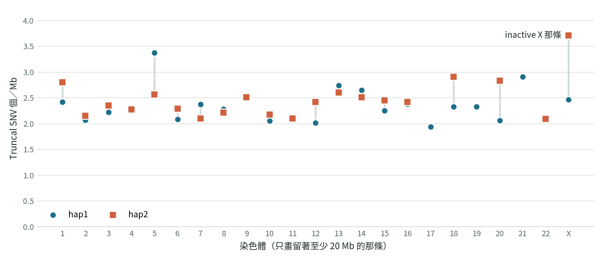

# HG008：體細胞 SNV 在兩條單倍型上的比例（2026-11-06）

問題：COLO829 以外，還有哪個腫瘤能看全基因組 hap1、hap2 的 SNV 比例？結果和 COLO829 一樣嗎？

真值來源：沒有演化真值，這是細胞株的觀測，來自腫瘤和正常組裝的直接比對，不是模擬。讀長：以 long read 組裝為主（HiFi、ONT，另用 Hi-C），polishing 也用了 short read。輸入：GIAB 的 small variant benchmark v0.4 和 SV／CNV benchmark v0.6。生成方法：已公開。

標記：〔實測〕本實驗計算；〔論文〕原文；〔推論〕本檔推論。



## 1. 結論

- **體染色體沒有明顯偏向。** 留著的片段上，hap1 2.31、hap2 2.39 個／Mb，比值 0.97（95% CI 0.93–1.01）。〔實測〕
- **原始比例 44:56 有 LOH 的影響。** chr4、chr9、chr22 的 hap1 和 chr17、chr21 的 hap2 已不在。原始數字是 4,933 比 6,378。〔實測〕
- **chrX 明顯偏向一條：** 2.46 比 3.71 個／Mb，比值 0.66（p ≈ 5e-10）。論文也寫 inactive 的 `chrX_hap2` 有較多 SNV 和 indel。這是 X 不活化的差異，不是爸媽偏向。〔實測〕〔論文〕
- **chr5 也偏向一條：** 比值 1.32，校正 17 次比較後 p ≈ 0.03。原因沒有查。其他染色體校正後都不顯著。〔實測〕
- **和 COLO829 一致：** COLO829 是 9.34 比 9.31 個／Mb（比值 1.004）。兩者的突變集不同，所以密度不能直接比，只能比「兩條是否接近」。

支持的層（N3）：觀測特徵。不支持克隆結構或演化路徑。

## 2. 預期和實際

| | 預期 | 實際 |
|---|---|---|
| 原始比例 | 因 LOH 偏離 50% | 44:56 |
| 扣掉流失片段後的體染色體 | 接近 1 | 0.97（CI 含 1） |
| chrX | 事前沒有預期，算完才知道論文有提 | 0.66，方向和論文相同 |
| 其他染色體 | 接近 1 | chr5 例外（1.32）；其餘校正後不顯著 |

## 3. 方法

每個鹼基要同時符合兩個條件才計入：

1. 在 benchmark BED 內。
2. 同一條單倍型在腫瘤的 CN ≥ 1（官方的 same-haplotype CN 軌道）。

突變的單倍型直接看 contig 名稱（`chr1_hap1`、`chr1_hap2`）。CN 軌道不靠突變位置，所以「留著的片段」的定義比 COLO829 那次獨立。比值用 Poisson 比率的 z 檢定，並把長度當固定值。留著少於 20 Mb 的單倍型不算密度，只有兩條都達標的 17 條染色體做比較。

## 4. 結果

`summary.tsv`：

| 組別 | hap1 SNV | hap1 Mb | hap1 個／Mb | hap2 SNV | hap2 Mb | hap2 個／Mb | 比值（95% CI） | p |
|---|---:|---:|---:|---:|---:|---:|---:|---:|
| 原始，全部 | 4,933 | — | — | 6,378 | — | — | — | — |
| 留著的片段，全部 | 4,733 | 2,039 | 2.32 | 6,181 | 2,503 | 2.47 | 0.940（0.905–0.976） | 0.0013 |
| 留著的片段，體染色體 | 4,351 | 1,884 | 2.31 | 5,610 | 2,349 | 2.39 | 0.967（0.930–1.006） | 0.097 |
| 留著的片段，chrX | 382 | 155 | 2.46 | 571 | 154 | 3.71 | 0.663（0.583–0.755） | 5.2e-10 |
| 兩條都達標的體染色體 | 3,926 | 1,698 | 2.31 | 4,747 | 1,979 | 2.40 | 0.964（0.924–1.006） | 0.091 |

各染色體見 `per_chromosome.tsv`，前幾行：

```
chrom  hap1_snv  hap2_snv  hap1_mb  hap2_mb  hap1_per_mb  hap2_per_mb  ratio  p_bonferroni
chr1   595       350       245.6    124.8    2.42         2.8          0.864  0.51
chr2   501       520       242.1    241.8    2.07         2.15         0.962  1
chr3   230       471       103.7    200.1    2.22         2.35         0.943  1
```

## 5. 限制

- **只有 truncal／clonal 突變。** Subclonal 看不到，低 VAF 的突變也不在這份 VCF 裡。〔論文〕
- **hap1、hap2 不等於爸媽。** 預印本全文以 maternal、paternal、trio 檢索都是 0 筆。跨染色體的 hap1 也不一定是同一位親代。〔實測〕〔推論〕
- **benchmark 排除了部分區域。** 複雜重複、組裝錯誤區和 somatic duplication 的 compound-het 區不算，所以這不是全基因組的完整密度。〔論文〕
- **CN > 1 的片段沒有另外校正。** 複製後才發生的突變會讓該片段的密度略高。〔推論〕
- **Poisson 檢定把突變當獨立。** Kataegis、omikli 這類聚集會讓 p 偏小，所以 chr5 那個 p 要保守看。〔推論〕
- **這是一個細胞株，而且 benchmark 還是 draft。** 結果不能推廣到其他腫瘤。

## 6. 重跑

```bash
python3 tools/hg008_hap_snv_density.py lab_report/2026-11-06_hg008_hap_snv_ratio
```

輸入是共用副本 `/big8_disk/yungjen114/data/HG008/NIST/`，只讀，不用下載。

## 7. 來源

- 預印本：*A complete human pancreatic cancer genome*，bioRxiv 2026，DOI 10.64898/2026.05.01.722316。
- 資料描述：McDaniel 2025，*Sci Data*，DOI 10.1038/s41597-025-05438-2。
- 欄位與方法：共用副本 `NIST/somatic-smvar_v0.4_20261006/README.md`、`NIST/somatic-stvar-CNV_v0.6_20261006/README.md`。
- COLO829 對照：`../2026-11-06_colo829_hap_snv_ratio/`。
