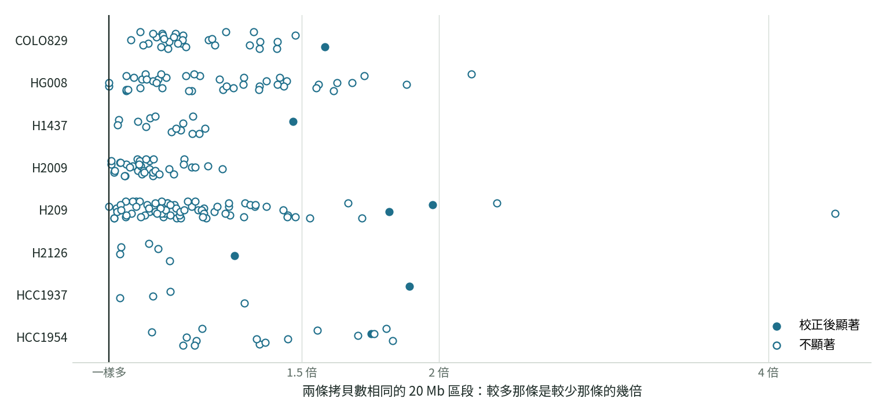

# PRCGAP 8 株細胞株：體細胞 SNV 在兩條單倍型上的比例（2026-11-06）

問題：COLO829、HG008 以外的腫瘤，兩條單倍型的 SNV 也接近各半嗎？染色體區段呢？

真值來源：沒有演化真值，這是細胞株的觀測，SNV 落在正常細胞組裝的兩條單倍型上，不是模擬。讀長：SNV 用 HiFi，組裝用 HiFi、ONT 加 Pore-C 或 Hi-C。輸入：Sakamoto 2026 預印本（PRCGAP，未經同儕審查）的公開結果。生成方法：論文有描述，程式是否完整公開未核對。

用到的會議：2026-11-04（N2、未決事項「突變是否偏向特定單倍型」）。標記：〔實測〕本實驗計算；〔論文〕原文；〔推論〕本檔推論。



## 1. 結論

- **控制拷貝數後，8 株都沒有明顯的全面偏向。** 兩條拷貝數相同的 229 個 20 Mb 體染色體區段中，只有 7 個校正後顯著。較多那條的占比是 51.9%–58.3%。這個數字本來就會高於 50%，因為它永遠取較多的那條。〔實測〕
- **不是完全均勻。** 7 株的卡方／自由度是 1.8–4.4，高於預期的 1，表示區段之間的差異比純隨機大；HG008 最接近 1（1.21）。原因沒有查，可能包含局部聚集、組裝或定位誤差。〔實測〕〔推論〕
- **不能用這份資料算全基因組 hap1:hap2。** 和 GIAB 比對時，約一半染色體的 hap1、hap2 標籤是對調的。〔實測〕
- **逐染色體比較受拷貝數影響，不能直接當偏向。** 份數多的那條突變也多：HCC1937 相關係數 0.95，HCC1954 0.90。〔實測〕

支持的層（N3）：觀測特徵。不支持克隆結構或演化路徑。親源沒有量，所以這也不能回答「偏向爸爸或媽媽」。

## 2. 結果

`summary.tsv` 的主要欄位：

| 細胞株 | 嚴格過濾 SNV | 平衡區段 | 區段內 SNV | 卡方／自由度 | 較多那條占比 | 顯著區段 | 染色體層級：CN 差和密度差的相關 |
|---|---:|---:|---:|---:|---:|---:|---:|
| COLO829 | 27,471 | 33 | 7,762 | 2.44 | 54.5% | 1 | 0.08 |
| HG008 | 6,699 | 43 | 2,520 | 1.21 | 55.8% | 0 | 0.09 |
| H1437 | 40,083 | 15 | 4,795 | 2.32 | 53.6% | 1 | 0.23 |
| H2009 | 112,957 | 36 | 31,617 | 1.82 | 51.9% | 0 | 0.55 |
| H209 | 22,947 | 75 | 11,983 | 2.31 | 54.6% | 2 | 0.41 |
| H2126 | 108,853 | 6 | 6,761 | 4.38 | 52.5% | 1 | 0.71 |
| HCC1937 | 9,893 | 5 | 434 | 2.03 | 55.8% | 1 | 0.95 |
| HCC1954 | 13,888 | 16 | 1,609 | 3.34 | 58.3% | 1 | 0.90 |

H2126、HCC1937 的平衡區段很少，HCC1954 的區段內 SNV 也少，這幾株的證據較弱。

校正後顯著的 7 個區段（`per_window_20mb.tsv`，起點用 CHM13 座標）：

| 細胞株 | 區段 | hap1 | hap2 | 校正後 p |
|---|---|---:|---:|---:|
| H209 | chr8 120–140 Mb | 182 | 92 | 7.6e-06 |
| H209 | chr8 100–120 Mb | 195 | 108 | 6.5e-05 |
| H2126 | chr2 20–40 Mb | 400 | 521 | 0.00043 |
| H1437 | chr11 80–100 Mb | 255 | 173 | 0.0013 |
| HCC1937 | chr6 20–40 Mb | 55 | 29 | 0.028 |
| COLO829 | chr15 80–100 Mb | 131 | 83 | 0.039 |
| HCC1954 | chr2 40–60 Mb | 47 | 82 | 0.039 |

逐染色體結果在 `per_chromosome.tsv`，它受拷貝數和長度估計影響，只當對照。

## 3. 預期和實際

| | 預期 | 實際 |
|---|---|---|
| 其他細胞株整體 | 接近各半 | 平衡區段大致接近，但差異比純隨機大 |
| 逐染色體 | 和 GIAB 版 HG008 相近 | 第一次多處不同；查出拷貝數和長度兩個問題，才改成平衡區段 |
| 檔案欄位 | 可以照論文過濾 | `Normal_depth`、`Normal_VAF` 全是 0，正常樣本的深度過濾無法重建 |

## 4. 方法

1. **過濾：** 依論文的條件，`Depth` ≥ 10、`VAF` ≥ 0.05、不在 misassembly、`Kmer_ratio` ≥ 0.8、沒有 gnomAD 註記。另外要求 `point_mutation_other` 和 `GRCh38_flag` 都是 True。這兩欄 README 沒有解釋，是用 GIAB 對照選的。
2. **留著的片段：** 該單倍型的 CBS 拷貝數 ≥ 0.5。
3. **平衡區段：** CHM13 上每 20 Mb 一段，兩條都留著至少 80%，平均拷貝數差小於 0.3，SNV 至少 10 個，不含 chrX。
4. **比較：** 直接比兩條的 SNV 數，用 Poisson 比率的 z 檢定（計數加 0.5）。每株各自用 Bonferroni 校正。

### 用 HG008 的 GIAB benchmark 驗證〔實測〕

在 GIAB 的 BED 內，以 GRCh38 座標比對：

| 過濾 | 落在 BED 內 | 吻合 GIAB | 吻合率 | 涵蓋 GIAB |
|---|---:|---:|---:|---:|
| 不過濾 | 12,260 | 8,405 | 68.6% | 87.8% |
| 論文可重建的條件 | 6,574 | 6,300 | 95.8% | 65.8% |
| 加上 `other=True` | 6,251 | 6,209 | 99.3% | 64.9% |
| 再加上 `GRCh38_flag=True`（本實驗採用） | 6,182 | 6,175 | 99.9% | 64.5% |

單倍型判定：容許每條染色體整條對調後，6,302 個突變有 97.4% 一致。

## 5. 限制

- **過濾偏向 clonal 突變。** GIAB 只收 truncal 突變，所以「不吻合」的突變可能是真的 subclonal。`other=False` 這組的 VAF 中位數很低（約 0.1–0.19），已被排除。所以這裡幾乎只看高 VAF 的突變。〔實測〕〔推論〕
- **過濾只在 HG008 驗證過。** 其他 7 株沒有同等的對照，單倍型判定也沒有另外驗證。
- **區段定位是粗略的。** 用 contig 到 CHM13 的線性比例定位，適合 20 Mb，不適合細部解讀。
- **長度差異沒有放進區段比較。** 只要求兩條都留著 ≥ 80%，所以小差異還在。
- **檢定把突變當獨立。** 局部聚集會讓 p 偏小。
- **細胞株不等於腫瘤演化現場。** 這些都是長期培養的細胞株，也沒有演化樹真值。
- **這是未經同儕審查的預印本。**
- **癌別：** H2009 是論文寫的肺腺癌；H1437、HCC1937、HCC1954 依 `docs/tumor_sample.md` 或 subagent 回報；H209、H2126 這次沒有在來源核對，所以報告不列。

## 6. 重跑

```bash
D=/big8_disk/boyu114/benchmark_data/prcgap_sakamoto2026
python3 tools/prcgap_hap_snv_ratio.py $D/extracted lab_report/2026-11-06_prcgap_hap_snv_ratio
```

資料來自 [Zenodo 21271691](https://zenodo.org/records/21271691)（v1.1），已通過 md5。`extracted/` 只解出 `point_mutation`、`copynumber`、`ref_table`、`misassembly`、`genomic_overview` 的部分檔案。

論文：Sakamoto 2026，bioRxiv，DOI [10.64898/2026.05.28.728591](https://doi.org/10.64898/2026.05.28.728591)。對照：`../2026-11-06_colo829_hap_snv_ratio/`、`../2026-11-06_hg008_hap_snv_ratio/`。
