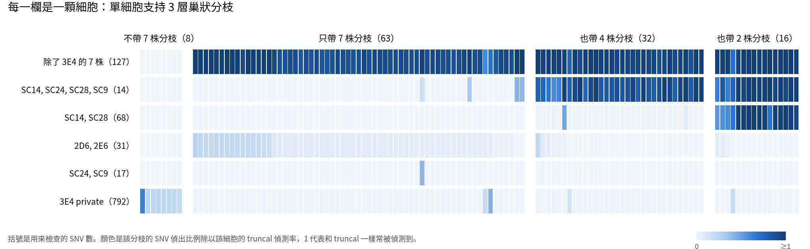
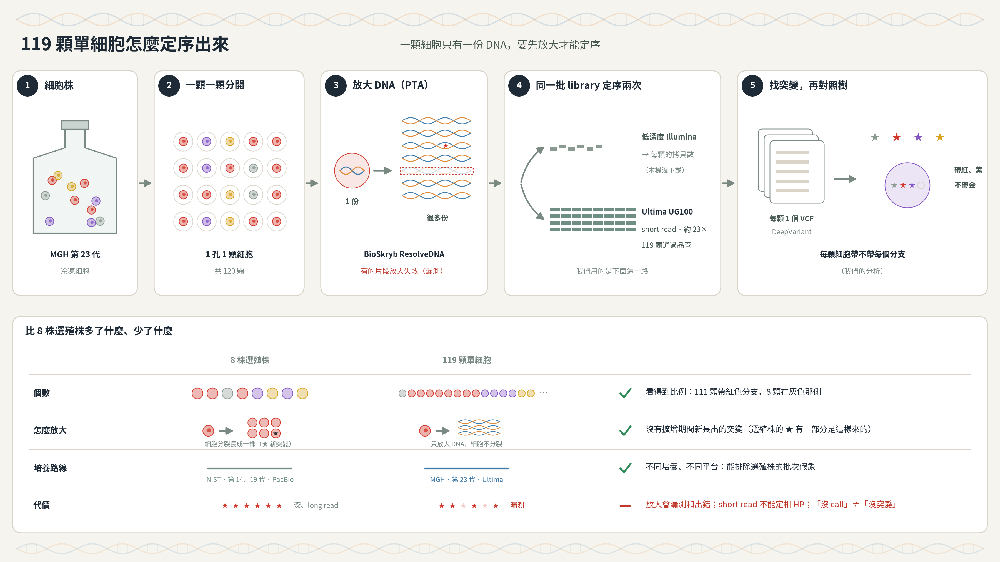
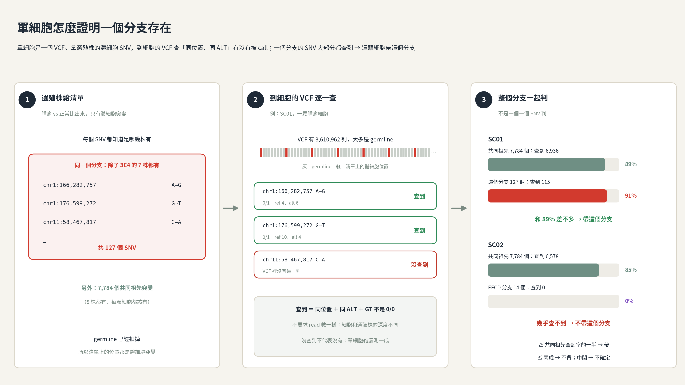
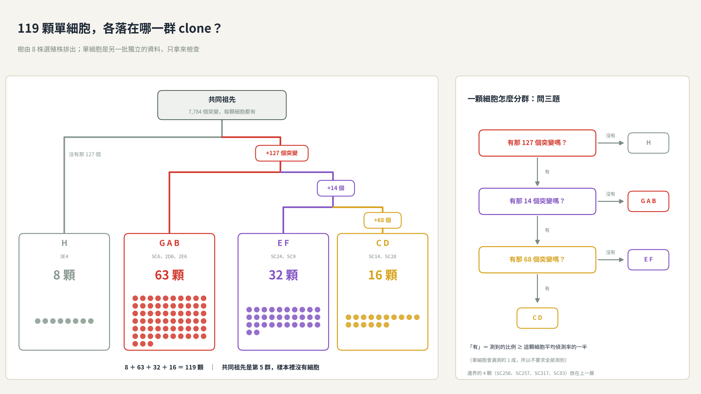

# HG008：用 119 顆單細胞檢查重建的 clone 樹（2026-11-07）

問題：8 株 clone 重建的候選樹（`../2026-11-07_hg008_tree_rebuild/`），在 p23 的單細胞裡站得住嗎？

真值來源：沒有演化真值，單細胞是獨立的量測，但不是已驗證的樹。讀長：UG100 short read（單細胞例外，2026-11-06）。輸入：119 顆 BioSkryb PTA 單細胞的公開 VCF；候選樹來自 PacBio clone。生成方法：見下方腳本。

用到的會議：2026-11-04（決議 2、未決事項 2、3）。標記：〔實測〕本實驗計算；〔推論〕本檔推論；〔事後〕看到結果才追加的檢查。



## 先備知識：單細胞怎麼定序出來（2026-11-11 補）



- 細胞：MGH 0823p23 批（第 23 代）的冷凍細胞，和 NIST 的 8 株選殖株是不同培養路線。〔repo〕GIAB `README_Bioskryb-Ultima.md`、`README_Bioskryb.md`
- BioSkryb 用 ResolveDNA 把 120 顆細胞各自的 DNA 放大做成 library；先做低深度 Illumina（每顆的拷貝數，本機沒下載），同一批 library 再轉成 Ultima 格式，UG100 單端 300 bp 定序；119/120 通過品管。〔repo〕同上
- 深度：平均覆蓋 12.1–47.6×，中位 23.1×。〔實測〕`single_cell_vcf/NIST_Bioskryb_QC_measures.csv`
- 呼叫：GRCh38 比對，DeepVariant 1.4.0，VEP 註解，PASS 過濾。〔repo〕VCF header
- 比選殖株多的：細胞層級的比例（111／48／16／8）、沒有擴增期間的新突變、不同培養與平台的獨立檢查。少的：放大漏測與錯誤、short read 不能定相 HP。〔推論〕
- 圖：`python3 tools/plot_hg008_singlecell_explainer.py lab_report/2026-11-07_hg008_sc_check/how_single_cells_were_sequenced.png`

## 簡單版：單細胞怎麼證明一個分支存在（2026-11-12 補）

**說法（使用者 2026-11-12 確認）：** 單細胞是一個 VCF。拿 8 株選殖株的體細胞 SNV，到細胞的 VCF 裡查「同位置、同 ALT」有沒有被 call（GT 不是 0/0）。一個分支的 SNV 大部分都查到，就表示這顆細胞帶這個分支。單細胞證明的是「分支存在」，不是逐一證明每個突變。
- 不比 read 數：細胞和選殖株的深度不同。細胞 VCF 是單一細胞的 DeepVariant call，沒有和正常組織比，所以 germline 和體細胞突變混在一起（SC01 有 3,610,962 列 PASS）；只查清單上的位置，就只看到體細胞突變。〔實測〕〔程式〕`tools/hg008_sc_tree_check.py:39-56`



圖：`python3 tools/plot_hg008_sc_matching.py lab_report/2026-11-07_hg008_sc_check/how_a_cell_is_matched.png`

## 簡單版：119 顆細胞各落在哪一群（2026-11-12 補）



- 每顆細胞依序問：有沒有那 127、14、68 個突變（「有」＝ rel ≥ 0.5）。走到哪裡停，就落在哪一群：H 8、G A B 63、E F 32、C D 16。〔實測〕`tables/cell_by_branch.tsv`
- 有 4 顆在邊界（SC256、SC257、SC83 的 14 個；SC317 的 68 個；rel 0.32–0.49），歸到上一層。
- 圖：`python3 tools/plot_hg008_sc_simple.py lab_report/2026-11-07_hg008_sc_check/tables/cell_by_branch.tsv lab_report/2026-11-07_hg008_sc_check/which_clone_each_cell.png`

## 1. 結論

- **樹的主架構有單細胞支持。** 119 顆細胞分成 3 層巢狀分枝：111 顆帶「除了 3E4 的 7 株」、其中 48 顆帶 {SC14, SC24, SC28, SC9}、其中 16 顆帶 {SC14, SC28}。〔實測〕
- **事先定的巢狀檢查全部通過。** 依判定規則，沒有細胞違反。訊號也很兩極：這三個分枝的帶者相對偵測率中位 0.93–0.99，不帶者 0.00。〔實測〕
- **這三個分枝不是 clone 批次造成的。** 單細胞都是 p23，和 clone 的 p14、p19 批次無關。〔實測〕〔推論〕
- **樹的末端沒有得到驗證。** {2D6, 2E6}、{SC24, SC9} 沒有細胞達到帶者標準，SC6 的位置也分不出來；8 條 private 枝中，只有 3E4 有 1 顆細胞達到帶者標準。〔實測〕
- **有少數細胞不符合簡單的樹。** 約 5 顆像混合細胞，SC293 和樹的順序不完全一致。〔事後〕

支持的層（N3）：克隆結構的主架構。不支持完整演化路徑；這是培養中的細胞株，不等於病人腫瘤。

## 2. 分枝結果

`tables/branch_summary.tsv`。帶者：相對偵測率 ≥ 0.5；不帶者：≤ 0.2；其餘不確定。

| 分枝 | 檢查的 SNV | 帶者 | 不確定 | 不帶者 | 判定 |
|---|---:|---:|---:|---:|---|
| 除了 3E4 的 7 株 | 127 | 111 | 0 | 8 | **支持** |
| SC14, SC24, SC28, SC9 | 14 | 48 | 3 | 68 | **支持** |
| SC14, SC28 | 68 | 16 | 1 | 102 | **支持** |
| 2D6, 2E6 | 31 | 0 | 14 | 105 | 只有部分支持（見第 3 節） |
| SC24, SC9 | 17 | 0 | 1 | 118 | 沒有驗證，只有 1 顆細胞帶部分位點 |
| 除了 3E4、SC6 的 6 株 | 4 | 未測 | | | SNV 太少，未達事先定的 10 個 |
| 3E4 private | 792 | 1 | 8 | 110 | 部分支持（見第 3 節） |
| 其他 7 條 private | 225–620 | 0 | 0–1 | 118–119 | 沒有驗證 |

所有細胞的 truncal 偵測率是 0.70–0.94，中位 0.873，沒有細胞被排除。

**巢狀檢查：** `tables/nesting.tsv` 違反數全為 0。但多數配對的帶者數是 0，只有 111、48、16 這三層和 3E4 的配對真正有檢定力。

**批次：** {SC14, SC24, SC28, SC9} 的帶者比例在 8 個定序 run 之間沒有明顯差異（置換檢定 p = 0.27，〔事後〕）。

**對照：** 低 QUAL 的衝突模式（例如 3E4,SC14、SC14,SC9）沒有帶者。但部分模式有很多不確定細胞，例如 SC6,SC9 有 97 顆（中位 0.27），低 QUAL 的 truncal 模式中位 0.44。這些位點可能有一部分是真的，只是 clone 的 call 不完整；所以「低 QUAL 全是假 call」不成立。〔實測〕〔推論〕

## 3. 事後檢查〔事後〕

這些不是事先定的檢定，門檻和分組都是看過資料才選的。

- **3E4 譜系：** 不帶 7 株分枝的 8 顆細胞，都帶 22–62% 的 3E4 private SNV；其他 111 顆的中位只有 1.2%。所以這 8 顆很可能是 3E4 這一側的細胞，也代表 3E4 private 有一部分在分離前就存在。〔推論〕
- **{2D6, 2E6} 分段：** 31 個位點中，2 個出現在 65–66 顆細胞（「只帶 7 株」的 63 顆中有 58–59 顆），4 個出現在同一群約 15 顆細胞，其餘幾乎只在 clone 看到。這表示這條枝可能分成幾段，細胞只分享前段。但每段的位點很少。〔推論〕
- **拷貝數規則得到支持：**
  - 「除了 SC6」且判定為丟失的 367 個 SNV，119 顆細胞全部帶（中位 0.996），所以它們是 truncal，只在 SC6 丟失。
  - 「除了 3E4」且判定為丟失的 110 個 SNV，8 顆 3E4 側細胞中有 7 顆也帶（0.85–1.03），所以不是分枝證據。排除它們是對的。
  - 同一模式但只有 LOH 狀態的 156 個 SNV，這 8 顆幾乎都沒有（≤ 0.06），代表它們其實是真的分枝。所以收緊的規則偏保守，但沒有造成錯誤結論。
- **chr10：** 「除了 2E6」的 71 個丟失 SNV 中有 69 個在 chr10 1–39 Mb，有 44 顆細胞沒有，其中 42 顆屬於「只帶 7 株」。這比較像 chr10 的 LOH，不是 SNV 分枝。〔推論〕
- **混合訊號的細胞：**
  - SC104、SC119、SC207、SC362：7 株分枝只有 0.59–0.79，又帶 14–43% 的 3E4 private，可能是兩顆細胞混在一起。
  - SC133：同時帶 4 株分枝（0.80）和 {2D6, 2E6}（0.22），也可能是混合。沒有用原始 read 確認。
- **SC293 不完全符合樹：** 它帶 {SC24, SC9} 的 6 個位點，但 {SC14, SC24, SC28, SC9} 的 14 個位點只帶約 2 個。依樹的順序，應該要先帶後者。原因沒有查，可能是這條枝的 SNV 順序不像樹那麼簡單，也可能是單細胞的 dropout 或錯誤。這只有一顆細胞。

## 4. 預期和實際

| | 預期 | 實際 |
|---|---|---|
| 三個深層分枝 | 兩極分布、巢狀 | 符合 |
| 批次假象 | 如果只是批次，單細胞不會有這些分群 | 主要分枝有分群；{2D6, 2E6} 只有部分支持，{SC24, SC9} 無法排除 |
| 低 QUAL 模式 | 接近 0 | 沒有帶者，但部分模式不接近 0 |
| private 枝 | 沒有事先預期 | 7 條沒有帶者，3E4 部分支持 |

## 5. 和 2026-10-27 的對照

**不是完全相同的樹。** 共同部分相同，新樹多解析了兩處。舊樹的輸入已刪除，舊樹形取自 `tools/draw_hg008_clone_tree.py`。

```text
舊：3E4 |（SC6、{2D6, 2E6}、{SC14, SC28, SC9, SC24} 三者先後未解析）；SC9、SC24 未再分組
新：3E4 |（SC6 |（{2D6, 2E6} |（{SC14, SC28} | {SC24, SC9}）））
```

- **相同：** 3E4 最早分出、{2D6, 2E6}、{SC14, SC24, SC28, SC9}、{SC14, SC28}。細胞數 111／8、48、16 和 chr10 的 44 顆也相同。「除了 3E4」的丟失 SNV 是 108 和 110 個，接近但篩選不同。
- **新增：** {SC24, SC9}（只有 clone 支持，單細胞未驗證）；SC6 先分出（只有 4 個 SNV，最弱）。兩處都不和舊樹矛盾，但也不是重現。
- **細節不同：** 舊報告寫 3E4 private 在 2 顆細胞部分帶；這次用 QUAL ≥ 20 後，8 顆都看得到。{2D6, 2E6} 舊報告是 16 顆帶 59 個中的 11 個；這次只用 CN 乾淨的 31 個 SNV，約 15 顆帶其中 4 個，另有 2 個出現在約 65 顆，兩者都指向部分支持。

**這次沒有完全避開舊結果：** 舊報告算完才讀，但 48、16 顆等數字已經寫在 2026-11-06 的證據盤點裡，我事先知道。單細胞查詢用的也是同一支 `tools/hg008_sc_tree_check.py`，帶者門檻 0.5 也相同。

**舊報告已刪除（2026-11-07，使用者決定）：** `git show 07ff507:lab_report/2026-10-27_hg008_sc_tree_check/README.md` 可取回文字和兩張小表；`sc_calls.tsv.gz` 沒進 git，無法取回。這次沒有重算的內容只在舊報告：chr10 兩群細胞失去不同 haplotype（24 顆的 germline het 比較），以及 7 株共同枝的 bulk HP 計數。

**可重現的範圍：** 同一批公開資料，用部分相同的程式，主要分枝和細胞數能重現。這不是用新樣本或新方法做的獨立重複，所以不能增加生物學上的證據強度。

## 6. 限制

- **只看 PASS VCF：** 沒有回到原始 read，所以「沒有 call」和「沒有突變」分不開。PTA 也有 dropout 和擴增錯誤。
- **Clone 和細胞的代數不同：** clone 在 p14、p19 分離，細胞是 p23。沒有帶者不代表分枝不存在，可能只是該譜系在 p23 很少。
- **判定門檻是人為的：** 0.5 和 0.2 不是由模型估出來的。
- **{SC14, SC24, SC28, SC9} 只有 14 個 SNV：** 位點少，相對偵測率會比較不穩定。
- **細胞比例不等於 bulk 的 clone 比例：** 119 顆是抽樣，也可能有捕捉偏差。

## 7. 重跑

```bash
T=lab_report/2026-11-07_hg008_tree_rebuild/tables
O=lab_report/2026-11-07_hg008_sc_check
V=/big8_disk/boyu114/benchmark_data/GIAB/HG008/single_cell_vcf/vcf
python3 -I tools/hg008_sc_tree_check.py $T/snv_classes_vaf0.25_qual20.tsv $V $O/tables 8
python3 -I tools/hg008_sc_clade_test.py $T/snv_classes_vaf0.25_qual20.tsv $T/clades_vaf0.25_qual20.tsv $O/tables/sc_calls.tsv.gz $V $O/tables
python3 tools/plot_hg008_sc_clades.py $O/tables/cell_by_branch.tsv $O/sc_clades.png
```

## 原分析對話

產生本結果的 Claude Code 對話已保存在 `/big8_disk/boyu114/analysis_transcripts/hg008_tree/`（不在 repo 內；說明見該處 `README.md`）。2026-11-11 週會要求保留，供日後 bulk 方法參考。
