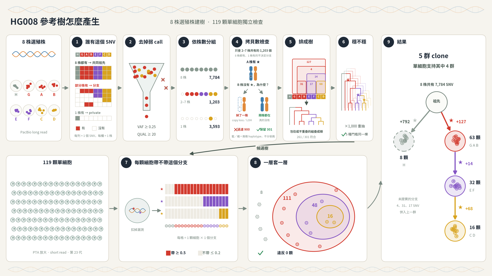
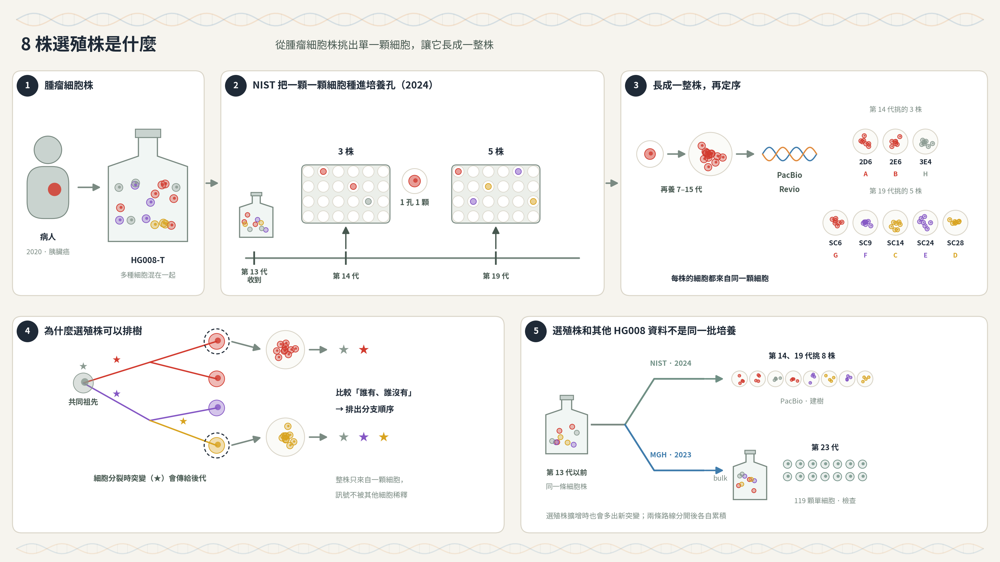
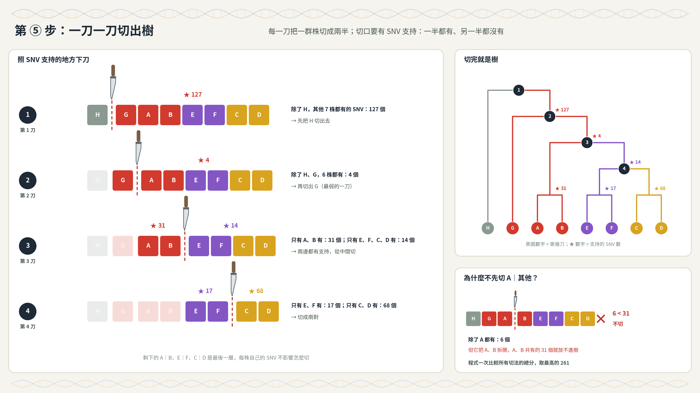
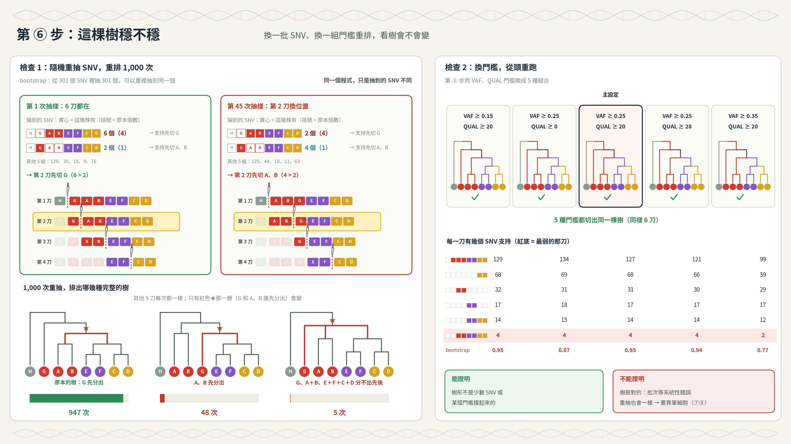
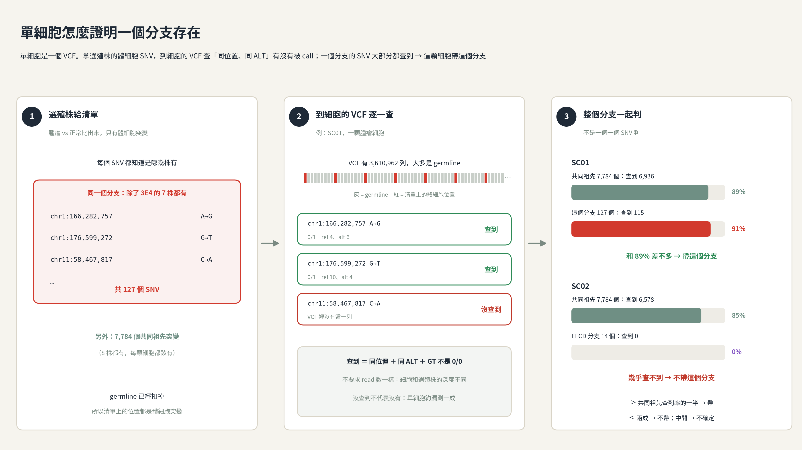
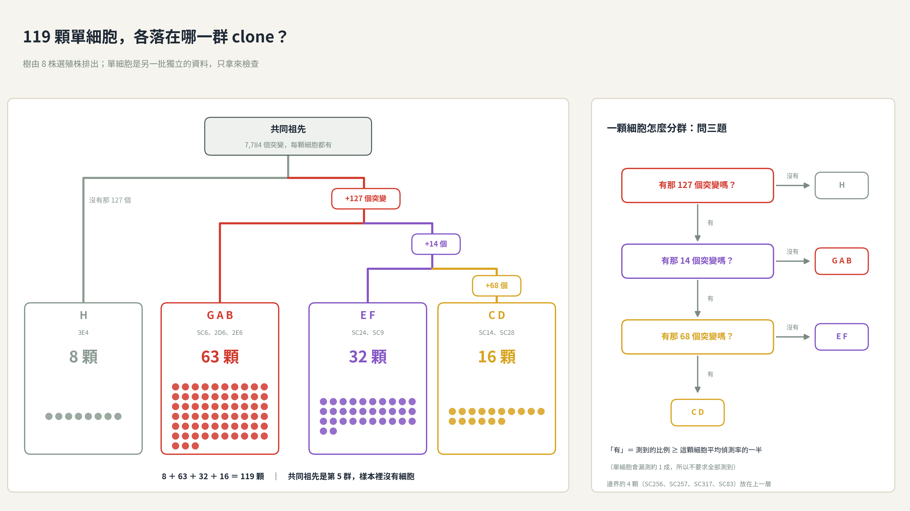
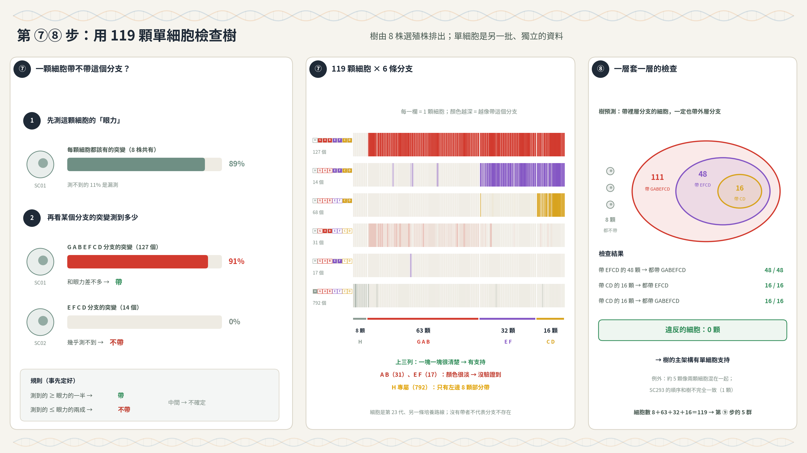

# HG008 參考樹是怎麼產生的（步驟清單，2026-11-11）

用途：11-11 週會待辦「理解 HG008 參考樹的產生方法」（本週主軸第 1 項）。這份清單是圖解的骨架，下一步才畫圖。
依據：程式（附 `檔案:行號`）與兩份 lab_report。原分析對話在 `/big8_disk/boyu114/analysis_transcripts/hg008_tree/`，只用來查當時的理由，不當證據（L3）。
標記：〔程式〕讀程式得到；〔實測〕報告裡的數字；〔推論〕本檔推論。



圖：`python3 tools/plot_hg008_tree_method.py lab_report/2026-11-07_hg008_tree_rebuild/how_tree_was_built.png`

## 先備知識：8 株選殖株是什麼



NIST 從 HG008-T 腫瘤細胞株（2020 年一位女性胰臟癌病人，MGH Liss lab 建立）做的「clonal cell lines」：在 bulk 培養的第 14 代與第 19 代把單顆細胞種進培養孔，每顆長成一株，再養 7–15 代後收 DNA，PacBio Revio 定序。〔repo〕GIAB `README_HG008.md`「HG008-T_clones」（本機副本 `/big8_disk/boyu114/benchmark_data/GIAB/HG008/README_HG008.md`）

| 批次（目錄） | 種單細胞時的代數 | 選殖株（再養幾代） |
|---|---|---|
| `20240718p14` | 14 | 2D6（+12）、2E6（+11）、3E4（+7） |
| `20240805p19` | 19 | SC14（+13）、SC24（+8）、SC28（+7）、SC6（+15）、SC9（+13） |

- 119 顆單細胞是 MGH 的 0823p23 批（第 23 代），和選殖株不是同一條培養路線；NIST 在 2024 年收到第 13 代後自己往下養。兩條路線在第 13 代或更早分開。〔repo〕`README_Bioskryb-Ultima.md`；〔推論〕分開點
- 每株也是整群細胞一起定序；擴增期間新產生的突變只在該株，會算進 private。〔推論〕
- 圖：`python3 tools/plot_hg008_clones_explainer.py lab_report/2026-11-07_hg008_tree_rebuild/what_are_the_8_clones.png`

## 一句話

先用 8 株選殖株的 SNV「誰有、誰沒有」排出一棵樹，再拿 119 顆單細胞獨立檢查每個分支。兩種資料**不是合在一起建樹**：選殖株負責建，單細胞負責檢查。〔程式〕`tools/hg008_sc_clade_test.py:1-15`

## 流程

```text
 8 株選殖株（PacBio，p14／p19）            119 顆單細胞（PTA，short read，p23）
 DeepSomatic SNV + PURPLE 拷貝數                 PASS VCF
          │                                          │
 ① 每株的 SNV「有／沒有」                            │
 ② 去掉弱 call、低 QUAL                              │
 ③ 依「哪幾株有」分組（pattern）                      │
 ④ 只留拷貝數乾淨的共有 SNV                          │
 ⑤ 選出彼此相容、SNV 最多的分支組合 ──► 候選樹       │
 ⑥ bootstrap、換門檻看穩不穩                         │
          │                                          │
          └──────────► ⑦ 每顆細胞帶不帶每個分支的 SNV ◄┘
                       ⑧ 巢狀檢查 → 哪些分支有單細胞支持
                       ⑨ 投影片：5 群 clone，單細胞支持其中 4 群
```

## 步驟

| # | 做什麼 | 程式 | 結果 | 為什麼這樣做／限制 |
|---|---|---|---|---|
| ① | 讀 8 株的 DeepSomatic VCF：只留 PASS、單鹼基 SNV、chr1–22 與 X；記 VAF 和 QUAL | `tools/hg008_tree_rebuild.py:45-57`〔程式〕 | 8 株：2D6、2E6、3E4（p14）；SC14、SC24、SC28、SC6、SC9（p19） | 只有 PASS call，沒有原始 read，「沒 call」和「沒突變」分不開〔實測〕README 限制 |
| ② | 任何一株 VAF 介於 0 和 0.25 → 整個 SNV 放旁邊；帶者 QUAL 中位數 < 20 → 放旁邊 | `hg008_tree_rebuild.py:153-160`〔程式〕 | 主設定放旁邊：弱 call 7,342、低 QUAL 2,841〔實測〕`tables/tree_summary.tsv` | 弱 call 不能算「有」也不能算「沒有」。QUAL 分布在 20 附近有谷；衝突模式 QUAL 中位約 6–8，真分支約 36〔實測〕 |
| ③ | 每個 SNV 依「哪幾株有」編成一個 pattern；8 株都有＝truncal，1 株＝private，2–7 株＝共有 | `hg008_tree_rebuild.py:162-176`〔程式〕 | truncal **7,784**（共同祖先）、private 3,593、共有 1,203〔實測〕 | truncal 就是投影片共同祖先的 7,784 |
| ④ | 共有 SNV 再看 PURPLE 拷貝數：沒有它的株，拷貝數不比帶的株少、且兩條 haplotype 都還在（minor ≥ 1）→「乾淨」 | `hg008_tree_rebuild.py:80-97`〔程式〕 | 乾淨 301、拷貝數丟失 655、落在 LOH 245、無 CN 2〔實測〕。依 LOH 狀態重分（2026-11-11 用同一程式的函式重算，主設定）：A 正常、只有 B 發生 LOH 637；兩株都 LOH 261；B 份數變少但不是 LOH 2。程式的分類名稱是「丟失」（B 任一條份數少於 A，先判）和「落在 LOH」（份數不少但 minor = 0，只在 A 也是 minor = 0 時發生）〔程式〕`:93-96` | 一株「沒有」可能是後來丟掉那段染色體，不是較晚才產生。PURPLE 不分是哪條 haplotype，所以 LOH 一律保守排除〔程式〕`:6-11` |
| ⑤ | 在乾淨 SNV 上，用精確動態規劃選一組「兩兩巢狀或不相交」的分支，讓落在樹上的 SNV 最多 | `best_laminar`，`hg008_tree_rebuild.py:104-136、188-189`〔程式〕 | 選出 6 個分支；301 個中 261 個落在樹上〔實測〕`tables/clades_vaf0.25_qual20.tsv` | 「相容」＝一個分支不能只和另一個部分重疊；這是完美系統發生（perfect phylogeny）的條件〔推論〕 |
| ⑥ | SNV 重抽 1,000 次 bootstrap；另跑 5 種 VAF／QUAL 門檻 | `hg008_tree_rebuild.py:40、190-194`〔程式〕 | 5 個分支 bootstrap 1.000，{除了 3E4、SC6 的 6 株} 0.947（只有 4 個 SNV）；5 種門檻選出相同分支〔實測〕 | bootstrap 只看 SNV 抽樣的穩定，不能排除批次或系統性錯誤〔推論〕 |
| ⑦ | 對每顆細胞的 PASS VCF 查樹上每個 SNV 有沒有被 call；細胞的 truncal 偵測率＝它的靈敏度；分支偵測率 ÷ truncal 偵測率＝rel | `tools/hg008_sc_tree_check.py:39-90`〔程式〕 | truncal 偵測率 0.70–0.94，中位 0.873，沒有細胞被排除〔實測〕sc_check README | 除以 truncal 是為了扣掉 PTA 的 dropout |
| ⑧ | 事先定規則：rel ≥ 0.5 帶者、≤ 0.2 不帶者；內層帶者不可以是外層不帶者；SNV < 10 個的分支不測 | `tools/hg008_sc_clade_test.py:4-15、32-35`〔程式〕 | 三層巢狀：111 ⊃ 48 ⊃ 16 顆，違反 0；{2D6, 2E6} 部分支持；{SC24, SC9} 未驗證；3E4 private 8 顆部分帶〔實測〕 | 細胞（p23）和選殖株（p14／p19）是不同樣本；沒帶者不等於分支不存在〔程式〕`:14-15` |
| ⑨ | 投影片把沒有單細胞證實的分支（4、31、17 個 SNV）併進上一群，得到 5 群 clone | `report/2026_11_11_slides/gen_res2.py:40-80`；代稱表 `report/2026_11_11_slides/BRIEF.md`「選殖株代稱」〔程式〕 | 共同祖先（0 顆）、H＝3E4（8 顆）、G＋A＋B＝SC6＋2D6＋2E6（63 顆）、E＋F＝SC24＋SC9（32 顆）、C＋D＝SC14＋SC28（16 顆） | 8＋63＋32＋16＝119；63＝111−48，32＝48−16〔實測〕。H 只靠「沒有 127 個 SNV」定義 |

## 第 ⑤ 步詳圖：一刀一刀切出樹



- 把 8 株排成一排，每一刀把一群切成兩半。一刀的支持＝「這一半都有、另一半都沒有」的拷貝數乾淨 SNV 數。〔程式〕`hg008_tree_rebuild.py:104-126、188`
- 選出的四刀：① H｜其他 7 株（127）② G｜其他 6 株（4，最弱）③ A、B｜E、F、C、D（31、14）④ E、F｜C、D（17、68）。〔實測〕`tables/clades_vaf0.25_qual20.tsv`
- 不切「A｜其他 7 株」：它有 6 個 SNV 支持，但會把 A、B 拆開，A、B 共有的 31 個就放不進樹。〔實測〕`tables/pattern_summary_vaf0.25_qual20.tsv`
- 圖是一刀一刀畫，程式其實一次比較所有切法的總分，取最高的 261（301 個中），是精確解。〔程式〕`:104-136`
- 圖：`python3 tools/plot_hg008_tree_ordering.py lab_report/2026-11-07_hg008_tree_rebuild/how_tree_is_ordered.png`

## 第 ⑥ 步詳圖：這棵樹穩不穩



- bootstrap：從 301 個乾淨 SNV 有放回地抽 301 個，重跑第 ⑤ 步，共 1,000 次。127、68、31、17、14 這 5 刀每次都在；只有 4 個 SNV 的那刀出現 947 次。〔程式〕`hg008_tree_rebuild.py:190-194`〔實測〕`tables/clades_vaf0.25_qual20.tsv`
- 1,000 次只排出三種完整的樹：原本的樹（G 先分出）947 次；A、B 先分出 48 次；G、A＋B、E＋F＋C＋D 三群分不出先後 5 次。其他 5 刀每次都相同。〔實測〕2026-11-11 用同一程式的函式、同一 seed 重算
- 圖上兩次是程式真正的抽樣（seed 20261107，2026-11-11 用同一程式的函式重算）：第 1 次「A、B、E、F、C、D 都有」抽到 6 個、「G、E、F、C、D 都有」2 個，第 2 刀先切 G；第 45 次（第一次不一樣）前者只抽到 2 個、後者 4 個，第 2 刀改成先切 A、B，再切 G。
- 換門檻：VAF 0.15／0.25／0.35 × QUAL 0／20／28 的 5 種組合從頭重跑，都切出同樣 6 刀；最弱那刀的 SNV 數 2–4，bootstrap 0.77–0.95。〔實測〕`tables/clades_vaf*_qual*.tsv`
- 能證明：樹形不是少數 SNV 或某個門檻撐起來的。不能證明：樹是對的；批次等系統性錯誤重抽也會一樣，要靠第 ⑦⑧ 步的單細胞。
- 圖：`python3 tools/plot_hg008_tree_stability.py lab_report/2026-11-07_hg008_tree_rebuild/how_tree_stability_was_checked.png`

## 第 ⑦⑧ 步詳圖：用單細胞檢查樹

**說法（使用者 2026-11-12 確認）：** 單細胞是一個 VCF。拿 8 株選殖株的體細胞 SNV，到細胞的 VCF 裡查「同位置、同 ALT」有沒有被 call（GT 不是 0/0）。一個分支的 SNV 大部分都查到，就表示這顆細胞帶這個分支。單細胞證明的是「分支存在」，不是逐一證明每個突變。
- 不比 read 數：細胞和選殖株的深度不同。細胞 VCF 是單一細胞的 DeepVariant call，沒有和正常組織比，所以 germline 和體細胞突變混在一起（SC01 有 3,610,962 列 PASS）；只查清單上的位置，就只看到體細胞突變。〔實測〕〔程式〕`tools/hg008_sc_tree_check.py:39-56`



圖：`python3 tools/plot_hg008_sc_matching.py lab_report/2026-11-07_hg008_sc_check/how_a_cell_is_matched.png`

**簡單版（2026-11-12）：** 每顆細胞問三題：有沒有那 127 個、14 個、68 個突變。走到哪裡停，就落在哪一群。結果是 H 8 顆、G A B 63 顆、E F 32 顆、C D 16 顆，合計 119 顆；共同祖先這一群沒有細胞。〔實測〕



圖：`python3 tools/plot_hg008_sc_simple.py lab_report/2026-11-07_hg008_sc_check/tables/cell_by_branch.tsv lab_report/2026-11-07_hg008_sc_check/which_clone_each_cell.png`

下面是詳細版，說明「有」怎麼判斷：



- 圖用「眼力」說明：先看每顆細胞都該有的 7,784 個突變測到幾成（SC01 為 89%，6,936／7,784），再看某一刀的突變測到幾成（SC01 的 127 個那刀 91%，115／127）；和眼力差不多（≥ 一半）判「帶」，幾乎測不到（≤ 兩成）判「不帶」，例如 SC02 的 14 個那刀 0%。〔實測〕`../2026-11-07_hg008_sc_check/tables/cell_by_branch.tsv`〔程式〕`tools/hg008_sc_clade_test.py:4-7`
- 熱圖：119 顆細胞依帶哪幾刀排序，127、14、68 三列呈清楚的色塊；A、B（31）和 E、F（17）幾乎沒有細胞帶；H 專屬只有 8 顆部分帶。
- 巢狀：帶 14 的 48 顆都帶 127，帶 68 的 16 顆都帶 14 和 127，違反 0 顆。〔實測〕`../2026-11-07_hg008_sc_check/tables/nesting.tsv`
- 圖：`python3 tools/plot_hg008_sc_check_explainer.py lab_report/2026-11-07_hg008_sc_check/tables/cell_by_branch.tsv lab_report/2026-11-07_hg008_sc_check/how_the_tree_was_checked.png`

## 單細胞能證明什麼、不能證明什麼（N3）

- **能：** 主架構的三層巢狀不是選殖株批次造成的，因為細胞全是 p23，和 p14／p19 批次無關。〔實測〕〔推論〕
- **不能：** 末端分支（{2D6, 2E6}、{SC24, SC9}、SC6 的位置、多數 private 枝）沒有驗證；這是培養中的細胞株，不等於病人腫瘤的演化路徑。〔實測〕
- **少數例外：** 約 5 顆細胞像混合細胞；SC293 的順序和樹不完全一致。〔實測〕sc_check README 第 3 節

## 和 10-27 第一版的差別

同一批資料、部分相同的程式。主要分支和細胞數（111／8、48、16）相同。新版多解析兩處：{SC24, SC9} 和「SC6 先分出」，兩處都只有選殖株支持。這是重現，不是獨立重複。〔實測〕`lab_report/2026-11-07_hg008_sc_check/README.md` 第 5 節

## 對 bulk 重建（本週主軸第 4 項）的啟示〔推論〕

- 這棵樹靠「8 個樣本各自的有／沒有」排序。單一 bulk 樣本沒有這個資訊，只能靠 VAF／CCF 分群推巢狀，所以兩者不能直接照搬（O6）。
- **bulk 和選殖株不是同一條培養路線（2026-11-12 查）：** 共用副本 `/big8_disk/yungjen114/data/HG008/` 的 tumor（ONT 63×、ONT-UL 54×、PacBio 116×）全是 Liss lab 的 0823p23 批〔repo〕該處 `README.md:33-37`。119 顆單細胞也是 0823p23〔repo〕`README_Bioskryb-Ultima.md:53`。8 株選殖株則是 NIST 收到第 13 代後自己養，在 p14／p19 種單細胞長成〔repo〕GIAB `README_HG008.md:53、153-170`。三者同一位病人、同一個細胞株，共享共同祖先突變；但選殖株和 bulk 在第 13 代或更早就分開培養。所以 bulk 的 clone 組成要和同批的單細胞比較（8／63／32／16），不是和選殖株比；選殖株只提供分支結構。〔推論〕NIST 自己的 bulk（`HG008/NIST/HG008-T_bulk/`，和選殖株同路線）先不用（使用者 2026-11-12）。
- 第 ② 步的 QUAL 門檻和第 ④ 步的拷貝數排除，在 bulk 也會遇到：低品質 call 和 LOH 造成的「缺失」都會產生假分支。

## 當時的理由（2026-11-12 補）

**VAF 0.25、QUAL 20 門檻**
- 使用者說明：當時做過實驗，不設這兩個門檻，選殖株排出的分支會互相矛盾（部分重疊、放不進同一棵樹）。〔使用者 2026-11-12〕
- 表格的數字支持這個說法，以 QUAL 為主：QUAL 0（不過濾）時，乾淨共有 SNV 520 個，有 249 個（48%）和選出的樹矛盾；QUAL 20 時是 40／301（13%）；QUAL 28 時是 6／258（2%）。〔實測〕`tables/tree_summary.tsv` 的 `conflicting_chosen` 列
- 選 20 不選 28：QUAL 分布在 20 附近有谷（見第 ② 步）；28 多放旁邊 839 個 SNV（2,841 → 3,680），truncal 少 224 個，選出的 6 刀相同。〔實測〕同上
- VAF 門檻在 0.15／0.25／0.35 之間，矛盾數差不多（45／40／35），選出的分支也相同。〔實測〕
- **VAF 0.25 的來源（查原對話，2026-11-12）：** 0.25 在 10-27 第一版定下，之後沒改。依據只有一張直方圖：2D6 一株 PASS SNV 的 VAF，以 0.1 為一格，峰在 0.5（3,002 個）和 1.0（2,881 個），0.0–0.2 有 17／447／446 個，0.3 起變多（597、1,594）。接著把 0.25 寫進程式，程式說明寫的理由是「選殖株由單顆細胞長成，真的 SNV 應該在 VAF 0.5 或 1.0 附近」。〔對話〕`2026-10-27_hg008_clone_tree_first.jsonl` 第 354–363 筆；〔程式〕`tools/hg008_clone_tree.py:1-10、23`
  - 當時沒有比較其他 VAF 值，也只看了 2D6 一株。助理的推理區塊在紀錄裡是空的，所以沒有更細的理由。
  - 11-07 重做時第一次比較 0.15／0.25／0.35。還沒加 QUAL 時，矛盾數是 1,084／729／496，三個都很多，選出的分支一樣。所以「會互相矛盾」的實驗結果是 QUAL 門檻解決的；VAF 怎麼調都解決不了。接著查矛盾 SNV 的 QUAL（中位約 6–8），才加入 QUAL 20。〔對話〕`2026-11-06_07_hg008_tree_rebuild_sc_check.jsonl` 第 2013–2035 筆
- 限制：門檻是看矛盾數挑的，用的是同一批資料。它能說明「過濾後樹比較一致」，不能證明被過濾掉的都是假 call。

**刪掉 10-27 的舊報告**
- 使用者說明：當時不太相信，只給 Claude 8 株 cell line 和 119 顆單細胞，就能做出有 long read 和單細胞驗證的演化樹參考答案。所以刪掉舊報告，11-07 從頭重做一次。〔使用者 2026-11-12〕
- 重做的結果：主要分支和細胞數（111、48、16）與第一版相同（見上節「和 10-27 第一版的差別」）。限制：這是同一批資料、部分相同程式的**重現**，不是獨立重複。所以「重做結果一樣」只能消除「第一次算錯」的疑慮，不能證明樹是對的。

## 還沒做

- ~~把這份清單畫成圖解（M3）~~：已畫，見檔頭圖（2026-11-11）。
- ~~補「每一步為什麼這樣選」的當時理由~~：已補，見上節（2026-11-12）。
