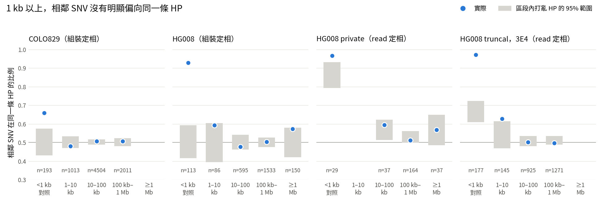

# 相鄰體細胞 SNV 在兩條單倍型上是否獨立（2026-11-07）

問題：`diplosim` 假設每個 SNV 獨立以 50% 落在某條 HP（`diplosim/src/hp.rs:27-31`）。真實資料中，相鄰 SNV 真的互不相關嗎？

真值來源：沒有演化真值，這是細胞株的觀測。讀長：PacBio HiFi，組裝定相另用 ONT 和 Pore-C 或 Hi-C。輸入：PRCGAP 的 COLO829、HG008 公開結果，以及 HG008 8 株的 DeepSomatic VCF。生成方法：本實驗程式已列於下方；PRCGAP 的完整流程未核對是否公開。

用到的會議：2026-11-04（N2、未決事項「突變是否偏向特定單倍型」）。標記：〔實測〕本實驗計算；〔推論〕本檔推論。



## 1. 結論

- **1 kb 以上，沒有否定獨立。** 16 個主要檢定校正後都不顯著。〔實測〕
- **1 kb 以內，局部不獨立。** HG008 100 bp 內 96.7% 在同一條 HP，COLO829 是 84.6%，遠高於打亂後約 50% 的基準。〔實測〕
- **這些配對只占少數。** 1 kb 內的配對約占 COLO829 SNV 的 2.5%、HG008 的 4.5%。〔實測〕COLO829 其中大約一半是密度造成的巧合配對。〔推論〕
- **HG008 的 1–10 kb 還不能下結論。** 兩種定相都偏高（0.59、0.63），但校正後不顯著，配對數也少，COLO829 沒有這個現象（0.48）。〔實測〕
- **第一階段可以繼續用獨立 50% 當暫定假設。** 但要明確標示：它忽略了少量的局部聚集，也只在兩株細胞株、拷貝數相同的區域檢查過。〔推論〕

支持的層（N3）：觀測特徵。不支持克隆結構或演化路徑，也不回答親源。

## 2. 主要結果

`pairs_by_distance.tsv`。超出＝實際比例減打亂後平均。

| 距離 | COLO829 組裝 | HG008 組裝 | HG008 truncal read（3E4） | HG008 private read |
|---|---:|---:|---:|---:|
| 1–10 kb | 0.480（−0.023，n=1013） | 0.593（+0.092，n=86） | 0.628（+0.087，n=145） | 0.667（+0.083，n=6） |
| 10–100 kb | 0.506（+0.004，n=4504） | 0.477（−0.024，n=595） | 0.502（−0.006，n=925） | 0.595（+0.034，n=37） |
| 100 kb–1 Mb | 0.506（+0.004，n=2011） | 0.504（+0.003，n=1533） | 0.496（−0.015，n=1271） | 0.512（−0.018，n=164） |
| ≥1 Mb | 0.500（0.000，n=8） | 0.573（+0.074，n=150） | 0.722（+0.145，n=18） | 0.568（−0.003，n=37） |

校正後 p 最小的是 HG008 truncal 的 1–10 kb（未校正 0.023，校正後 0.36）。

**偵測力不一樣：** COLO829 在 1 kb–1 Mb 的打亂範圍只有 ±0.015–0.03，足以看出 0.05 的偏離。HG008 組裝的 1–10 kb 是 ±0.10，HG008 private 和各資料的 ≥1 Mb 配對都太少，這些格子不足以排除 0.05 的偏離。

## 3. 預期和實際

| | 預期 | 實際 |
|---|---|---|
| 1 kb 內的有效性檢查（≥ 0.8） | 全部通過 | **COLO829 沒通過（0.658）**，其他都通過 |
| 1 kb 以上 | 沒有定量預期，只先定判定規則 | 沒有達到否定標準 |
| 先前 phase block 的訊號（truncal 0.58，隨機 0.68） | 可能是真的聚集 | 限制在 1+1 區域、QUAL ≥ 20 並合併聚集後，10 kb 以上就看不到。那張表沒有控制這些條件，不能當聚集的證據 |

### COLO829 沒通過有效性檢查

依事先的規則，COLO829 這組不算有效。看到結果後，我加了一項診斷（`control_detail.tsv`），規則本身沒改：

| 距離 | COLO829 配對 | 巧合預期 | 同 HP 比例 |
|---|---:|---:|---:|
| 0–100 bp | 65 | 9.7 | 0.846 |
| 100–300 bp | 29 | 19.3 | 0.517 |
| 300–1000 bp | 99 | 67.3 | 0.576 |

100 bp 內高於 0.8，所以定相訊號存在。1 kb 內比例低，符合「COLO829 密度高，混入很多巧合配對」的解釋，但這是事後解釋，不是獨立驗證。〔推論〕

## 4. 方法

1. **資料：** 只用體染色體和拷貝數相同的區域。PRCGAP 用 strict filter 和 20 Mb 平衡區段（同 `../2026-11-06_prcgap_hap_snv_ratio/`）。HG008 VCF 用 PASS、QUAL ≥ 20、VAF 0.25–0.75、PURPLE 1+1 的 SNV，只比同一 phase block 內的配對。
2. **聚集：** 距離小於 1 kb 的 SNV 只留第一個，再算 1 kb 以上的配對。1 kb 內的對照則使用全部 SNV。
3. **統計量：** 依位置排序後，相鄰配對落在同一條 HP 的比例，依距離分組。
4. **隨機基準：** 在每個區段或 phase block 內打亂 HP 標籤 5,000 次，保留該區的 HP 比例，雙尾檢定。
5. **校正：** Bonferroni，4 組資料 × 4 個距離，共 16 個檢定。8 株的 truncal SNV 相同，所以只用配對最多的 3E4 當主要檢定，其他 7 株只當參考。
6. **事先定的規則：** 只有組裝和 read 兩邊都比基準高 ≥ 0.05，而且校正後 p < 0.05，才算否定獨立。對照比例 < 0.8 時，該檢查不算數。

輸入 SNV 數見 `input_summary.tsv`。

## 5. 限制

- **只檢查相鄰配對。** 不能排除更複雜的相關，例如一長串 SNV 都在同一條。20 Mb 以上的差異也被保留在打亂基準內，所以這裡不檢查。區段層級的差異見 PRCGAP 報告（COLO829 卡方／自由度 2.44、HG008 1.21）。
- **定相錯誤會把比例拉向 0.5。** 所以「沒有偏離」可能低估真實的聚集，距離越遠越可能。COLO829 的組裝定相沒有獨立驗證。
- **DeepSomatic 可能影響短距離。** 同一條 read 上的多個變異可能被當成錯誤過濾，也可能產生同 read 的假訊號。這次沒有用原始 read 檢查。
- **過濾偏向高 VAF 的 clonal 突變。** 低 VAF 的 subclonal 突變幾乎沒看到。HG008 private 的配對也很少。
- **細胞株不等於病人腫瘤。** 只有兩株，COLO829 的 UV 突變和 HG008 的突變過程也可能不同，結果不能直接外推。
- **拷貝數不同的區域沒有檢查。** 這些區域已知會有偏向，第一階段只模擬單點突變，所以先不納入。

## 6. 重跑

```bash
python3 tools/snv_hp_independence.py /big8_disk/boyu114/benchmark_data/prcgap_sakamoto2026/extracted /big8_disk/boyu114/benchmark_data/GIAB/HG008 lab_report/2026-11-07_snv_hp_independence
python3 tools/plot_snv_hp_independence.py lab_report/2026-11-07_snv_hp_independence
```

對照：`../2026-11-06_prcgap_hap_snv_ratio/`、`../2026-11-06_colo829_hap_snv_ratio/`。文獻：`research/literature/surveys/tumor_evolution_history_2026-11-05/summary.md` 第 10–12、73 行。
