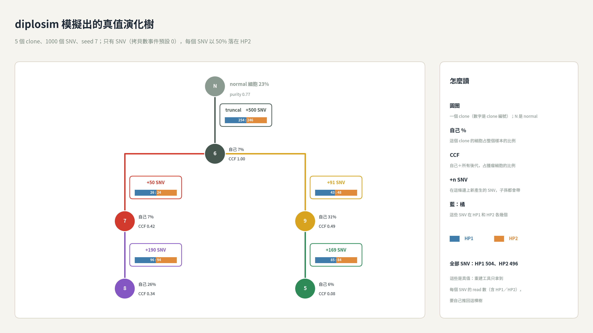

# diplosim SNV-only → haploclone 重建：第一次試跑（2026-11-12）

本週主軸第 3 項（模擬驗證）的第一步。用到的會議：2026-11-11（附錄 C 第 3 項、O6）。標記：〔實測〕本實驗計算；〔程式〕讀程式；〔推論〕本檔推論。

**真值來源：** 模擬（diplosim，branch `diplosim-v1`）。**讀長：** 不適用，diplosim 直接產生 read 計數。**輸入：** 一個 bulk sample 的 ref／alt 計數，含 HP1／HP2。**生成程式：** 公開在本 repo `diplosim/`。

## 1. 結論

- **haploclone 重建出主架構，但 5 群只找回 4 群。** truncal 500 個、最小的 clone 5（169 個，CCF 0.08）完整找回。clone 7（50 個，CCF 0.42）的 CCF 夾在 clone 9（0.49）和 clone 8（0.34）之間，被拆進這兩群。〔實測〕
- **這次 HP 資訊（A1）沒有改善。** binomial 下 base 和 A1 的 ARI 是 0.951 和 0.949，pair accuracy 是 0.952 和 0.927。兩者都是單一模擬樹、單一 seed，這個差距可能只是 MCMC 的隨機差異，沒有檢驗。〔實測〕
- **這在預期之內。** 全部位置都是 1+1 時，A1 只用 SNV 所在 HP 的 read 估 CCF，讓 CCF 稍微準一點；它不提供 SNV 之間的關係。單一 sample 的樹形只受 CCF 加總規則限制。HP 能幫樹形，要靠拷貝數不同的區域（A2）或同一條 read 上的共現（C4，diplosim 沒有 read，做不到）。〔程式〕`haploclone/rust/src/data/hp.rs` `snv_grid`、`combos`；〔推論〕
- **能證明：** 轉檔、重建、比對的流程可以跑通；haploclone 在這棵樹上能找回大部分結構。**不能證明：** HP 有沒有幫助（只有 1 棵樹、1 個 seed）；結果能否推到其他樹形、purity、深度。

## 2. 設定

| 項目 | 值 |
|---|---|
| diplosim | `--n-clones 5 --n-snv 1000 --seed 7`，其他全用預設（拷貝數事件 0、`prop_snv_on_b` 0.5、coverage 400、purity U(0.7, 0.9) 抽到 0.77） |
| haploclone | branch `rust-port`；`-b 1000 -n 3000 --num-chains 4 --seed 1`；`-d binomial`（A1 只支援 binomial）；另跑一次 base 的預設 beta-binomial |
| 比對 | `tools/eval_diplosim_haploclone.py`：clone 數、ARI、pair accuracy（任兩個 SNV 的關係：同群、祖先、後代、不同分支）、CCF 平均絕對誤差 |

真值樹：



## 3. 結果〔實測〕

| 執行 | clone 數 | ARI | pair accuracy | CCF 誤差 |
|---|---:|---:|---:|---:|
| base，beta-binomial（預設） | 3 | 0.864 | 0.856 | 0.020 |
| base，binomial | 4 | 0.951 | 0.952 | 0.006 |
| A1（HP），binomial | 4 | 0.949 | 0.927 | 0.006 |

真值：6 ← root（500，CCF 1.00）；7 ← 6（50，0.42）；8 ← 7（190，0.34）；9 ← 6（91，0.49）；5 ← 9（169，0.08）。

| 執行 | 重建的樹（clone ← parent，CCF，SNV 數） | 和真值比 |
|---|---|---|
| base，beta-binomial | 0 ← root（1.00，500）；1 ← 0（0.39，331）；2 ← 1（0.08，169） | 7、8、9 合成一群 |
| base，binomial | 0 ← root（1.00，500）；1 ← 0（0.48，121）；2 ← 1（0.08，169）；3 ← 0（0.34，210） | 9 和 5 的關係對；7 被拆進 9（30 個）和 8（20 個）；8 直接接在 truncal 下 |
| A1，binomial | 0 ← root（1.00，500）；1 ← 0（0.48，128）；2 ← 1（0.08，169）；3 ← 1（0.34，203） | 同上，但 8 被接到 9 的下面（錯） |

- beta-binomial 比 binomial 差，可能是因為 precision 400 讓模型以為資料比實際更分散；diplosim 的計數是純 binomial，沒有額外變異。〔推論〕
- 原始輸出：`input/`（haploclone 輸入與真值）、`map/`（MAP 表與樹）。trace 太大，沒有放進來。

## 4. 怎麼跑

```bash
diplosim/target/release/diplosim --n-clones 5 --n-snv 1000 --seed 7 --out $SIM
python3 -I tools/diplosim_to_haploclone.py $SIM $IN
H=/bip8_disk/boyu114/haploclone/rust/target/release/haploclone
$H run -i $IN/data.tsv -o $RUN_BASE -d binomial -b 1000 -n 3000 --num-chains 4 --seed 1
$H --hp-mode a1 run -i $IN/data_hp.tsv -o $RUN_A1 -d binomial -b 1000 -n 3000 --num-chains 4 --seed 1
$H map -i $RUN_BASE -o map_base_bin.tsv -t map_base_bin.nwk
$H --hp-mode a1 map -i $RUN_A1 -o map_a1.tsv -t map_a1.nwk
python3 -I tools/eval_diplosim_haploclone.py $IN map_a1.tsv map_a1.nwk
python3 tools/plot_diplosim_truth_tree.py $SIM truth_tree.png
```

每組約 10 分鐘（4 條 chain 平行）。

## 5. 後續

- 多棵樹、多個 seed 的比較：見 `../2026-11-12_diplosim_haploclone_hp_vs_base/`（樹關係沒差，CCF 略準）。
- 依第 1 節的推論，SNV-only（全部 1+1）下 HP 很可能幫不上樹形。要不要繼續測 SNV-only，或改測有拷貝數的情境，是設計選擇，要先決定。
