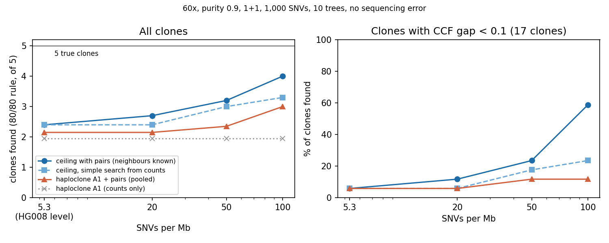

# 加了共現以後的天花板：已知真值時最多能找回幾群（2026-11-16）

**狀態：** 完成（2026-11-16）。使用者 2026-11-16 決定「先做 1」（三步中的第 ① 步，不改任何設計）。

## 1. 問題

`../2026-11-15_diplosim_c4_density/` 顯示：加入同一條 read 的共現後，CCF 差 < 0.1 的群仍只找回 0–20%。這一步要分辨原因：

- 共現的資訊本身不夠（天花板也低）；或
- 資訊夠，但 haploclone 沒用上（天花板高、haploclone 低）。

## 2. 做法與判定（跑之前寫下）

- 資料：`/bip8_disk/boyu114/diplosim_c4_2026-11-15/{center,d20,d50,d100}`（每 Mb 5.3／20／50／100 個 SNV；10 棵樹；60×、purity 0.9、5 群、1,000 SNV、read 33 kb）。不重跑模擬，也不重跑 haploclone。
- 腳本 `oracle_pairs.py`。已知真值：每群 CCF、每群 SNV 比例、樹。
- SNV 對的 read pattern 機率照 `diplosim/DECISIONS.md` 2026-11-15（同群只有 11／00；祖先 P(10) ＝ t × CCF 差；兄弟 P(11) ＝ 0），再混入 eps 0.01（haploclone `--pair-eps` 預設）。

**甲：逐個 SNV 分配（80/80 規則，和 11-15 天花板相同）**

| 名稱 | 做法 | 意義 |
|---|---|---|
| counts | 只用 SNV 所在 HP 的 read 計數 | 核對用，應重現 11-15 的 2.40 群與 10%／0%／31%／90% |
| joint | 計數＋SNV 對，全部 SNV 一起分配（從 counts 的答案出發，逐個 SNV 改到不再變） | 簡單搜尋能到的地方 |
| nbr | 計數＋SNV 對，而且直接告訴程式每個鄰居的真值群 | 寬鬆的上限：連這個都低，就是資訊不夠 |

**乙：每對相近的 clone（CCF 差 < 0.1），資料支不支持「是兩群」**

- 分開：兩群各用真值 CCF，SNV 對用真值關係。合併：兩群共用一個 CCF（由計數估），SNV 對當成同群。
- 2 ×（分開 − 合併的 log-likelihood）> 2 × ln(SNV 數) 算「支持兩群」（BIC，多 2 個參數）。
- 分別算「只用計數」和「計數＋SNV 對」。

**判定**

- joint 在差 < 0.1 的群明顯高於 haploclone（a1c4pool：10–20%、0%）→ 方法問題，第 ② 步（共現當錨點）值得做。
- nbr 也低 → 逐個 SNV 分對在原理上做不到；看乙：若乙高，表示「有兩群」看得出來，目標要改成群層級（第 ③ 步）。
- 乙也低 → 這個密度下共現不夠。

## 3. 限制

- 分開模型用真值 CCF，合併模型用估計值，對「合併」略為有利，所以乙偏保守。
- diplosim 沒有定序錯誤；eps 0.01 只在評分端。真實資料會比較差。
- 天花板已知樹與 CCF；haploclone 要自己找，所以天花板不是 haploclone 能達到的保證。
- 10 棵樹，相近的 clone 對數量少。
- （2026-11-16 補）`pairs.tsv` 有約 6% 的 SNV 對，其中一個 SNV 沒有 alt read（`snv_hp` 是 NA）。haploclone 會跳過這些 SNV 對；這裡的天花板全部都用，因為它已知真值。這些 SNV 的 read 計數取 HP2 那一邊（alt 都是 0，只有 read 深度可能略有不同）。所以天花板比 haploclone 能用的資訊略多。

## 4. 結果〔實測〕

`oracle_pairs_summary.txt`、`oracle_pairs_per_clone.tsv`、`oracle_pairs_clone_pairs.tsv`；圖 `ceiling_vs_density.png`（`plot_ceiling.py`）。

- **核對：** counts 重現 11-15 的 2.40 群與 10%／0%／31%／90%。
- **跑完後補的一欄（不在 §2）：** `joint_from_truth`，有 SNV 對的 SNV 從真值出發，再逐個改到不再變。第一版讓沒有 SNV 對的 SNV 留在真值，數字虛高（4.90），已修正；修正後它和 nbr 相同。它的用途是和 joint 比 log-posterior。

### 4.1 甲：逐個 SNV 分配（找回群數，5 群）

| 每 Mb SNV | 每棵樹 SNV 對 | counts | joint | nbr（上限） | haploclone a1c4pool |
|---|---|---|---|---|---|
| 5.3（HG008 等級） | 82 | 2.40 | 2.40 | **2.40** | 2.15 |
| 20 | 336 | 2.40 | 2.40 | 2.70 | 2.15 |
| 50 | 799 | 2.40 | 3.00 | 3.20 | 2.35 |
| 100 | 1,613 | 2.40 | 3.30 | **4.00** | 3.00 |

CCF 差 < 0.1 的非主幹群（17 群；haploclone 是 2 個 seed 共 34 次）：

| 每 Mb SNV | nbr：< 0.05 | nbr：0.05–0.1 | joint：< 0.05 | joint：0.05–0.1 | haploclone：< 0.05 | haploclone：0.05–0.1 |
|---|---|---|---|---|---|---|
| 5.3 | 10% | 0% | 10% | 0% | 10% | 0% |
| 20 | 20% | 0% | 10% | 0% | 10% | 0% |
| 50 | 20% | 29% | 20% | 14% | 20% | 0% |
| 100 | 50% | 71% | 20% | 29% | 20% | 0% |

- **密度 5.3 時，上限和只看計數一樣（2.40）。** 就算告訴程式每個鄰居的真值群，也沒有多找回任何一群。原因：每個 SNV 平均只有 0.17 個同 HP 鄰居，大多數 SNV 沒有 SNV 對。
- **密度 100 時，上限是 4.00 群，haploclone 是 3.00 群。** 差 < 0.1 的群：上限 50%、71%，haploclone 20%、0%。這個差距不是資訊不夠造成的。
- **簡單搜尋會卡住。** 密度 100 時，從真值出發的答案 log-posterior 比從 counts 出發的高（9／10 棵樹，最多高 346）。所以更好的答案存在，逐個 SNV 移動到不了。

### 4.2 乙：資料支不支持「是兩群」

11 對相近的 clone；其中 2 對有一邊只有 1–2 個 SNV（第 2 棵樹 clone 7、第 6 棵樹 clone 5），資料太少，下表不算，剩 9 對。

| 每 Mb SNV | 只用計數 | 計數＋SNV 對 | 沒通過的 |
|---|---|---|---|
| 5.3 | 6／9 | 7／9 | 2 對兄弟，之間 0 對 SNV |
| 20 | 6／9 | 9／9 | — |
| 50 | 6／9 | 9／9 | — |
| 100 | 6／9 | 9／9 | — |

- **兄弟關係：只要有 1 對 SNV 就夠。** 例：第 8 棵樹 clone 5／9（CCF 差 0.021），只用計數 −1.2（偏向一群）；加上 2 對 SNV 後 35.3（門檻 13.8）。第 7 棵樹 clone 7／9 加上 1 對 SNV，從 20.5 升到 307。
- **密度 5.3 時，兄弟 6 對中有 2 對完全沒有 SNV 對**，這時共現沒有幫助。
- 注意：乙的「只用計數 6／9」已知每個 SNV 屬於哪一群，所以遠比實際樂觀（11-15 的 BIC 不知分群時 0／10 選對群數）。乙只能用來看「加了 SNV 對後多了多少」。

## 5. 照 §2 判定

- **密度 100：方法問題。** 上限 4.00 對 haploclone 3.00；差 < 0.1 的群 50–71% 對 0–20%。
- **密度 5.3（HG008 等級）：逐個 SNV 分對在原理上做不到**（nbr ＝ counts）。但乙顯示「有兩群」看得出來（7／9；兄弟只要有 1 對 SNV）。所以這個密度下，目標要改成群層級才達得到。

## 6. 能證明／不能證明

**能證明：**
- 沒有定序錯誤時，共現把「有幾群、誰和誰分開」的證據補上了；密度 20 以上，9 對相近的 clone 全部支持兩群。
- 每個 SNV 分對（80/80）需要每個 SNV 自己有鄰居。HG008 等級的密度做不到，和方法無關。
- 高密度時 haploclone 沒用完共現的資訊（上限 4.00 對 3.00）。
- 我的簡單搜尋（一次移一個 SNV）會卡在較差的答案。haploclone 是不是卡在同一個原因，這次沒有測〔推論〕。

**不能證明：**
- haploclone 改了以後能到上限。上限已知 CCF 與樹；haploclone 要自己找。
- 真實資料也一樣。diplosim 沒有定序錯誤，密集區的假訊號也不在模擬裡。
- 祖先關係、CCF 差 < 0.05 的情況：只有 1 對，而且一邊只有 2 個 SNV。
- 樣本很小：17 個相近的群、9 對 clone、10 棵樹。

## 7. 下一步（設計選擇，還沒決定）

- 第 ② 步（共現當錨點，一次移動一整組 SNV）：密度 100 有 1 群的空間，值得做。
- 第 ③ 步（完成標準改成群層級）：HG008 等級的密度只有這條路。
- 兩步不互斥。順序與做法是設計選擇，照規則帶週會，除非使用者說現在決定。
