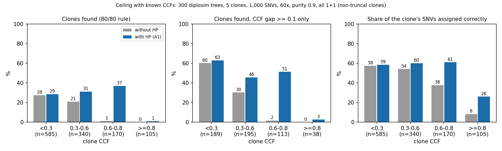

# 加 HP 的好處是不是集中在高 CCF 的群（2026-11-16）

**狀態：** 完成（2026-11-16，haploclone 確認也完成）。使用者 2026-11-16 決定「先做方向 1」。這一步不改 diplosim，也不跑 haploclone。

## 1. 問題與假說

- **問題：** 全部 1+1、只有 SNV 時，加 HP（A1）對哪些群有幫助？
- **假說〔推論〕：** 幫助隨群的 CCF 變大。
  - 不加 HP：alt read 數 ~ Binomial(n, t × CCF ÷ 2)，n 是全部 read，t 是 purity。
  - 加 HP：只看突變所在那條 HP，alt read 數 ~ Binomial(n ÷ 2, t × CCF)。
  - 兩者對 CCF 的資訊量（Fisher information）相除：**（1 − t × CCF ÷ 2）÷（1 − t × CCF）**。這個比值等於「加 HP 相當於把深度乘上幾倍」。
  - t ＝ 0.9 時：CCF 0.2 → 1.11 倍；0.5 → 1.41 倍；0.8 → 2.29 倍；0.9 → 3.13 倍；1.0 → 5.5 倍。
- 這個假說來自 11-15 天花板資料的事後觀察（seed 1–10）。所以這裡用新的樹驗證。

## 2. 做法與預測（跑之前寫下）

- diplosim 現行版本，設定同 11-14 中心點：`--n-clones 5 --n-snv 1000 --coverage 60 --min/max-tumour-purity 0.9`，**seed 101–400（300 棵新樹）**。輸出在 `/bip8_disk/boyu114/diplosim_hp_ccf_2026-11-16/`。
- 每棵樹用天花板算法（`../2026-11-15_close_ccf_oracle/oracle_ccf.py` 的規則：已知每群 CCF 與 SNV 比例，逐個 SNV 選最可能的群），分「不加 HP」和「加 HP」。腳本 `hp_by_ccf.py`。
- 兩個指標（非主幹群）：
  - 找回：80/80 規則（主要）。
  - SNV 分對比例：這一群的 SNV 有多少被分到正確的群（輔助，不受 80% 門檻影響）。
- 分層：群的 CCF（< 0.3、0.3–0.6、0.6–0.8、≥ 0.8）× 和最近一群的 CCF 差（< 0.05、0.05–0.1、0.1–0.2、≥ 0.2）。
- **預測：**
  1. CCF < 0.3 的群：加 HP 的找回比例最多只多 5 個百分點。
  2. CCF ≥ 0.6 的群：加 HP 多 ≥ 15 個百分點。
  3. 同一個 CCF 差的分層裡，增益隨 CCF 變大（看 0.05–0.1、0.1–0.2 兩層；< 0.05 預期兩者都接近 0，≥ 0.2 預期兩者都接近 100%）。
- 三條都成立算「假說成立」；任何一條不成立，寫出哪一條。

## 3. 限制

- 天花板已知真值 CCF，不是 haploclone 的結果。假說成立後，還要用 haploclone 確認。
- diplosim 的 read 全部有 HP，而且突變在哪條 HP 是已知的。真實資料有沒定相的 read，好處會打折。
- CCF 高低和 CCF 差是事後分層，不是直接指定；某些格子的群可能很少。
- 高 CCF 的非主幹群，最近的一群常常是主幹（CCF 1.0）。

## 4. 結果〔實測〕

`hp_by_ccf_summary.txt`、`hp_by_ccf_per_clone.tsv`（1,200 個非主幹群）；圖 `hp_by_ccf.png`（`plot_hp_by_ccf.py`）。

**依群的 CCF（不加 HP → 加 HP）**

| 群的 CCF | 群數 | 找回（80/80） | 增益 | SNV 分對比例 | 理論：相當於深度乘上 |
|---|---|---|---|---|---|
| < 0.3 | 585 | 28% → 29% | +1 | 0.58 → 0.59 | 約 1.0–1.2 倍 |
| 0.3–0.6 | 340 | 21% → 31% | +10 | 0.54 → 0.60 | 約 1.2–1.6 倍 |
| 0.6–0.8 | 170 | 1% → 37% | +36 | 0.38 → 0.61 | 約 1.6–2.3 倍 |
| ≥ 0.8 | 105 | 0% → 1% | +1 | 0.08 → 0.26 | 約 2.3 倍以上 |

**同一個 CCF 差的分層裡（找回的增益，百分點；括號內是 SNV 分對比例的增益）**

| CCF 差 | CCF < 0.3 | 0.3–0.6 | 0.6–0.8 | ≥ 0.8 |
|---|---|---|---|---|
| < 0.05 | +0（+0.00） | +6（+0.02） | +9（+0.15） | +0（+0.06） |
| 0.05–0.1 | +0（+0.02） | +0（+0.04） | +8（+0.14） | +0（+0.18） |
| 0.1–0.2 | +4（+0.02） | +10（+0.07） | +21（+0.23） | +3（+0.30） |
| ≥ 0.2 | +1（+0.02） | +23（+0.10） | +67（+0.31） | 沒有這種群 |

## 5. 照 §2 的預測判定

1. **CCF < 0.3 增益 ≤ 5 點：成立**（+1）。
2. **CCF ≥ 0.6 增益 ≥ 15 點：成立**（合併 275 群，0.7% → 23.3%，+23）。但全部來自 0.6–0.8；≥ 0.8 只有 +1。
3. **同一個 CCF 差裡，增益隨 CCF 變大：只成立到 CCF 0.8。** 用「找回」看，≥ 0.8 那一格掉回 0 到 +3。用「SNV 分對比例」看，四格是一路變大的（0.05–0.1：+0.02、+0.04、+0.14、+0.18；0.1–0.2：+0.02、+0.07、+0.23、+0.30）。

**結論：假說部分成立。** 加 HP 的好處確實隨 CCF 變大。但 CCF ≥ 0.8 的群，加 HP 後 SNV 分對比例也只有 0.26，離 80% 門檻很遠，所以「找回」沒有改善。

## 6. 看到什麼

- **好處最大的是 CCF 0.6–0.8、而且和別群差 ≥ 0.2 的群：3% → 70%。** 不加 HP 時這些群幾乎找不回；加 HP 後多數找得回。
- **CCF < 0.3 的群，加不加 HP 一樣。**
- **CCF ≥ 0.8 的群幾乎都找不回（0% → 1%）。** 這些群全部和主幹（CCF 1.0）差不到 0.2，而主幹有一半的 SNV，會把它們吸過去〔推論〕。
- **對 CCF 相近的群幫助很小。** CCF 差 < 0.1 的 665 群：8.9% → 10.5%。CCF 差 ≥ 0.1 的 535 群：32.7% → 49.9%。

## 7. 能證明／不能證明

**能證明：**
- 在已知 CCF 的天花板下（60×、purity 0.9、1+1、5 群、1,000 SNV），加 HP 的增益隨群的 CCF 變大，方向和理論一致。
- 加 HP 主要幫到 CCF 0.3–0.8、和別群差 ≥ 0.1 的群。
- 加 HP 解決不了 CCF 相近（差 < 0.1）的群，也解決不了貼近主幹（CCF ≥ 0.8）的群。

**不能證明：**
- haploclone 的實際重建也有同樣的增益。這裡是天花板。
- 真實資料有同樣的增益。diplosim 的 read 全部有 HP。
- 理論的倍數在數字上對得上。這裡只核對了方向，沒有做定量比較。
- 別的深度、purity、群數下的情況。只有一組設定。

## 8. 對 HG008 的意義〔推論〕

HG008 的 L111（0.93）貼近主幹，屬於這裡「≥ 0.8、幾乎找不回」的那一類。所以 11-13、11-14 的重建沒把 L111 分開，和這個結果一致；加 HP 讓一部分 SNV 分對（PacBio 那次約 35%），但不夠形成一個找得回的群。

## 9. 用 haploclone 確認（使用者 2026-11-16 決定跑完整的 240 次；規則在跑之前寫下）

**問題：** 天花板看到的「加 HP 的增益隨 CCF 變大」，在 haploclone 的實際重建裡還在不在？

**資料與設定**
- 樹：seed 101–160（60 棵，照 seed 順序取，不挑樹）。設定同 §2：5 群、1,000 SNV、60×、purity 0.9、全部 1+1、沒有共現。
- 批次腳本會用相同的 seed 重新產生模擬資料，輸出在 `/bip8_disk/boyu114/diplosim_hp_ccf_2026-11-16/hc60/`。diplosim 同一個 seed 的輸出相同；跑完後用 `cmp` 核對它和 §2 的輸入檔逐位元相同。
- haploclone：不加 HP（`data.tsv`）與加 HP（A1，`data_hp.tsv`），`-d binomial -b 1000 -n 3000 --num-chains 4`，seed 1、2，其他全部預設。共 240 次重建。
- 指令：`python3 tools/run_diplosim_haploclone_batch.py /bip8_disk/boyu114/diplosim_hp_ccf_2026-11-16/hc60 --sim-seeds 101-160 --hc-seeds 1,2 --coverage 60 --purity 0.9 --modes base,a1 --jobs 16`

**評分**
- 80/80 規則（同 `../2026-11-15_diplosim_c4_center/summarize_c4.py`），非主幹群，依群的 CCF 分層。每個群先平均 2 個 seed。腳本 `summarize_hc.py`。
- 增益的 95% 區間：以「樹」為單位 bootstrap 2,000 次（同一棵樹的群和 seed 不獨立）。

**預測**
1. CCF < 0.3：增益在 ±5 個百分點內。
2. CCF 0.6–0.8：增益 ≥ 15 點，而且區間不含 0。（天花板在這 60 棵樹的同一層是多少，跑完一起列。）
3. CCF ≥ 0.8：兩種模式的找回比例都 ≤ 5%。
4. CCF 差 < 0.1 的群：增益在 ±5 點內。

四條都成立算「haploclone 確認了天花板的結果」。不成立的逐條寫出。

**限制：** 一組設定；CCF 0.6–0.8 只有 37 群、≥ 0.8 只有 15 群；diplosim 的 read 全部有 HP。

### 9.1 結果〔實測〕

`hc_summary.txt`、`hc_per_clone.tsv`（240 群，haploclone 與天花板並排）。240 次重建全部完成；輸入檔和 §2 逐位元相同（`cmp` 240 個檔，0 個不同）。

找回比例（非主幹群；haploclone 先平均 2 個 seed；區間是以樹為單位 bootstrap 的 95% 區間）：

| 分層 | 群數 | haploclone 不加 → 加 HP | 增益 [95% 區間] | 天花板 不加 → 加 HP |
|---|---|---|---|---|
| CCF < 0.3 | 117 | 20% → 24% | +3.4 [−0.8, +8.1] | 29% → 29% |
| CCF 0.3–0.6 | 71 | 4% → 17% | +12.7 [+5.6, +21.1] | 14% → 21% |
| CCF 0.6–0.8 | 37 | 0% → 35% | +35.1 [+20.4, +52.9] | 0% → 43% |
| CCF ≥ 0.8 | 15 | 0% → 0% | 0 | 0% → 0% |
| CCF 差 < 0.1 | 134 | 4% → 7% | +2.2 [+0.0, +5.0] | 7% → 10% |
| CCF 差 ≥ 0.1 | 106 | 19% → 41% | +21.7 [+13.3, +30.7] | 32% → 49% |
| CCF 0.6–0.8 且差 ≥ 0.2 | 15 | 0% → 63% | +63.3 [+38.9, +86.4] | 0% → 67% |
| 全部 | 240 | 11% → 22% | +10.8 [+7.1, +14.8] | 18% → 27% |

### 9.2 照 §9 的預測判定

1. CCF < 0.3 增益在 ±5 點內：**成立**（+3.4）。
2. CCF 0.6–0.8 增益 ≥ 15 點、區間不含 0：**成立**（+35.1，區間 +20.4 到 +52.9）。
3. CCF ≥ 0.8 兩種模式都 ≤ 5%：**成立**（0%、0%）。
4. CCF 差 < 0.1 增益在 ±5 點內：**成立**（+2.2）。

**haploclone 確認了天花板的結果。** 加 HP 的增益隨 CCF 變大，集中在 CCF 0.3–0.8、和別群有距離的群；CCF 低、貼近主幹、CCF 相近的群幫不上。

### 9.3 看到什麼

- **加 HP 時，haploclone 接近天花板。** CCF 0.6–0.8 且差 ≥ 0.2：63% 對天花板 67%。
- **不加 HP 時，haploclone 比天花板差較多，尤其在 CCF 0.3–0.6**（4% 對 14%）。所以 haploclone 的增益（+12.7）比天花板的增益（+7）還大。原因沒有查〔推論：可能是不加 HP 時 haploclone 的搜尋或 prior 損失較多〕。
- **整體來說，加 HP 讓找回的群數多一倍**（11% → 22%），但兩者都低，因為 60× 下大多數群和別群太近。

### 9.4 能證明／不能證明

**能證明：** 在 60×、purity 0.9、5 群、1,000 SNV、全部 1+1、只有 SNV 的模擬下，haploclone 加 HP（A1）的增益集中在 CCF 0.3–0.8、和最近一群差 ≥ 0.1 的群；對 CCF < 0.3、CCF ≥ 0.8、CCF 差 < 0.1 的群沒有可量到的增益。

**不能證明：**
- 別的深度、purity、群數下的情況（只有一組設定）。
- 真實資料有同樣的增益（diplosim 的 read 全部有 HP、沒有定序錯誤）。
- CCF ≥ 0.8 的結論很穩：只有 15 群。
- 11-12 的「沒看到 HP 改善樹形」被推翻。那次看的是 SNV 對的分數，這次看的是群；兩個指標不同，而且那次 10 棵樹裡 CCF 0.6–0.8 的群很少〔推論〕。
